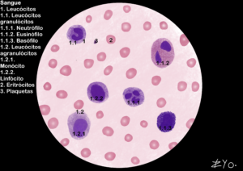

+++
title = "Blood Cells"
date = "2022-06-17"
author = "Rafael Martins da Silva Afeto"
cover = ""
tags = ["Histology", "Histology Atlas","Blood Cells", "Scientific Illustration", "UNIFAL-MG"]
categories = ["Educational Material"]
keywords = ["blood cells histology", "leukocytes erythrocytes platelets", "blood cell atlas", "hematopoiesis", "blood tissue"]
description = "Get to know the blood cells: leukocytes, erythrocytes and platelets. Illustrated material from UNIFAL-MG's Interactive Histology Atlas."
showFullContent = false
readingTime = false
hideComments = false
+++
Blood is a fluid connective tissue that circulates through the cardiovascular system, carrying nutrients, gases and metabolic waste throughout the body. It is made up of plasma, an extracellular matrix rich in water and proteins, and the formed elements, which carry out vital defense and oxygenation functions ([visit the Atlas for more information](https://www.unifal-mg.edu.br/histologiainterativa/celulas-do-sangue-e-hematopoiese/)).

Blood cells can be divided as follows:

#### Leukocytes (White Blood Cells)

##### Granulocytes (have specific granules in the cytoplasm)

*Neutrophil*: Recognizable by its multilobed nucleus; it is the first line of phagocytic defense against bacteria.
*Eosinophil*: Has a typically bilobed nucleus and granules that act in allergic reactions and in fighting parasites.
*Basophil*: The rarest; has dense granules (histamine/heparin) that often obscure the nucleus, and acts in inflammatory processes.

##### Agranulocytes (cytoplasm with nonspecific granules)

*Monocyte*: The largest blood cell, with a kidney-shaped nucleus; when it migrates into tissues, it becomes a macrophage.
*Lymphocyte*: Has a large, spherical nucleus that fills almost the entire cell; it is central to the adaptive immune response (antibody production and memory).

#### Erythrocytes (Red Blood Cells)

These are the abundant pink, anucleate cells in the image. Their biconcave disc shape optimizes oxygen transport through the blood vessels.

#### Platelets (Thrombocytes)

Small cell fragments (the smaller dark dots) derived from megakaryocytes, essential for clot formation and for stopping bleeding.
<!-- achar uma imagem melhor -->

