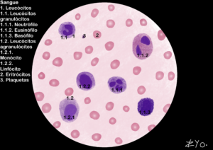

+++
title = "Células de la Sangre"
date = "2022-06-17"
author = "Rafael Martins da Silva Afeto"
cover = ""
tags = ["Histología", "Atlas Histológico","Células de la Sangre", "Ilustración Científica", "UNIFAL-MG"]
categories = ["Material Educativo"]
keywords = ["células de la sangre histología", "leucocitos eritrocitos plaquetas", "atlas células sanguíneas", "hematopoyesis", "tejido sanguíneo"]
description = "Conoce las células de la sangre: leucocitos, eritrocitos y plaquetas. Material ilustrado del Atlas Interactivo de Histología de la UNIFAL-MG."
showFullContent = false
readingTime = false
hideComments = false
+++
La sangre es un tejido conectivo líquido que circula por el sistema cardiovascular y transporta nutrientes, gases y desechos metabólicos a todo el organismo. Está compuesta por el plasma, una matriz extracelular rica en agua y proteínas, y por los elementos figurados, que desempeñan funciones vitales de defensa y oxigenación ([visita el Atlas para más información](https://www.unifal-mg.edu.br/histologiainterativa/celulas-do-sangue-e-hematopoiese/)).

Las células sanguíneas pueden dividirse de la siguiente manera:

#### Leucocitos (Glóbulos Blancos)

##### Granulocitos (tienen gránulos específicos en el citoplasma)

*Neutrófilo*: Se identifica por su núcleo multilobulado; es la primera línea de defensa fagocítica contra las bacterias.
*Eosinófilo*: Tiene un núcleo típicamente bilobulado y gránulos que actúan en las reacciones alérgicas y en el combate a los parásitos.
*Basófilo*: El más raro; tiene gránulos densos (histamina/heparina) que muchas veces ocultan el núcleo, y actúa en procesos inflamatorios.

##### Agranulocitos (citoplasma con gránulos inespecíficos)

*Monocito*: La célula más grande de la sangre, con núcleo en forma de riñón; al migrar a los tejidos, se convierte en macrófago.
*Linfocito*: Tiene un núcleo grande y esférico que ocupa casi toda la célula; es central en la respuesta inmunitaria adaptativa (producción de anticuerpos y memoria).

#### Eritrocitos (Glóbulos Rojos)

Son las células rosadas y anucleadas que abundan en la imagen. Su forma de disco bicóncavo optimiza el transporte de oxígeno por los vasos sanguíneos.

#### Plaquetas (Trombocitos)

Pequeños fragmentos celulares (los puntos oscuros más pequeños) derivados de los megacariocitos, fundamentales para la formación del coágulo y para detener las hemorragias.
<!-- achar uma imagem melhor -->

