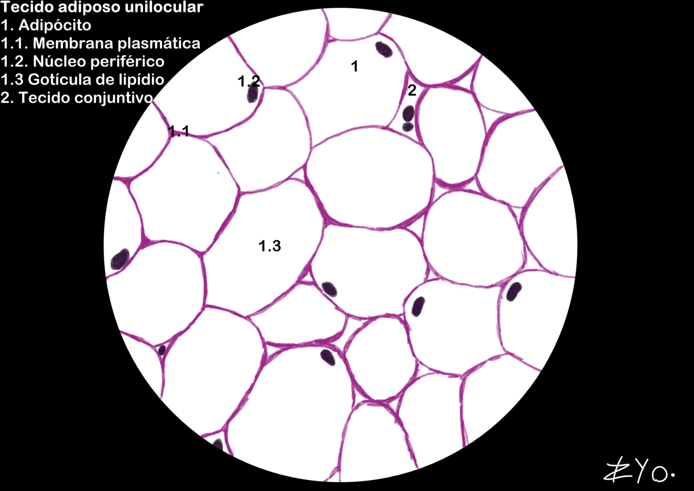
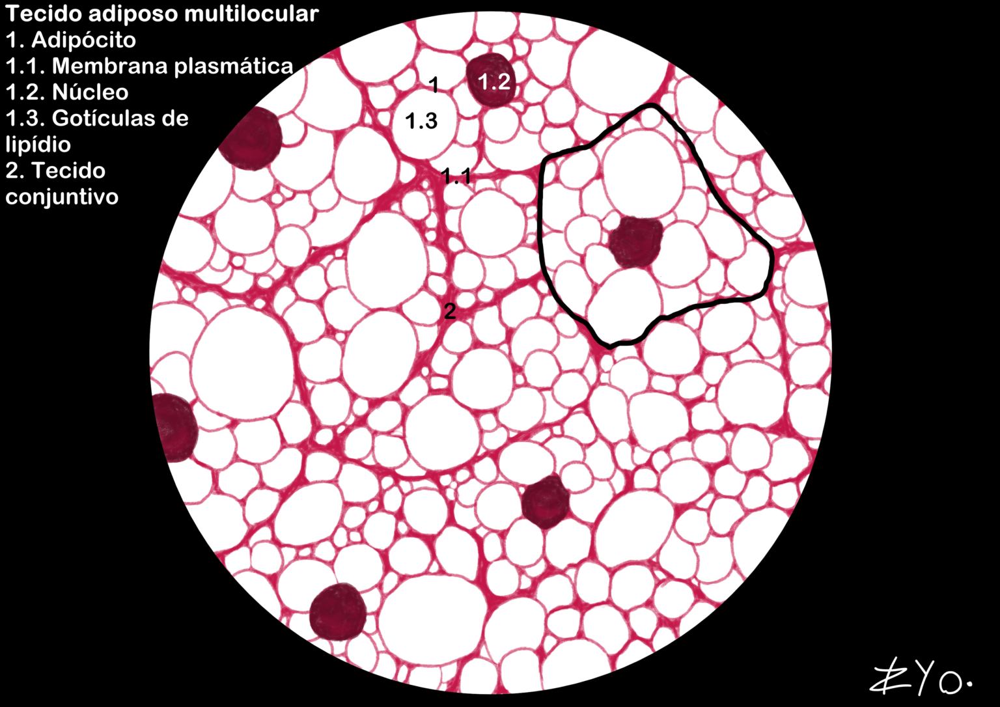

+++
title = "Adipose Tissue"
date = "2022-06-17"
author = "Rafael Martins da Silva Afeto"
cover = ""
tags = ["Histology", "Histology Atlas","Adipose Tissue", "Scientific Illustration", "UNIFAL-MG"]
categories = ["Educational Material"]
keywords = ["adipose tissue histology", "unilocular multilocular adipose tissue", "adipocytes", "what is adipose tissue", "adipose tissue atlas"]
description = "A study of unilocular and multilocular adipose tissue with scientific illustrations. Material from UNIFAL-MG's Interactive Histology Atlas."
showFullContent = false
readingTime = false
hideComments = false
+++
Adipose tissue, divided into unilocular and multilocular, is made up of adipocytes, cells that store fat in central vacuoles and take on a polyhedral shape when packed together. It works as an efficient energy reserve and also provides thermal insulation and mechanical protection for the organs. On histological slides, it looks like a polygonal network because the lipids are extracted by the solvents ([visit the Atlas for more information](https://www.unifal-mg.edu.br/histologiainterativa/tecido-adiposo/)).

### Unilocular adipose tissue

Unilocular adipose tissue is characterized by adipocytes that store a single lipid (fat) droplet, giving them a 'honeycomb' or 'chicken wire' appearance. It is found mainly under the skin (subcutaneous tissue) and around the internal organs, where it serves as an energy reserve, thermal insulation and protection against impacts.

### Multilocular adipose tissue

Multilocular adipose tissue is made up of adipocytes that contain multiple lipid droplets, giving them a granular appearance. It is found mainly in newborns and in hibernating animals, where it plays a crucial role in thermogenesis (heat production), helping to maintain body temperature. Multilocular adipose tissue is highly vascularized and contains a large number of mitochondria, which contributes to heat production and to its characteristic brown color.

