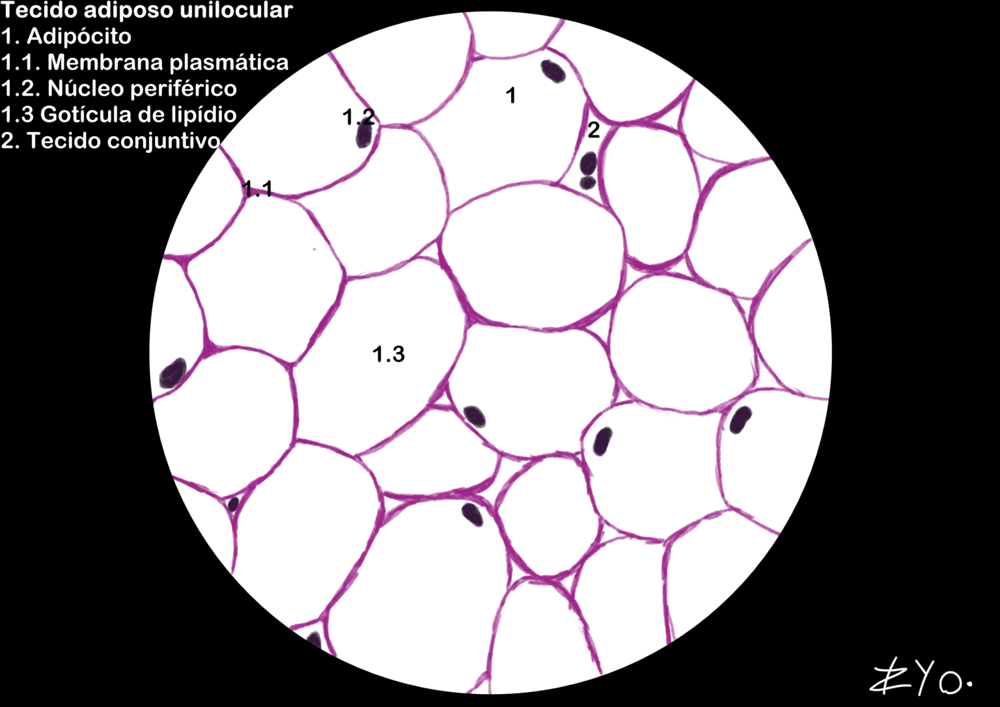
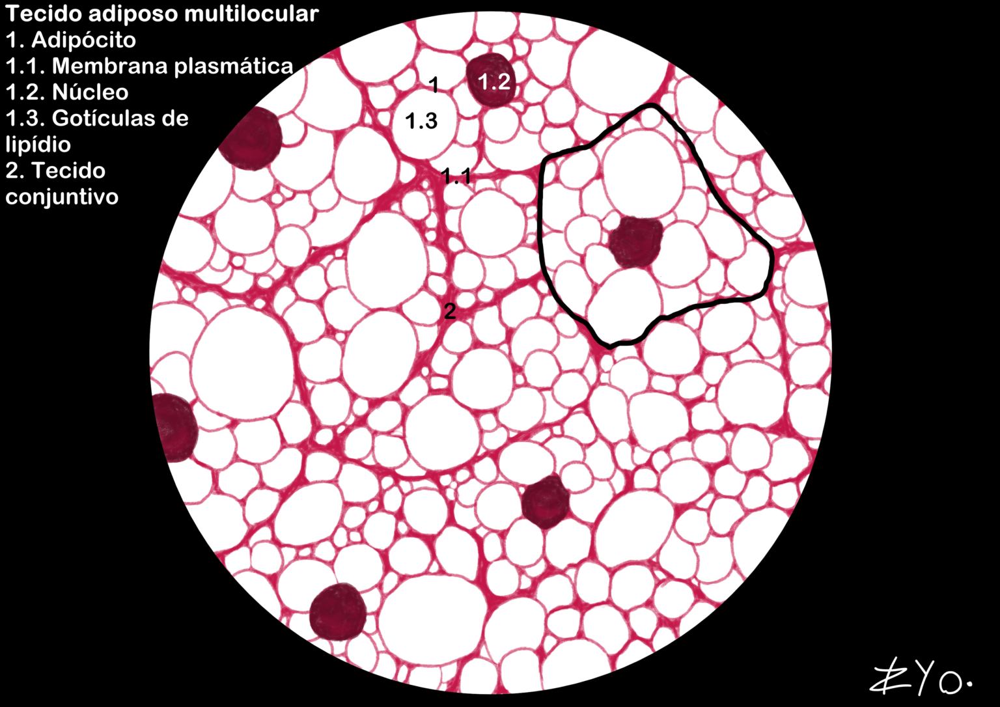

+++
title = "Tejido Adiposo"
date = "2022-06-17"
author = "Rafael Martins da Silva Afeto"
cover = ""
tags = ["Histología", "Atlas Histológico","Tejido Adiposo", "Ilustración Científica", "UNIFAL-MG"]
categories = ["Material Educativo"]
keywords = ["tejido adiposo histología", "tejido adiposo unilocular multilocular", "adipocitos", "qué es el tejido adiposo", "atlas tejido adiposo"]
description = "Estudio del tejido adiposo unilocular y multilocular con ilustraciones científicas. Material del Atlas Interactivo de Histología de la UNIFAL-MG."
showFullContent = false
readingTime = false
hideComments = false
+++
El tejido adiposo, dividido en unilocular y multilocular, está compuesto por adipocitos, células que almacenan grasa en vacuolas centrales y adoptan una forma poliédrica cuando están agrupadas. Funciona como una eficiente reserva energética, además de proporcionar aislamiento térmico y protección mecánica a los órganos. En las láminas histológicas presenta un aspecto de red poligonal debido a la extracción de los lípidos por los solventes ([visita el Atlas para más información](https://www.unifal-mg.edu.br/histologiainterativa/tecido-adiposo/)).

### Tejido adiposo unilocular

El tejido adiposo unilocular se caracteriza por adipocitos que almacenan una única gota de lípido (grasa), lo que les da un aspecto de 'panal de abejas' o de 'tela de gallinero'. Se encuentra principalmente bajo la piel (tejido subcutáneo) y alrededor de los órganos internos, donde actúa como reserva de energía, aislamiento térmico y protección contra impactos.

### Tejido adiposo multilocular

El tejido adiposo multilocular está compuesto por adipocitos que contienen múltiples gotas de lípido, lo que les da un aspecto granular. Se encuentra principalmente en recién nacidos y en animales que hibernan, donde desempeña un papel crucial en la termogénesis (producción de calor) y ayuda a mantener la temperatura corporal. El tejido adiposo multilocular está altamente vascularizado y contiene una gran cantidad de mitocondrias, lo que contribuye a la producción de calor y a su característico color pardo.

