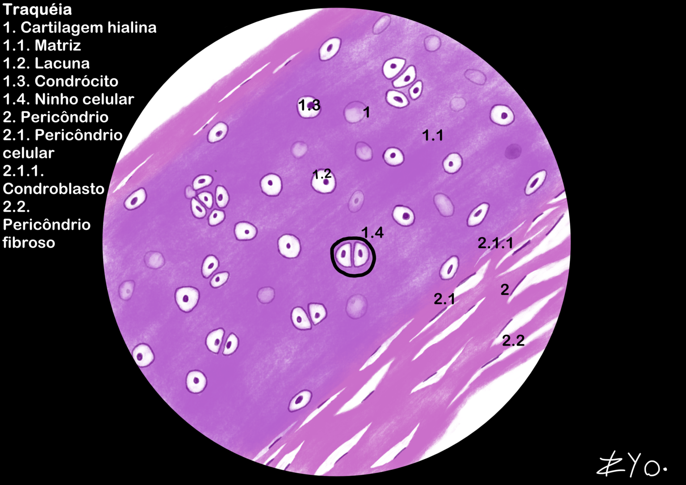
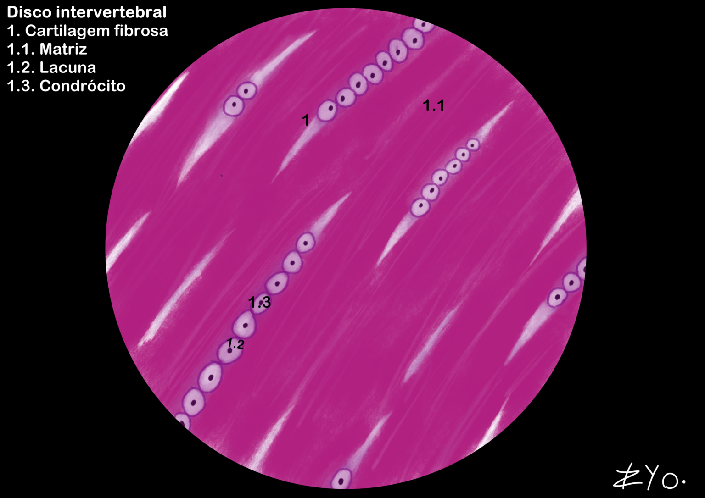

+++
title = "Cartilage Tissue"
date = "2022-06-17"
author = "Rafael Martins da Silva Afeto"
cover = ""
tags = ["Histology", "Histology Atlas","Cartilage Tissue", "Scientific Illustration", "UNIFAL-MG"]
categories = ["Educational Material"]
keywords = ["cartilage tissue histology", "hyaline elastic fibrous cartilage", "what is cartilage tissue", "tracheal cartilage", "cartilage tissue atlas"]
description = "Types of cartilage tissue: hyaline, elastic and fibrous, with illustrations of the trachea and intervertebral discs. UNIFAL-MG Histology Atlas."
showFullContent = false
readingTime = false
hideComments = false
+++

Cartilage tissue is an avascular connective tissue that supports soft tissues and absorbs impacts, and it is divided into: hyaline cartilage (type II collagen, common in joints and in the embryonic skeleton), elastic cartilage (flexibility for the ear and epiglottis) and fibrocartilage (type I collagen, resistant to tension). While the first two have a perichondrium, fibrocartilage is nourished by diffusion or by synovial fluid ([visit the Atlas for more information](https://www.unifal-mg.edu.br/histologiainterativa/tecido-cartilaginoso/)).

### Trachea

The trachea is made up of hyaline cartilage tissue. This tissue forms the cartilaginous rings that keep the trachea open, allowing air to pass through. These structures are incomplete at the back, where the trachea is flexible to accommodate the esophagus during swallowing. Hyaline cartilage tissue is characterized by a homogeneous extracellular matrix rich in type II collagen, which gives the trachea strength and structural support.

### Intervertebral discs

The intervertebral discs are made up of fibrocartilage. They are located between the vertebrae of the spine and act as shock absorbers, absorbing impacts and allowing the spine to flex. Fibrocartilage is characterized by a dense extracellular matrix rich in type I collagen, which gives the intervertebral discs tensile strength and structural support.

