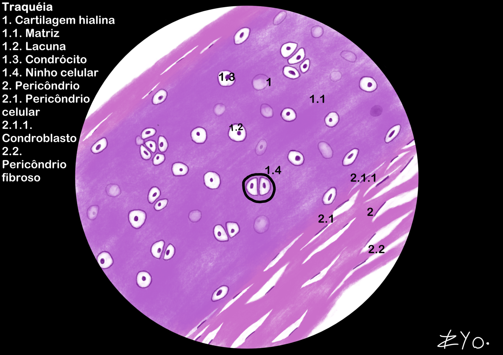
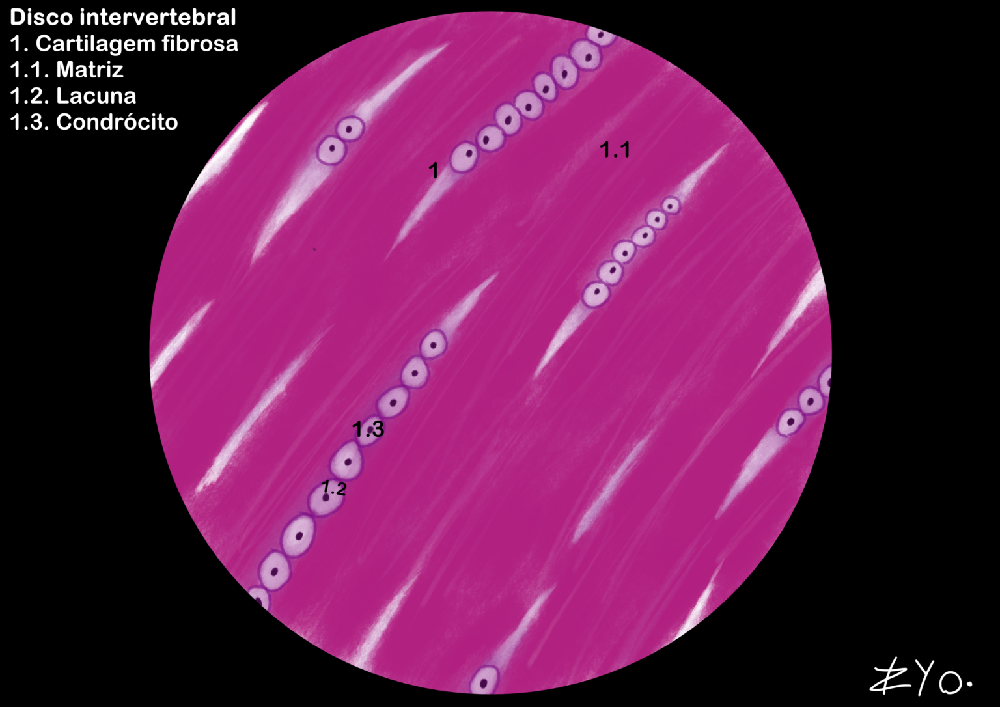

+++
title = "Tejido Cartilaginoso"
date = "2022-06-17"
author = "Rafael Martins da Silva Afeto"
cover = ""
tags = ["Histología", "Atlas Histológico","Tejido Cartilaginoso", "Ilustración Científica", "UNIFAL-MG"]
categories = ["Material Educativo"]
keywords = ["tejido cartilaginoso histología", "cartílago hialino elástico fibroso", "qué es el tejido cartilaginoso", "cartílago de la tráquea", "atlas tejido cartilaginoso"]
description = "Tipos de tejido cartilaginoso: hialino, elástico y fibroso, con ilustraciones de la tráquea y los discos intervertebrales. Atlas de Histología de la UNIFAL-MG."
showFullContent = false
readingTime = false
hideComments = false
+++

El tejido cartilaginoso es un tejido conectivo avascular que sostiene los tejidos blandos y absorbe impactos, y se divide en: hialino (colágeno tipo II, común en las articulaciones y en el esqueleto embrionario), elástico (flexibilidad para la oreja y la epiglotis) y fibroso (colágeno tipo I, resistente a las tensiones). Mientras que los dos primeros tienen pericondrio, el fibrocartílago se nutre por difusión o por el líquido sinovial ([visita el Atlas para más información](https://www.unifal-mg.edu.br/histologiainterativa/tecido-cartilaginoso/)).

### Tráquea

La tráquea está compuesta por tejido cartilaginoso hialino. Este tejido forma los anillos cartilaginosos que mantienen la tráquea abierta y permiten el paso del aire. Estas estructuras son incompletas en la parte posterior, donde la tráquea es flexible para acomodar el esófago durante la deglución. El tejido cartilaginoso hialino se caracteriza por una matriz extracelular homogénea y rica en colágeno tipo II, que confiere resistencia y soporte estructural a la tráquea.

### Discos intervertebrales

Los discos intervertebrales están compuestos por tejido cartilaginoso fibroso. Se ubican entre las vértebras de la columna vertebral y actúan como amortiguadores, absorbiendo impactos y permitiendo la flexibilidad de la columna. El tejido cartilaginoso fibroso se caracteriza por una matriz extracelular densa y rica en colágeno tipo I, que confiere resistencia a la tracción y soporte estructural a los discos intervertebrales.

