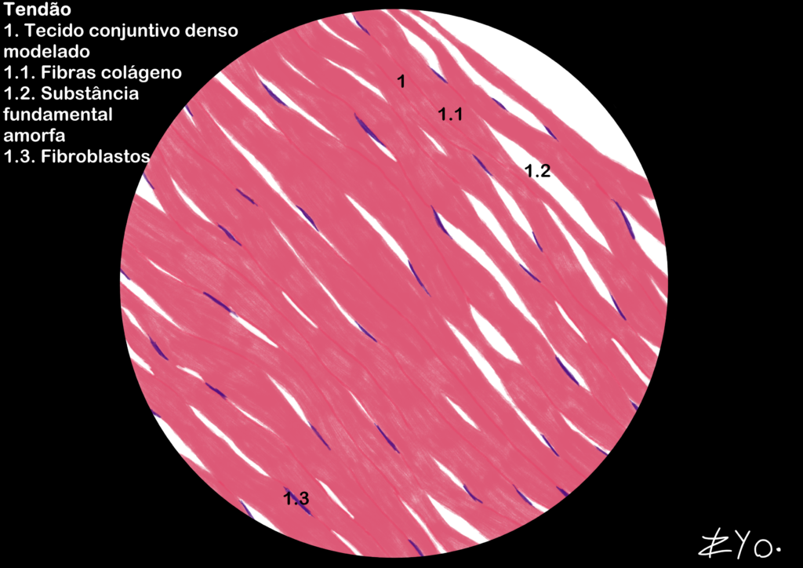

+++
title = "Connective Tissue"
date = "2022-06-17"
author = "Rafael Martins da Silva Afeto"
cover = ""
tags = ["Histology", "Histology Atlas","Connective Tissue", "Scientific Illustration", "UNIFAL-MG"]
categories = ["Educational Material"]
keywords = ["connective tissue histology", "loose dense connective tissue", "tendon collagen", "what is connective tissue", "connective tissue atlas"]
description = "Loose and dense connective tissue: structure, function and an illustration of the tendon. Material from UNIFAL-MG's Interactive Histology Atlas."
showFullContent = false
readingTime = false
hideComments = false
+++
Connective tissue is characterized by a predominance of extracellular matrix, made up of fibers and a viscous, hydrophilic 'ground substance'. This matrix, rich in proteoglycans and glycoproteins, fills the spaces between cells and plays a role in adhesion, lubrication and defense against pathogens. Unlike other tissues, it has scattered cells, as well as blood vessels and nerves. It is divided into loose and dense connective tissue, but only dense connective tissue is illustrated here ([visit the Atlas for more information](https://www.unifal-mg.edu.br/histologiainterativa/tecido-conjuntivo/)).

### Tendon

The tendon is made of dense connective tissue that connects muscles to bones. It is organized mainly by collagen fibers arranged in parallel bundles, which gives the tendon great tensile strength. The predominant cells in the tendon are fibroblasts, which produce the collagen fibers and the amorphous ground substance.

