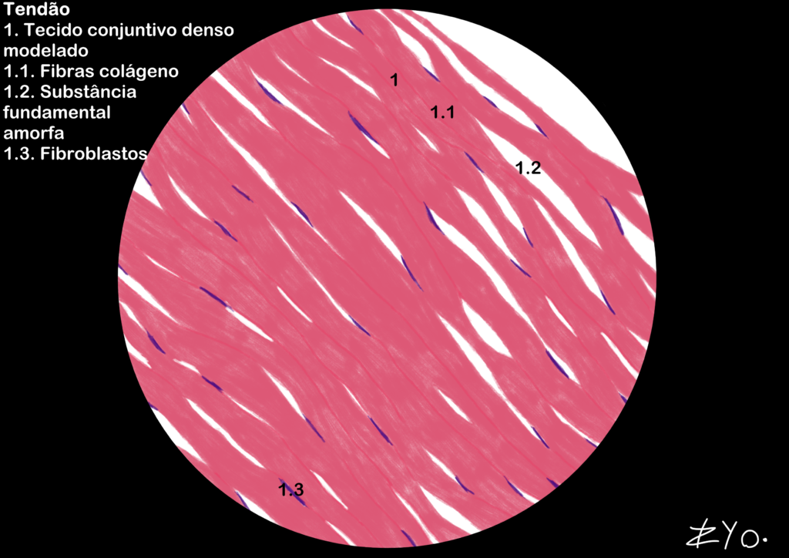

+++
title = "Tejido Conectivo"
date = "2022-06-17"
author = "Rafael Martins da Silva Afeto"
cover = ""
tags = ["Histología", "Atlas Histológico","Tejido Conectivo", "Ilustración Científica", "UNIFAL-MG"]
categories = ["Material Educativo"]
keywords = ["tejido conectivo histología", "tejido conectivo laxo denso", "tendón colágeno", "qué es el tejido conectivo", "atlas tejido conectivo"]
description = "Tejido conectivo laxo y denso: estructura, función e ilustración del tendón. Material del Atlas Interactivo de Histología de la UNIFAL-MG."
showFullContent = false
readingTime = false
hideComments = false
+++
El tejido conectivo se caracteriza por el predominio de la matriz extracelular, compuesta por fibras y una 'sustancia fundamental' viscosa e hidrofílica. Esta matriz, rica en proteoglucanos y glucoproteínas, rellena los espacios intercelulares y actúa en la adhesión, la lubricación y la defensa contra patógenos. A diferencia de otros tejidos, tiene células dispersas, además de vasos sanguíneos y nervios. Se divide en tejido conectivo laxo y denso, pero aquí solo está ilustrado el tejido conectivo denso ([visita el Atlas para más información](https://www.unifal-mg.edu.br/histologiainterativa/tecido-conjuntivo/)).

### Tendón

El tendón está compuesto por tejido conectivo denso que une los músculos a los huesos. Está organizado principalmente por fibras de colágeno dispuestas en haces paralelos, lo que le confiere al tendón una gran resistencia a la tracción. Las células predominantes en el tendón son los fibroblastos, que producen las fibras de colágeno y la sustancia fundamental amorfa.

