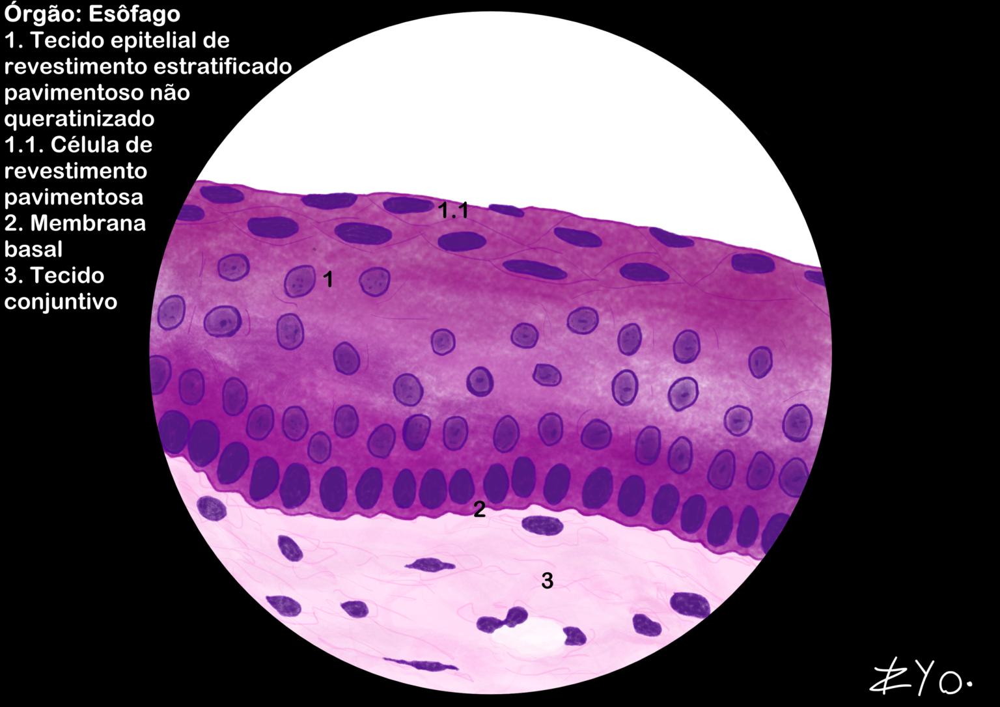
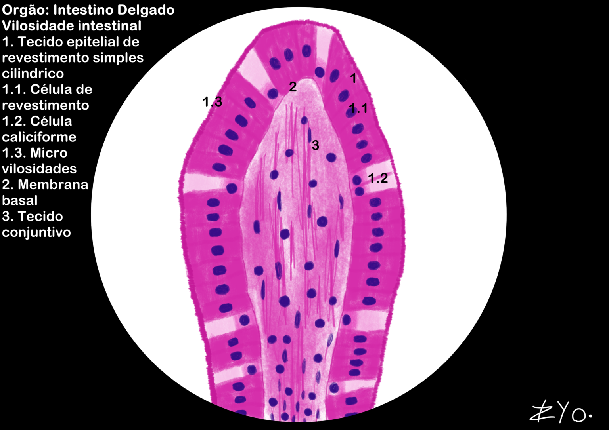
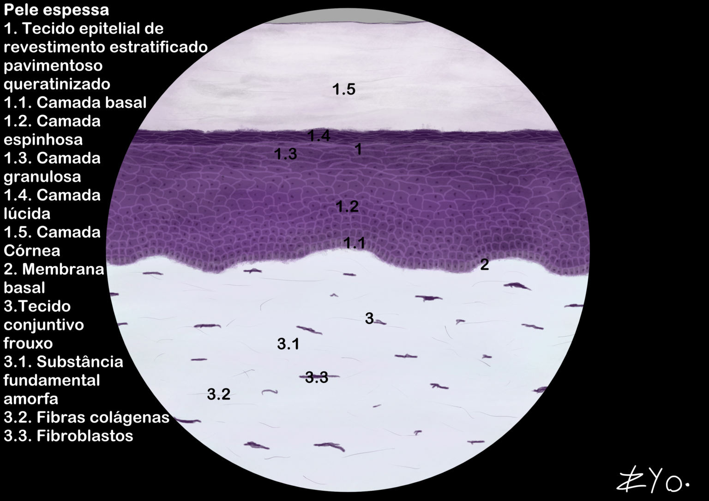
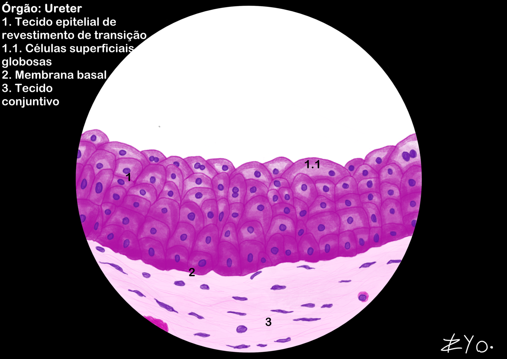
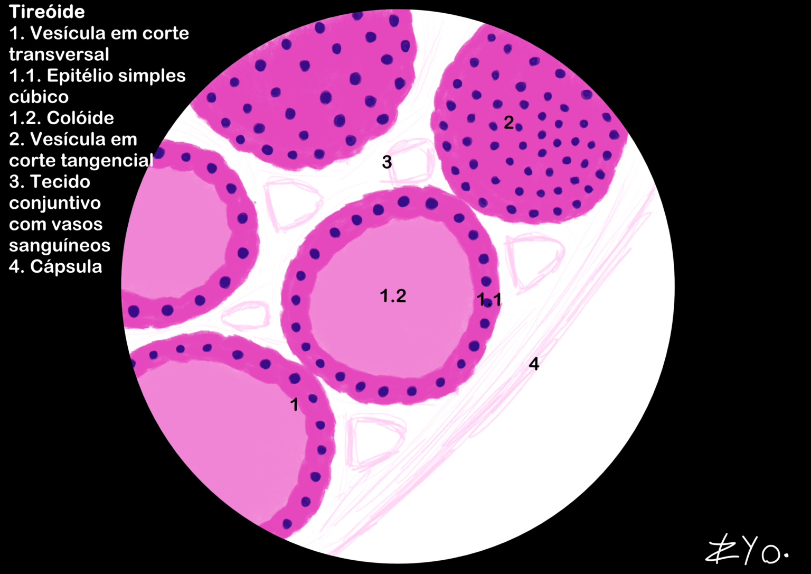

+++
title = "Covering Epithelial Tissue"
date = "2022-06-17"
author = "Rafael Martins da Silva Afeto"
cover = ""
tags = ["Histology", "Histology Atlas","Epithelial Tissue", "Scientific Illustration", "UNIFAL-MG"]
categories = ["Educational Material"]
keywords = ["covering epithelial tissue", "stratified squamous epithelium", "what is epithelial tissue", "esophagus intestine histology", "epithelial tissue atlas"]
description = "Covering epithelial tissue: types, structure and examples from the esophagus and small intestine. UNIFAL-MG Interactive Histology Atlas."
showFullContent = false
readingTime = false
hideComments = false
+++

Epithelial tissue is one of the 4 basic animal tissues. It is made up of tightly packed cells with little extracellular matrix and no blood vessels, so it depends on connective tissue for nourishment. The basal lamina (or basement membrane) serves as the interface between these tissues, providing structural support and adhesion ([visit the Atlas for more information](https://www.unifal-mg.edu.br/histologiainterativa/tecido-epitelial-de-revestimento-2/)).

### Esophagus

The esophagus has a nonkeratinized stratified squamous covering epithelium, which is adapted to withstand the friction caused by the passage of food. It is made up of several layers of cells, in which the most superficial cells are flattened and the deeper layers are more cuboidal or columnar. The absence of keratin keeps the tissue moist, making it easier for food to pass.

### Small intestine

The small intestine is lined by a simple columnar covering epithelium, specialized for nutrient absorption. It is made up of a single layer of columnar cells, which have microvilli on their apical surface to increase the absorptive area. This tissue also contains goblet cells (secretory glands) that produce mucus to protect the epithelium and ease the passage of the intestinal contents.

### Thick skin

Thick skin, found in areas such as the palms of the hands and the soles of the feet, is covered by a keratinized stratified squamous covering epithelium. It is made up of several layers of cells, in which the most superficial cells are flattened and rich in keratin, a protein that provides strength and waterproofing. Keratin helps protect the skin against mechanical damage, water loss and infections.

### Ureter

The ureter is lined by a transitional covering epithelium. It is made up of several layers of cells that can stretch and adapt to the changing volume of the ureter. The most superficial cells are large and rounded, while the deeper layers are more cuboidal. This type of epithelium is specialized to allow the ureter to distend while transporting urine.

### Thyroid

The thyroid is made up of a simple cuboidal covering epithelium, which forms the thyroid follicles. These follicles are spherical structures that store thyroid hormone in a substance called colloid. The cuboidal epithelial cells are responsible for producing and releasing the thyroid hormones, which regulate the body's metabolism.

