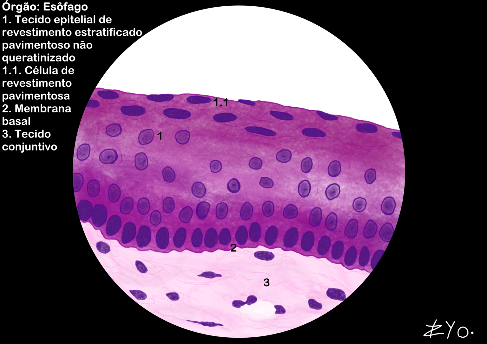
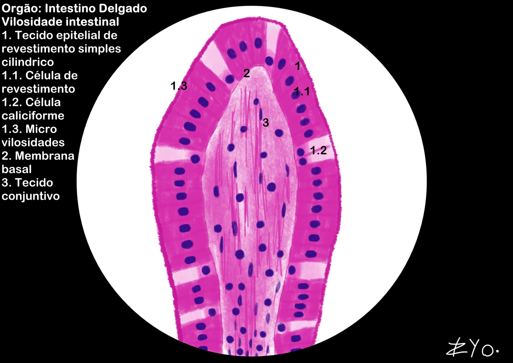
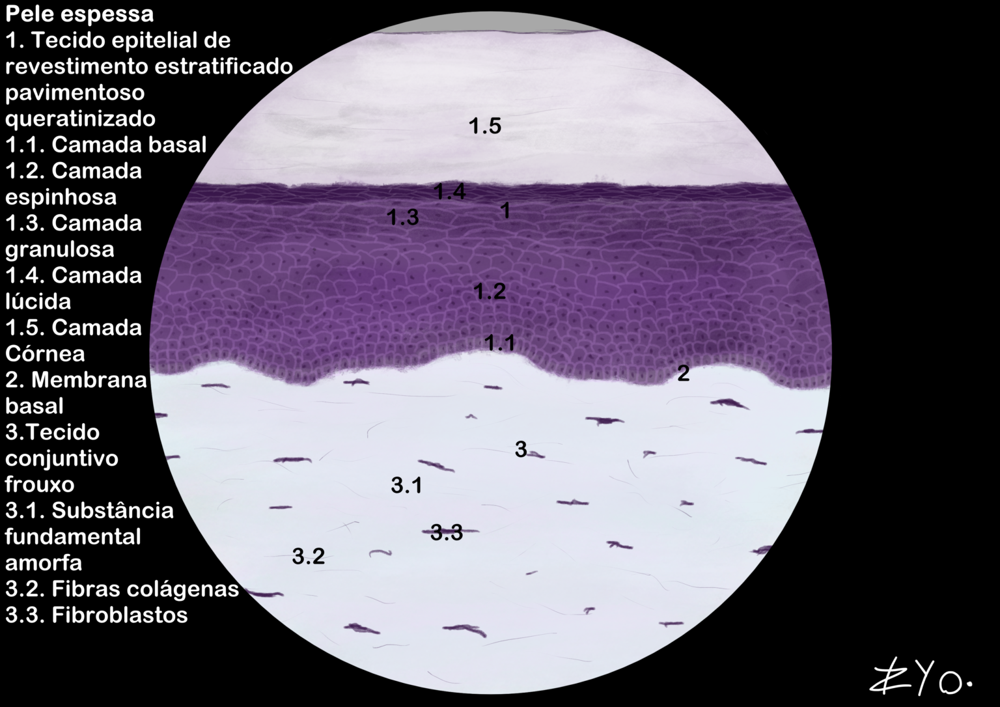
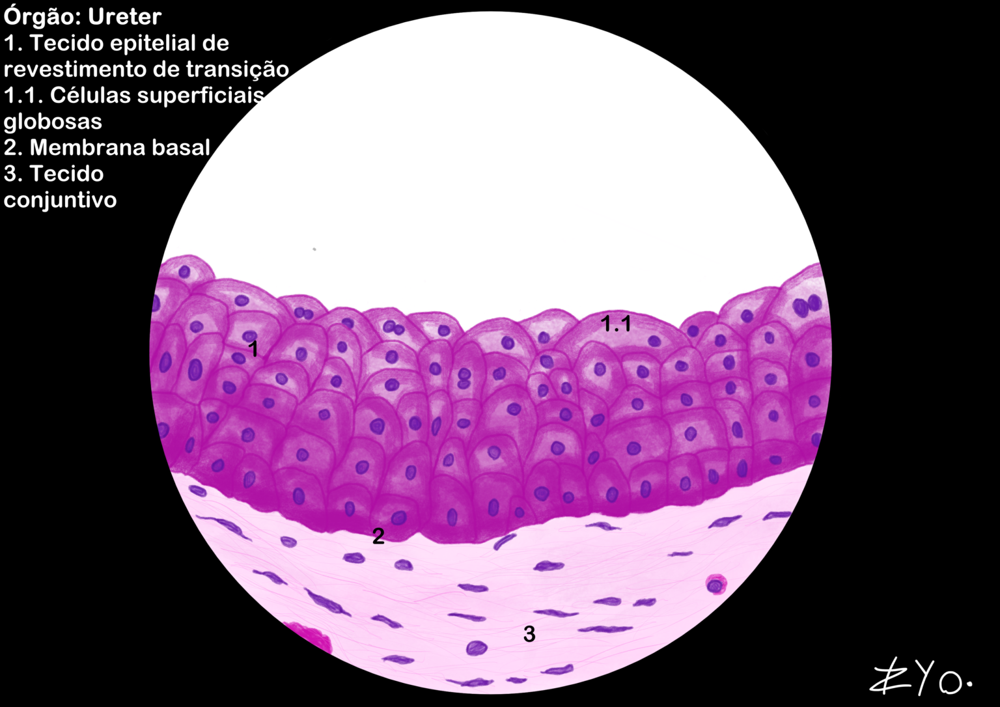
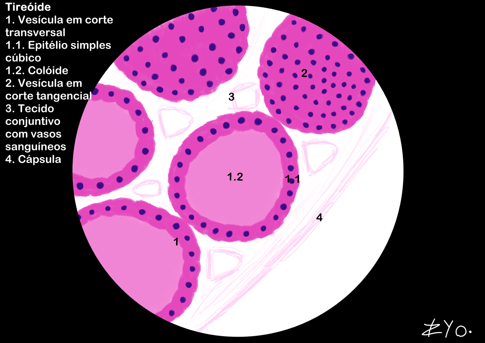

+++
title = "Tejido Epitelial de Revestimiento"
date = "2022-06-17"
author = "Rafael Martins da Silva Afeto"
cover = ""
tags = ["Histología", "Atlas Histológico","Tejido Epitelial", "Ilustración Científica", "UNIFAL-MG"]
categories = ["Material Educativo"]
keywords = ["tejido epitelial de revestimiento", "epitelio estratificado plano", "qué es el tejido epitelial", "esófago intestino histología", "atlas tejido epitelial"]
description = "Tejido epitelial de revestimiento: tipos, estructura y ejemplos del esófago y el intestino delgado. Atlas Interactivo de Histología de la UNIFAL-MG."
showFullContent = false
readingTime = false
hideComments = false
+++

El tejido epitelial es uno de los 4 tejidos animales básicos. Está compuesto por células yuxtapuestas con poca matriz extracelular y sin vasos sanguíneos, por lo que depende del tejido conectivo para su nutrición. La lámina basal (o membrana basal) sirve como interfaz entre estos tejidos y proporciona soporte estructural y adhesión ([visita el Atlas para más información](https://www.unifal-mg.edu.br/histologiainterativa/tecido-epitelial-de-revestimento-2/)).

### Esófago

El esófago cuenta con un tejido epitelial de revestimiento estratificado plano no queratinizado, adaptado para resistir la fricción causada por el paso de los alimentos. Está compuesto por varias capas de células, en las que las células más superficiales son aplanadas y las capas más profundas son más cúbicas o cilíndricas. La ausencia de queratina permite que el tejido permanezca húmedo, lo que facilita el paso de los alimentos.

### Intestino delgado

El intestino delgado está revestido por un tejido epitelial de revestimiento simple cilíndrico, especializado en la absorción de nutrientes. Está compuesto por una única capa de células columnares, que tienen microvellosidades en la superficie apical para aumentar el área de absorción. Este tejido también contiene células caliciformes (glándulas secretoras) que producen moco para proteger el epitelio y facilitar el paso del contenido intestinal.

### Piel gruesa

La piel gruesa, presente en zonas como las palmas de las manos y las plantas de los pies, está revestida por un tejido epitelial de revestimiento estratificado plano queratinizado. Está compuesto por varias capas de células, en las que las células más superficiales son aplanadas y ricas en queratina, una proteína que confiere resistencia e impermeabilidad. La queratina ayuda a proteger la piel contra daños mecánicos, pérdida de agua e infecciones.

### Uréter

El uréter está revestido por un tejido epitelial de revestimiento de transición. Está compuesto por varias capas de células que pueden estirarse y adaptarse al volumen variable del uréter. Las células más superficiales son grandes y redondeadas, mientras que las capas más profundas son más cúbicas. Este tipo de epitelio está especializado para permitir la distensión del uréter durante el transporte de la orina.

### Tiroides

La tiroides está compuesta por un tejido epitelial de revestimiento simple cúbico, que forma los folículos tiroideos. Estos folículos son estructuras esféricas que almacenan la hormona tiroidea en una sustancia llamada coloide. Las células epiteliales cúbicas son responsables de la producción y liberación de las hormonas tiroideas, que regulan el metabolismo del cuerpo.

