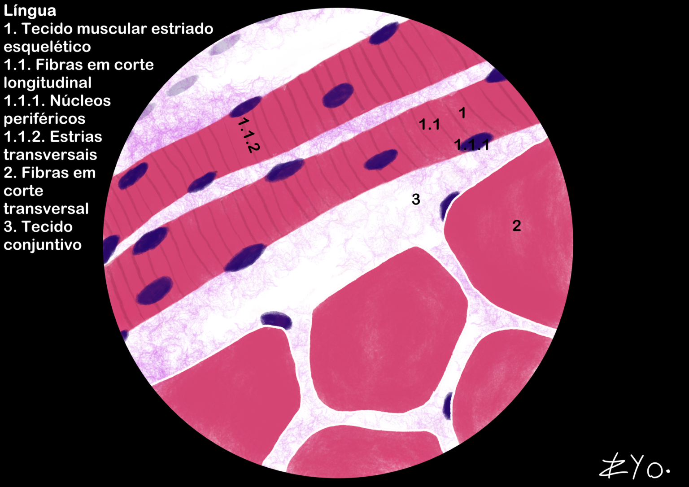
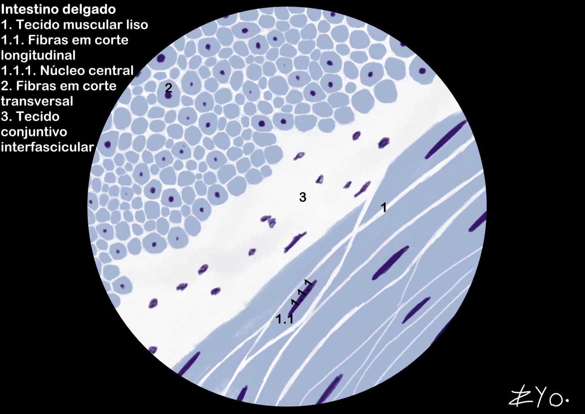
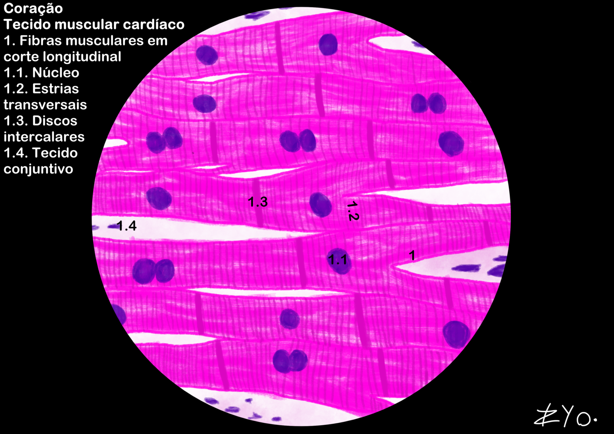

+++
title = "Muscle Tissue"
date = "2022-06-17"
author = "Rafael Martins da Silva Afeto"
cover = ""
tags = ["Histology", "Histology Atlas","Muscle Tissue", "Scientific Illustration", "UNIFAL-MG"]
categories = ["Educational Material"]
keywords = ["muscle tissue histology", "skeletal smooth cardiac muscle", "what is muscle tissue", "sarcomere muscle contraction", "muscle tissue atlas"]
description = "Skeletal, smooth and cardiac muscle tissue: structure, function and illustrations of the tongue and intestine. UNIFAL-MG Histology Atlas."
showFullContent = false
readingTime = false
hideComments = false
+++

Muscle tissue is made up of elongated, excitable fibers that use ATP to contract through the sliding of actin and myosin myofilaments. Structurally, it is organized into sarcomeres and wrapped in connective tissue sheaths (epimysium, perimysium and endomysium), and it depends on the release of calcium to trigger the contractile process. As for regeneration, smooth muscle is the most efficient, skeletal muscle has limited capacity through satellite cells, and cardiac muscle only forms fibrous scar tissue ([visit the Atlas for more information](https://www.unifal-mg.edu.br/histologiainterativa/tecido-muscular/)).

### Tongue

The tongue has fibers, that is, skeletal muscle cells, arranged in more than one direction, which gives it great mobility and flexibility. Around these muscle fibers there is connective tissue, which allows for innervation, vascularization and the presence of defense cells.

### Small intestine

The small intestine contains smooth muscle tissue organized into two layers: an inner circular layer and an outer longitudinal layer. This arrangement allows the coordinated movement of the intestinal contents through peristaltic contractions, aiding digestion and nutrient absorption. Between these muscle layers there is connective tissue.

### Heart

The heart is made up of cardiac muscle tissue, characterized by striated, branched muscle fibers connected by intercalated discs. Cardiac muscle tissue is highly resistant to fatigue thanks to its abundant mitochondria and rich vascularization, which ensure a constant supply of oxygen and nutrients to sustain the heart's continuous contractile activity. Between the muscle fibers there is connective tissue.

