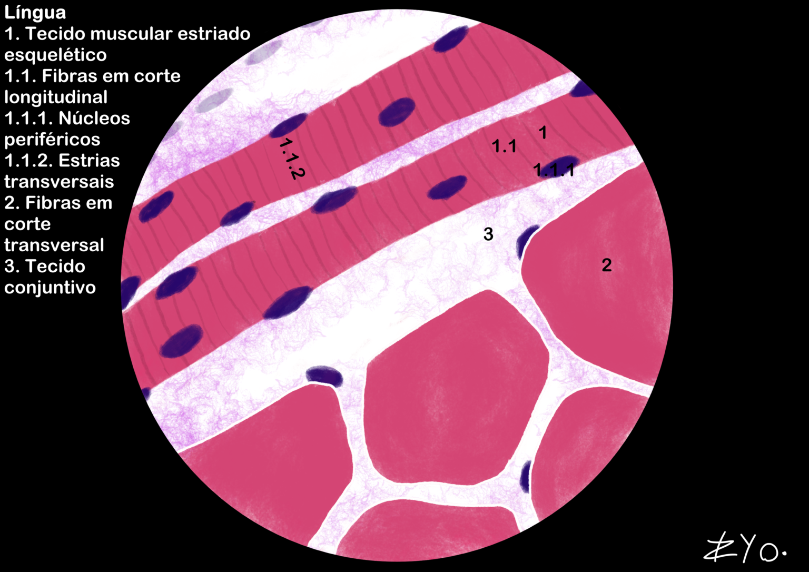
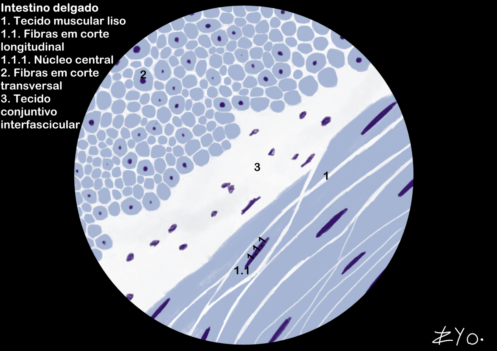
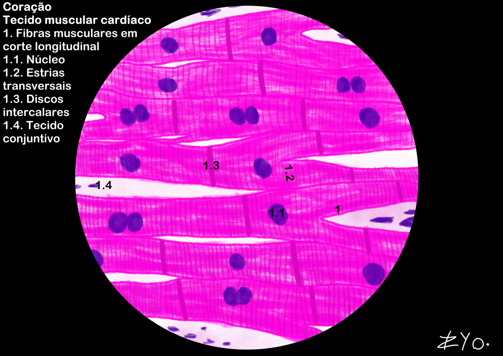

+++
title = "Tejido Muscular"
date = "2022-06-17"
author = "Rafael Martins da Silva Afeto"
cover = ""
tags = ["Histología", "Atlas Histológico","Tejido Muscular", "Ilustración Científica", "UNIFAL-MG"]
categories = ["Material Educativo"]
keywords = ["tejido muscular histología", "músculo esquelético liso cardíaco", "qué es el tejido muscular", "sarcómero contracción muscular", "atlas tejido muscular"]
description = "Tejido muscular esquelético, liso y cardíaco: estructura, función e ilustraciones de la lengua y el intestino. Atlas de Histología de la UNIFAL-MG."
showFullContent = false
readingTime = false
hideComments = false
+++

El tejido muscular está compuesto por fibras alargadas y excitables que utilizan ATP para contraerse mediante el deslizamiento de los miofilamentos de actina y miosina. Estructuralmente, se organiza en sarcómeros y está envuelto por capas de tejido conectivo (epimisio, perimisio y endomisio), y depende de la liberación de calcio para activar el proceso contráctil. En cuanto a la regeneración, el músculo liso es el más eficiente, el esquelético tiene una capacidad limitada a través de las células satélite y el cardíaco solo forma una cicatriz fibrosa ([visita el Atlas para más información](https://www.unifal-mg.edu.br/histologiainterativa/tecido-muscular/)).

### Lengua

La lengua tiene fibras, es decir, células musculares esqueléticas, organizadas en más de una dirección, lo que le confiere gran movilidad y flexibilidad. Alrededor de estas fibras musculares hay tejido conectivo, que permite la inervación, la vascularización y la presencia de células de defensa.

### Intestino delgado

El intestino delgado contiene tejido muscular liso organizado en dos capas: la capa circular interna y la capa longitudinal externa. Esta organización permite el movimiento coordinado del contenido intestinal mediante contracciones peristálticas, lo que facilita la digestión y la absorción de nutrientes. Entre estas capas musculares hay tejido conectivo.

### Corazón

El corazón está compuesto por tejido muscular cardíaco, caracterizado por fibras musculares estriadas y ramificadas, conectadas por discos intercalares. El tejido muscular cardíaco es altamente resistente a la fatiga gracias a sus abundantes mitocondrias y a su rica vascularización, que garantizan el suministro constante de oxígeno y nutrientes para sostener la actividad contráctil continua del corazón. Entre las fibras musculares hay tejido conectivo.

