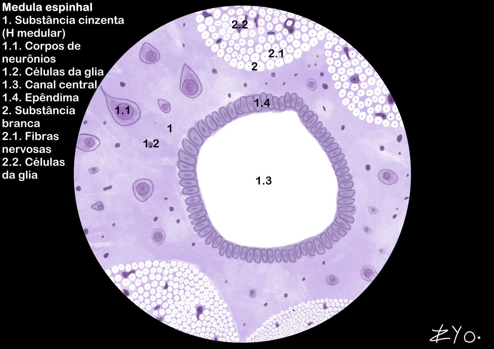
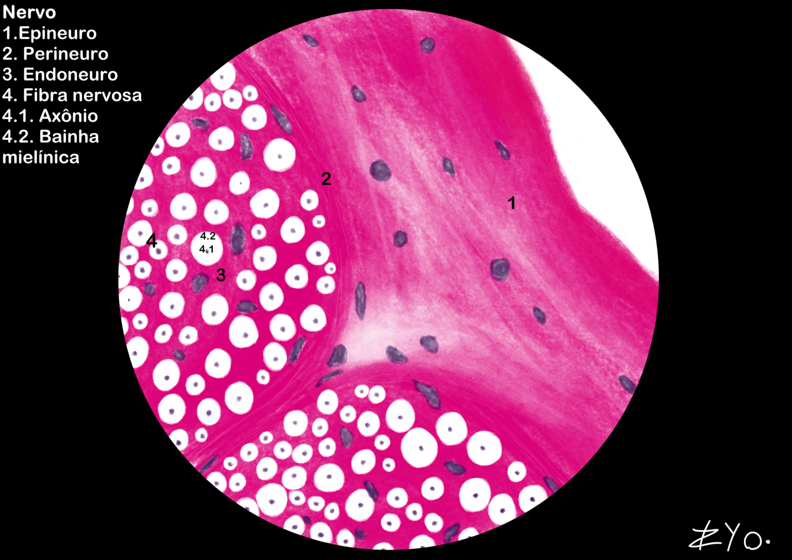

+++
title = "Nervous Tissue"
date = "2022-06-17"
author = "Rafael Martins da Silva Afeto"
cover = ""
tags = ["Histology", "Histology Atlas","Nervous Tissue", "Scientific Illustration", "UNIFAL-MG"]
categories = ["Educational Material"]
keywords = ["nervous tissue histology", "neurons glial cells", "spinal cord nerves", "what is nervous tissue", "nervous tissue atlas"]
description = "Nervous tissue: neurons, glial cells, spinal cord and nerves with scientific illustrations. UNIFAL-MG Histology Atlas."
showFullContent = false
readingTime = false
hideComments = false
+++
Nervous tissue is made up of neurons, which transmit electrical impulses through axons and dendrites, and of glial cells (such as astrocytes and oligodendrocytes), which are responsible for support, nourishment and electrical insulation (the myelin sheath). Anatomically, it is divided into the CNS (brain and spinal cord) and the PNS (nerves and ganglia), which connects the nerve centers to the organs. The system works to regulate homeostasis and to control voluntary and autonomic functions (sympathetic and parasympathetic) through neurotransmitters ([visit the Atlas for more information](https://www.unifal-mg.edu.br/histologiainterativa/tecido-nervoso/)).

### Spinal cord

The spinal cord consists of central gray matter, where the neuron cell bodies are located, and peripheral white matter, formed by myelinated axons that conduct nerve impulses. The spinal cord is responsible for transmitting sensory information from the body to the brain and motor commands from the brain to the body, and it is also a center for fast, automatic reflexes.

### Nerves

Nerves are structures of the peripheral nervous system made up of bundles of axons wrapped in connective tissue. In a cross section, you can see how they are organized into: Epineurium, Perineurium and Endoneurium; while the nerve fiber is organized into axons wrapped by the myelin sheath.

