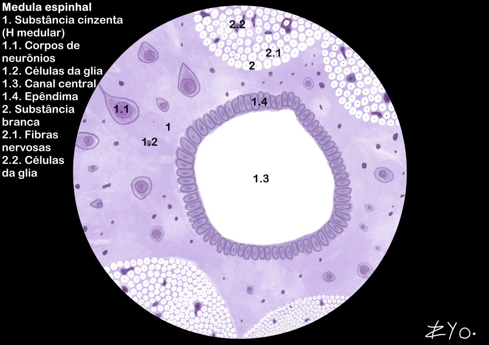
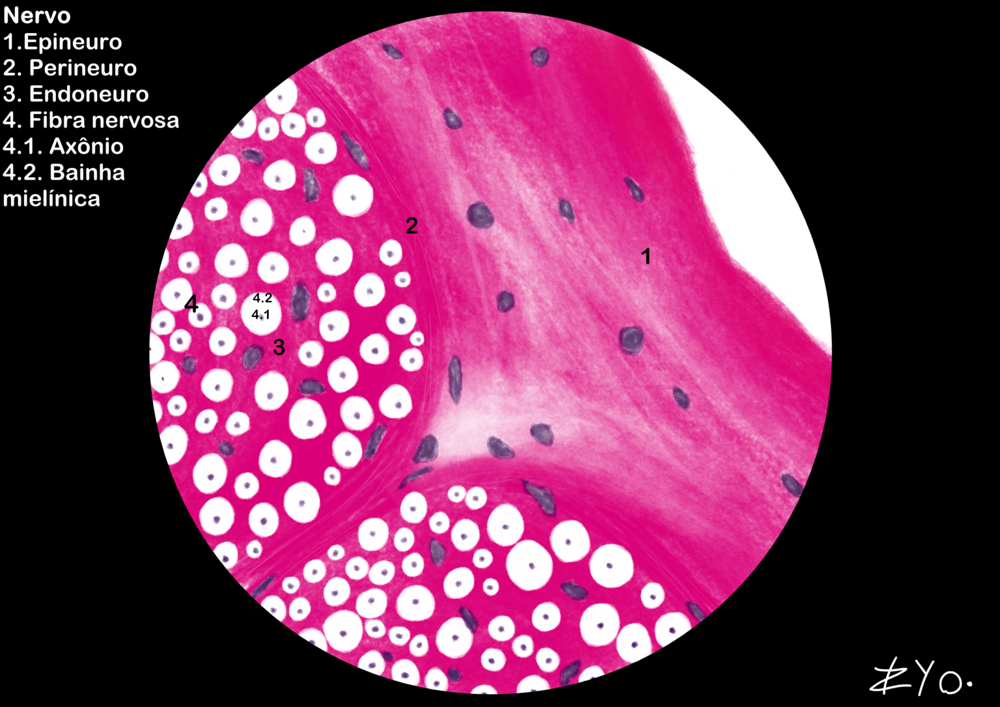

+++
title = "Tejido Nervioso"
date = "2022-06-17"
author = "Rafael Martins da Silva Afeto"
cover = ""
tags = ["Histología", "Atlas Histológico","Tejido Nervioso", "Ilustración Científica", "UNIFAL-MG"]
categories = ["Material Educativo"]
keywords = ["tejido nervioso histología", "neuronas células gliales", "médula espinal nervios", "qué es el tejido nervioso", "atlas tejido nervioso"]
description = "Tejido nervioso: neuronas, células gliales, médula espinal y nervios con ilustraciones científicas. Atlas de Histología de la UNIFAL-MG."
showFullContent = false
readingTime = false
hideComments = false
+++
El tejido nervioso está compuesto por neuronas, que transmiten impulsos eléctricos a través de axones y dendritas, y por las células gliales (como astrocitos y oligodendrocitos), responsables del sostén, la nutrición y el aislamiento eléctrico (vaina de mielina). Anatómicamente, se divide en SNC (encéfalo y médula espinal) y SNP (nervios y ganglios), que conecta los centros nerviosos con los órganos. El sistema actúa en la regulación de la homeostasis y en el control de las funciones voluntarias y autónomas (simpático y parasimpático) a través de neurotransmisores ([visita el Atlas para más información](https://www.unifal-mg.edu.br/histologiainterativa/tecido-nervoso/)).

### Médula espinal

La médula espinal está compuesta por una sustancia gris central, donde se encuentran los cuerpos celulares de las neuronas, y una sustancia blanca periférica, formada por axones mielinizados que conducen los impulsos nerviosos. La médula espinal se encarga de transmitir la información sensorial del cuerpo al cerebro y los comandos motores del cerebro al cuerpo, además de ser un centro de reflejos rápidos y automáticos.

### Nervios

Los nervios son estructuras del sistema nervioso periférico compuestas por haces de axones envueltos por tejido conectivo. Al hacer un corte transversal, se observa su organización en: Epineuro, Perineuro y Endoneuro; mientras que la fibra nerviosa se organiza en axones envueltos por la vaina de mielina.

