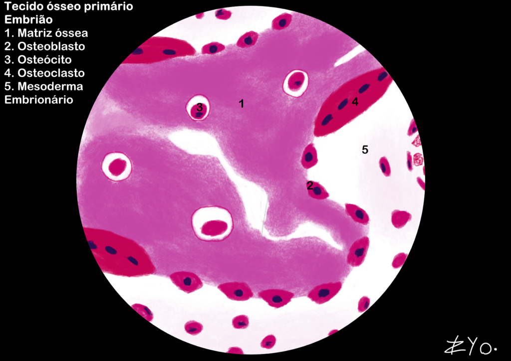
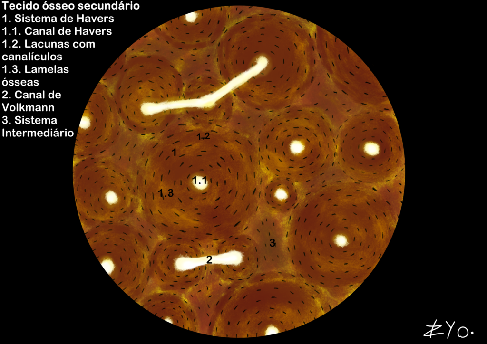
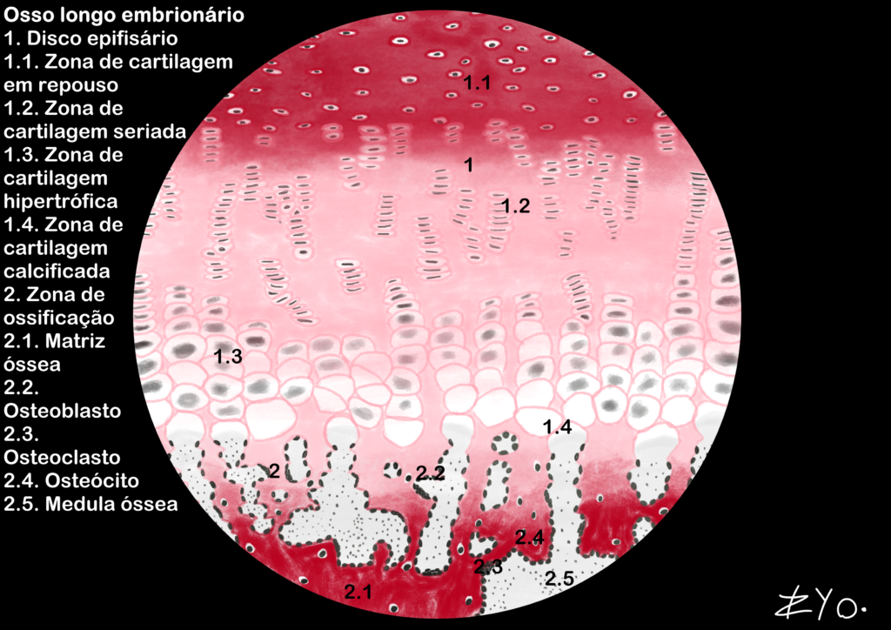

+++
title = "Bone Tissue"
date = "2022-06-17"
author = "Rafael Martins da Silva Afeto"
cover = ""
tags = ["Histology", "Histology Atlas","Bone Tissue", "Scientific Illustration", "UNIFAL-MG"]
categories = ["Educational Material"]
keywords = ["bone tissue histology", "primary secondary bone tissue", "compact spongy bone", "what is bone tissue", "bone tissue atlas"]
description = "Primary and secondary bone tissue: structure, mineralization and remodeling with illustrations. UNIFAL-MG Interactive Histology Atlas."
showFullContent = false
readingTime = false
hideComments = false
+++

Bone tissue is a specialized connective tissue in which the mineralized matrix (hydroxyapatite crystals) provides hardness and the organic portion (type I collagen) ensures flexibility. It provides mechanical support, protects vital organs and stores ions such as calcium and phosphate, and it is a dynamic structure in constant remodeling. It also houses the bone marrow and amplifies movement through the lever system it forms with the skeletal muscles ([visit the Atlas for more information](https://www.unifal-mg.edu.br/histologiainterativa/tecido-osseo/)).

### Primary bone tissue

Primary bone tissue is characterized by a newly formed, disorganized bone matrix. It is found mainly during embryonic development and in bone repair processes, such as fractures. Primary bone tissue is made up of irregularly arranged type I collagen fibers, which make it look less dense and more flexible than mature bone tissue. It is later remodeled to form secondary bone tissue, which is more organized and stronger.

### Secondary bone tissue

Secondary bone tissue, also known as lamellar bone tissue, is characterized by a bone matrix organized in layers or lamellae. It is found in mature bones and is the result of bone remodeling, in which primary bone tissue is replaced by stronger, more organized bone tissue. It is responsible for providing structural support to the skeleton and protecting the vital organs, and it also serves as an ion reserve and as the site of blood cell production in the bone marrow.

### Embryonic long bone

The embryonic long bone develops through endochondral ossification, in which a hyaline cartilage model is gradually replaced by primary bone tissue. This process takes place in distinct zones: chondrocytes proliferate in rows, undergo hypertrophy and the matrix becomes calcified, allowing osteoblasts to deposit bone matrix and osteoclasts to shape the medullary canal. This dynamic is essential for building the skeleton and for the organism's longitudinal growth during the embryonic stage.

