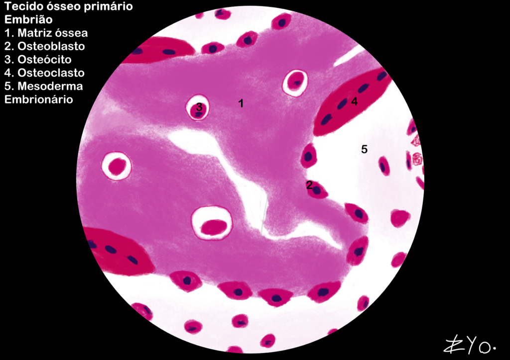
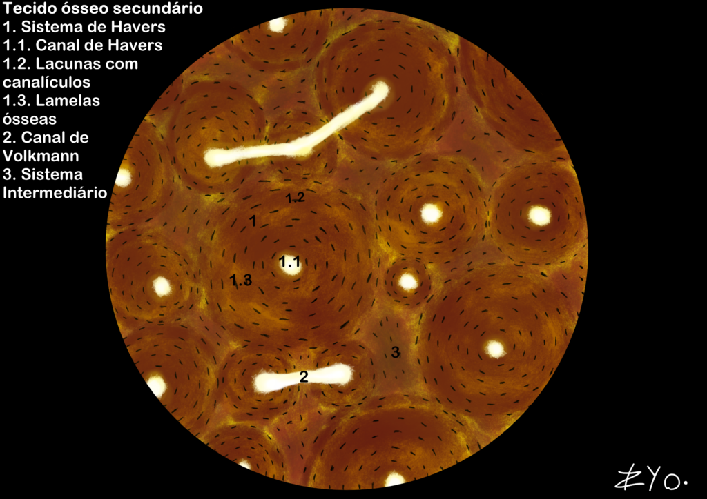
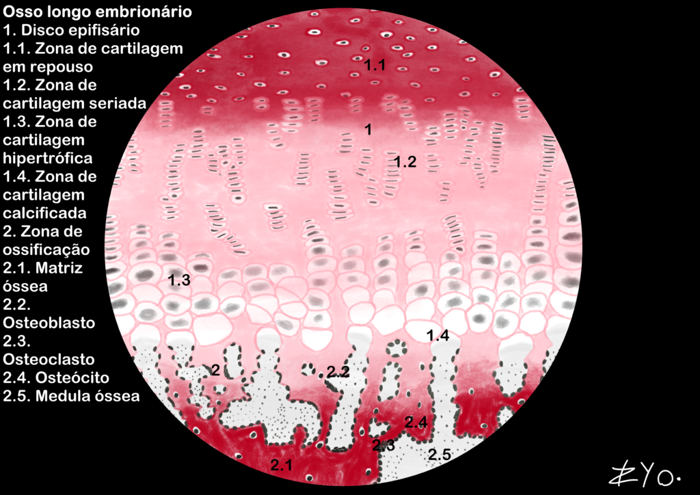

+++
title = "Tejido Óseo"
date = "2022-06-17"
author = "Rafael Martins da Silva Afeto"
cover = ""
tags = ["Histología", "Atlas Histológico","Tejido Óseo", "Ilustración Científica", "UNIFAL-MG"]
categories = ["Material Educativo"]
keywords = ["tejido óseo histología", "tejido óseo primario secundario", "hueso compacto esponjoso", "qué es el tejido óseo", "atlas tejido óseo"]
description = "Tejido óseo primario y secundario: estructura, mineralización y remodelación con ilustraciones. Atlas Interactivo de Histología de la UNIFAL-MG."
showFullContent = false
readingTime = false
hideComments = false
+++

El tejido óseo es un tejido conectivo especializado en el que la matriz mineralizada (cristales de hidroxiapatita) proporciona dureza y la parte orgánica (colágeno tipo I) garantiza flexibilidad. Actúa en el soporte mecánico, la protección de órganos vitales y la reserva de iones como el calcio y el fosfato, y es una estructura dinámica en constante remodelación. Además, alberga la médula ósea y potencia los movimientos mediante el sistema de palancas que forma con los músculos esqueléticos ([visita el Atlas para más información](https://www.unifal-mg.edu.br/histologiainterativa/tecido-osseo/)).

### Tejido óseo primario

El tejido óseo primario se caracteriza por una matriz ósea recién formada y desorganizada. Se encuentra principalmente durante el desarrollo embrionario y en procesos de reparación ósea, como las fracturas. El tejido óseo primario está compuesto por fibras de colágeno tipo I dispuestas de manera irregular, lo que le da un aspecto menos denso y más flexible en comparación con el tejido óseo maduro. Posteriormente se remodela para formar el tejido óseo secundario, que es más organizado y resistente.

### Tejido óseo secundario

El tejido óseo secundario, también conocido como tejido óseo laminar, se caracteriza por una matriz ósea organizada en capas o laminillas. Se encuentra en los huesos maduros y es el resultado del proceso de remodelación ósea, en el que el tejido óseo primario es sustituido por un tejido óseo más resistente y organizado. Es responsable de proporcionar soporte estructural al esqueleto y proteger los órganos vitales, además de actuar como reserva de iones y como lugar de producción de las células sanguíneas en la médula ósea.

### Hueso largo embrionario

El hueso largo embrionario se desarrolla mediante la osificación endocondral, en la que un molde de cartílago hialino es reemplazado gradualmente por tejido óseo primario. Este proceso ocurre en zonas distintas: los condrocitos proliferan en hileras, se hipertrofian y la matriz se calcifica, lo que permite que los osteoblastos depositen matriz ósea y los osteoclastos modelen el canal medular. Esta dinámica es esencial para la estructuración del esqueleto y el crecimiento longitudinal del organismo durante la etapa embrionaria.

