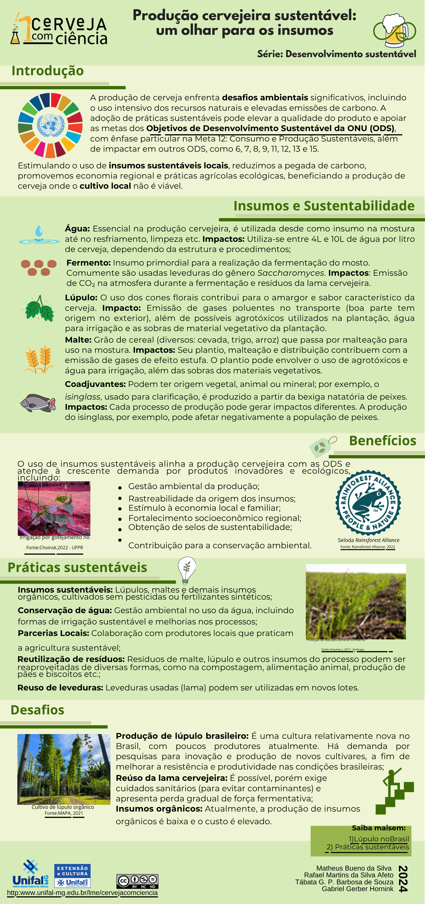

+++
date = '2024-04-01'
draft = false
title = 'Infographic: Sustainable beer production, a look at the ingredients - Sustainable Development series - Beer Science - UNIFAL-MG'
author = "Rafael Martins da Silva Afeto"
cover = ""
tags = ["Beer Science", "Sustainability", "Infographic", "UNIFAL-MG"]
categories = ["Educational Material"]
keywords = ["sustainable beer production", "beer infographic", "beer ingredients sustainability", "beer science UNIFAL", "sustainable beer"]
description = "Infographic on sustainable practices in beer production with a focus on ingredients. Sustainable Development series from the Beer Science course, UNIFAL-MG."
+++

The infographic "Sustainable beer production, a look at the ingredients" is a visual piece that highlights the importance of sustainable practices in beer production, focusing on the ingredients used.

The infographic is part of the "Sustainable Development" series from the "Beer Science" course at UNIFAL-MG, which aims to raise awareness about sustainability in the brewing industry. To access this and other full infographics, click [here](https://www.unifal-mg.edu.br/lme/cervejacomciencia/materiais/infograficos/).

The course is taught by professor Gabriel Hornink, from the Institute of Biological Sciences (ICB) at UNIFAL-MG.

### Infographic: Sustainable beer production, a look at the ingredients

