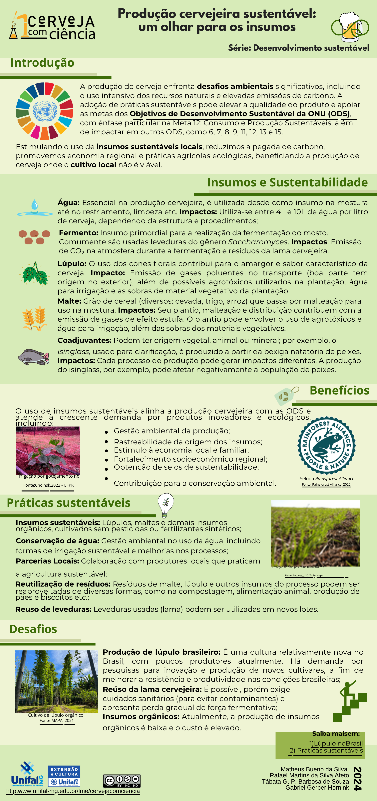

+++
date = '2024-04-01'
draft = false
title = 'Infografía: Producción cervecera sostenible, una mirada a los insumos - serie Desarrollo sostenible - Ciencia de la Cerveza - UNIFAL-MG'
author = "Rafael Martins da Silva Afeto"
cover = ""
tags = ["Ciencia de la Cerveza", "Sostenibilidad", "Infografía", "UNIFAL-MG"]
categories = ["Material Educativo"]
keywords = ["producción cervecera sostenible", "infografía cerveza", "insumos cerveza sostenibilidad", "ciencia de la cerveza UNIFAL", "cerveza sostenible"]
description = "Infografía sobre prácticas sostenibles en la producción de cerveza con enfoque en los insumos. Serie Desarrollo Sostenible de la asignatura Ciencia de la Cerveza, UNIFAL-MG."
+++

La infografía "Producción cervecera sostenible, una mirada a los insumos" es una representación visual que destaca la importancia de las prácticas sostenibles en la producción de cerveza, con enfoque en los insumos utilizados.

La infografía forma parte de la serie "Desarrollo sostenible" de la asignatura "Ciencia de la Cerveza" de la UNIFAL-MG, que busca promover la concientización sobre la sostenibilidad en la industria cervecera. Para acceder a esta y otras infografías completas, haz clic [aquí](https://www.unifal-mg.edu.br/lme/cervejacomciencia/materiais/infograficos/).

La asignatura es impartida por el docente Gabriel Hornink, del Instituto de Ciencias Biológicas (ICB) de la UNIFAL-MG.

### Infografía: Producción cervecera sostenible, una mirada a los insumos

