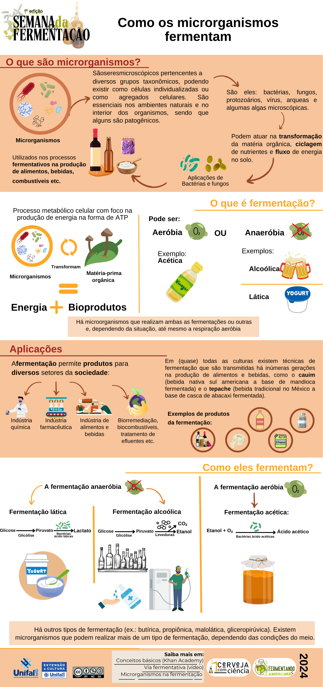

+++
date = '2024-09-16'
draft = false
title = '1st Fermentation Week - UNIFAL-MG'
author = "Rafael Martins da Silva Afeto"
cover = ""
tags = ["Fermentation", "Beer", "Beer Science", "Microorganisms", "UNIFAL-MG"]
categories = ["Educational Material"]
keywords = ["fermentation week UNIFAL", "how microorganisms ferment", "fermentation biotechnology", "university fermentation event", "fermentation infographic"]
description = "Material from UNIFAL-MG's 1st Fermentation Week: a banner and an infographic on how microorganisms ferment, focusing on biological processes and applications."
+++
UNIFAL-MG's 1st Fermentation Week was an event dedicated to exploring the fascinating world of fermentation, highlighting its historical, scientific and cultural importance. The event featured talks and interactive activities covering many aspects of fermentation, from the biological processes involved to its applications in the production of food, beverages and biotechnology.

Under the supervision of professor Gabriel Hornink, from the Institute of Biological Sciences (ICB) at UNIFAL-MG, and technician Gustavo Silveira, my partner Bianca Soares and I made a banner about how microorganisms work ([see the full banner here](https://www.researchgate.net/publication/384011832_Como_os_microrganismos_fermentam_painel)) and an infographic on the same topic ([see the full infographic here](https://www.researchgate.net/publication/384011528_Como_os_microrganismos_fermentam_infografico)).

### Banner: How do microorganisms ferment?

### Infographic: How do microorganisms ferment?

