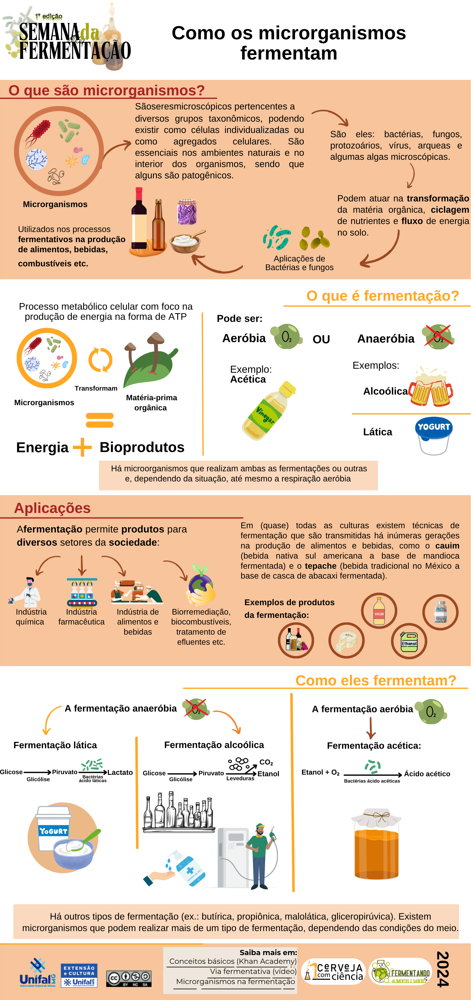

+++
date = '2024-09-16'
draft = false
title = '1.ª Semana de la Fermentación - UNIFAL-MG'
author = "Rafael Martins da Silva Afeto"
cover = ""
tags = ["Fermentación", "Cerveza", "Ciencia de la Cerveza", "Microorganismos", "UNIFAL-MG"]
categories = ["Material Educativo"]
keywords = ["semana de la fermentación UNIFAL", "cómo fermentan los microorganismos", "fermentación biotecnología", "evento fermentación universidad", "infografía fermentación"]
description = "Material de la 1.ª Semana de la Fermentación de la UNIFAL-MG: póster e infografía sobre cómo fermentan los microorganismos, con enfoque en los procesos biológicos y sus aplicaciones."
+++
La 1.ª Semana de la Fermentación de la UNIFAL-MG fue un evento dedicado a explorar el fascinante mundo de la fermentación, destacando su importancia histórica, científica y cultural. El evento contó con charlas y actividades interactivas que abordaron diversos aspectos de la fermentación, desde los procesos biológicos involucrados hasta sus aplicaciones en la producción de alimentos, bebidas y biotecnología.

Bajo la orientación del profesor Gabriel Hornink, del Instituto de Ciencias Biológicas (ICB) de la UNIFAL-MG, y del técnico Gustavo Silveira, mi compañera Bianca Soares y yo hicimos un póster sobre cómo funcionan los microorganismos ([consulta el póster completo aquí](https://www.researchgate.net/publication/384011832_Como_os_microrganismos_fermentam_painel)) y una infografía sobre el mismo tema ([consulta la infografía completa aquí](https://www.researchgate.net/publication/384011528_Como_os_microrganismos_fermentam_infografico)).

### Póster: ¿Cómo fermentan los microorganismos?

### Infografía: ¿Cómo fermentan los microorganismos?

