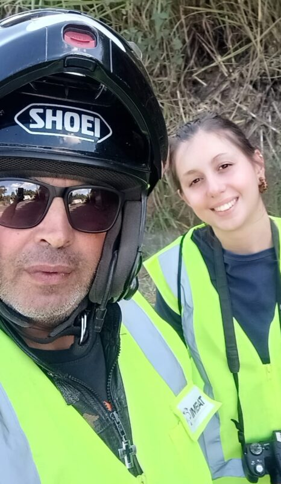
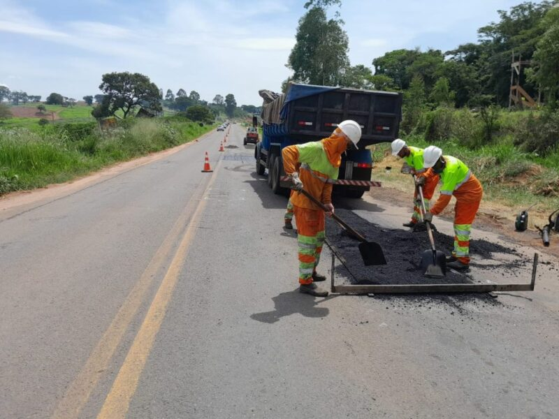

+++
title = "Alfenas–Elói Mendes stretch has the highest incidence of wild and domestic animal roadkill on highway MG-491"
subtitle = "Study by UNIFAL-MG researchers identifies collisions that harm both local wildlife and the safety of travelers"
date = "2024-09-25"
author = "Rafael Martins da Silva Afeto"
cover = "danna-em-campo.jpg"
coverCaption = "Danna Ferreira collecting data. (Photo: Personal Archive)"
tags = ["Roadkill", "Science", "FAPEMIG", "Undergraduate Research", "Projeto +Ciência", "UNIFAL-MG"]
categories = ["Environment"]
keywords = ["wildlife roadkill", "MG-491 highway", "Alfenas wildlife", "roadkill hotspots", "road ecology"]
description = "UNIFAL-MG research maps the stretches with the highest incidence of wild and domestic animal roadkill on highway MG-491, between Alfenas and Varginha."
showFullContent = false
readingTime = false
hideComments = false
+++
A study carried out by Danna Perondi Ferreira, a recent Biological Sciences graduate from UNIFAL-MG, under the supervision of professor Érica Hasui (Institute of Natural Sciences), identified the locations on highway MG-491 with the highest rates of wild and domestic animal roadkill, known as hotspots. Conducted between October 2023 and April 2024, the study also identified the factors that influence these collisions.

The stretch studied lies between the Minas Gerais cities of Alfenas and Varginha; however, the locations with the highest incidence of wild animal roadkill were between km 210 and 218, between Paraguaçu and Elói Mendes. For domestic animals, km 196, between Alfenas and Paraguaçu, stood out the most.

Throughout the study, the researcher photographed animals that had been hit by vehicles for later analysis and also recorded the geographic and environmental patterns around the animals found.

The section chosen for the study is currently managed by the EPR Vias do Café group and is already known for its large number of animal collisions. The research shows that these accidents harm both local wildlife, through the death of these animals, and the safety of travelers.


    
    

Points with the highest incidence of roadkill. (Images: Reproduction/Danna Ferreira's undergraduate thesis)

## What motivated the research

Titled "Assessment of wildlife roadkill hotspots on highway MG-491," the study is the result of an undergraduate thesis (TCC) linked to the undergraduate research project "Biodiversity and associated services: PELD Cantareira Mantiqueira Corridor."

The idea for the thesis came from the trips the researcher used to make between Alfenas and her hometown. "I'm from Três Corações, and whenever I went there on weekends I saw lots of animals that had been run over. It always upset me, and I kept wondering why there were so many cases and whether there was anything I could do. I looked into the subject, found several papers, and talked to Érica [Hasui], my advisor, suggesting the topic," says Danna Ferreira. "From there, we saw the possibility of developing this research to better understand roadkill patterns and, based on that, suggest measures that could change this reality," she adds.

To help identify the animals found, other researchers from UNIFAL-MG and the Federal University of Lavras (UFLA) joined the effort. Danna Ferreira says her family and her boyfriend were a great help in making the research happen. "My family and my boyfriend immediately offered to do the data collection with me, especially my dad, with whom I did most of the research," she shares.

Danna Ferreira with her father, Kerlei Ferreira, during data collection. (Photo: Personal Archive)

## Highways and habitat fragmentation

In her work, the author emphasizes that the expansion of pastureland, the construction of industries, and the opening of new highways directly affect vegetation cover and the way land is used.

According to the study, what is seen as progress for humans can mean destruction for fauna and flora, since urbanization and infrastructure construction fragment natural habitats. This turns once-continuous areas into smaller, isolated patches. For the author, the main problem is that this fragmentation makes it harder for animals to move between these areas, due to the lack of connectivity between fragments. In addition, according to data from the Brazilian Center for Road Ecology Studies (CBEE) at the Federal University of Lavras, an estimated 450 million wild animals are run over every year in Brazil, seriously threatening the country's biodiversity.

Danna Ferreira points out that, after September 2023, highway MG-491, previously managed by the state, was granted to the EPR Vias do Café group under the Minas Gerais State Government's Highway Concessions program. "The concessionaire took responsibility for lot 3 – Varginha – Furnas, which includes MG 491," the author explains. The researcher also notes that the concession contract runs for 30 years and includes a series of improvements, such as road repairs, construction of toll plazas, clearing of roadside areas, and renewal of signage, all aimed at improving road safety. "It's important to consider the safety of the wildlife that lives in the region and moves through the landscape, since the high incidence of animal roadkill on the highway is plain to see," she warns.

(Press photo: EPR Vias do Café)

## Who were the victims?

During the data collection period, the researcher found 189 animals that had been run over, both wild and domestic. Among wild animals, most were mammals, such as capybaras, Brazilian porcupines, opossums, and armadillos. To a lesser extent, tapitis (Brazilian cottontail rabbits), a mammal that is endangered, were also found.

Some birds, such as saffron finches and black vultures, were also frequently found. As for reptiles, tegus (lizards) were also seen run over. Among amphibians, it was not possible to identify the species.

According to the study, species that are locally more abundant and/or generalists (able to survive in a wide range of conditions and feed on many different food sources) are the ones that move most between fragments and highways, and therefore tend to be hit most often.

The same applies to nocturnal species, such as opossums, which can become victims because drivers' visibility is reduced at night and headlights disorient the animals.

Danna Ferreira also mentions scavenger species, that is, those that feed on dead animals, such as vultures, which suffer because they are attracted to carcasses on the highways, increasing their chances of becoming victims.

Dogs and cats were commonly seen run over on highways far from urban areas. Because they are domestic animals, factors such as the presence of small farms and rural properties near the roads, the availability of food such as carrion and garbage, and the abandonment of these animals are directly related to their being hit.

## Does the environment play a role?

In her study, Danna Ferreira shows that the environment is a crucial factor in defining hotspots, or critical locations, since better-preserved environments, such as those near areas of natural forest vegetation, tend to have more roadkill. Meanwhile, in places near degraded environments, such as forestry plantations, or far from any water source, roadkill decreases. As the author emphasizes, this is related to reduced resources: with these plantations, such as the eucalyptus plantations common in the region, the soil and water resources become impoverished, which is unattractive to animals, resulting in less biodiversity and, consequently, fewer collisions.

## Outcomes of the study

The study's data point to the need to consider mitigation measures. In early 2023, Guilherme Abraão, an environmentalist and sociologist, submitted to the Public Prosecutor's Office a proposal for wildlife preservation measures in the highway concession bidding documents, which include the stretch studied. However, these measures have not been implemented so far.

"I didn't see any measures to mitigate animal roadkill on this highway even before starting the research," said Danna Ferreira. "[The EPR Vias do Café group] has started several construction projects along the road, but I still don't see any measures aimed at reducing roadkill," she argues.

According to the author and other studies on the subject, measures such as wildlife crossing bridges, speed cameras at strategic points, and roadside fencing, among others, would help reduce roadkill. "They're important not only to keep animals from dying on the road, but also to allow both them and humans to move around safely, since these accidents are also a risk for us."

*Text written under the supervision and guidance of Ana Carolina Araújo, journalist at the Federal University of Alfenas (UNIFAL-MG).*

Visit the [UNIFAL-MG page](https://jornal.unifal-mg.edu.br/trecho-alfenas-x-paraguacu-possui-maior-incidencia-de-atropelamento-de-animais-silvestres-e-domesticos-da-rodovia-mg-491/) to read the full text (in Portuguese).
