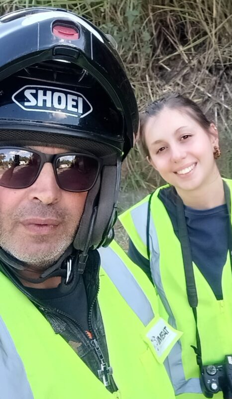
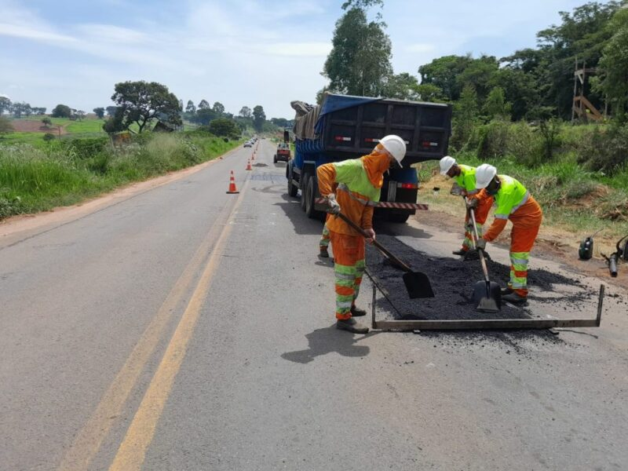

+++
title = "El tramo Alfenas–Elói Mendes tiene la mayor incidencia de atropellamientos de animales silvestres y domésticos de la carretera MG-491"
subtitle = "Estudio realizado por investigadores de la UNIFAL-MG identifica accidentes que perjudican tanto a la fauna local como a la seguridad de los viajeros"
date = "2024-09-25"
author = "Rafael Martins da Silva Afeto"
cover = "danna-em-campo.jpg"
coverCaption = "Danna Ferreira recolectando los datos. (Foto: Archivo Personal)"
tags = ["Atropellamientos", "Ciencia", "FAPEMIG", "Iniciación Científica", "Projeto +Ciência", "UNIFAL-MG"]
categories = ["Medio Ambiente"]
keywords = ["atropellamiento de animales silvestres", "carretera MG-491", "fauna silvestre Alfenas", "hotspots de atropellamiento", "ecología de carreteras"]
description = "Investigación de la UNIFAL-MG mapea los tramos con mayor incidencia de atropellamientos de animales silvestres y domésticos en la carretera MG-491, entre Alfenas y Varginha."
showFullContent = false
readingTime = false
hideComments = false
+++
Una investigación realizada por Danna Perondi Ferreira, recién graduada en Ciencias Biológicas por la UNIFAL-MG, bajo la dirección de la profesora Érica Hasui (Instituto de Ciencias de la Naturaleza), permitió señalar los lugares de la carretera MG-491 con el mayor índice de atropellamientos de animales silvestres y domésticos, conocidos como hotspots. Realizado entre octubre de 2023 y abril de 2024, el estudio también identificó los factores que influyen en los atropellamientos.

El tramo estudiado se encuentra entre las ciudades de Alfenas y Varginha, en el estado de Minas Gerais; sin embargo, los lugares con mayor incidencia de atropellamientos de animales silvestres estuvieron entre los km 210 y 218, entre Paraguaçu y Elói Mendes. En el caso de los animales domésticos, el km 196, entre Alfenas y Paraguaçu, fue el que más se destacó.

Durante el período del estudio, la investigadora fotografió animales atropellados para su posterior análisis y también registró los patrones geográficos y del entorno cercano a los animales encontrados.

El tramo elegido para el estudio está actualmente bajo la administración del grupo EPR Vias do Café y ya es conocido por la gran cantidad de atropellamientos de animales. La investigación muestra que estos accidentes perjudican tanto a la fauna local, con la muerte de estos animales, como a la seguridad de los viajeros.


    
    

Puntos con mayor incidencia de atropellamientos. (Imágenes: Reproducción/Trabajo de grado de Danna Ferreira)

## La motivación del tema de investigación

Titulado "Evaluación de hotspots de atropellamiento de animales silvestres en la carretera MG-491", el estudio es fruto del trabajo de conclusión de carrera (TCC), vinculado al proyecto de iniciación científica "Biodiversidad y servicios asociados: PELD Corredor Cantareira Mantiqueira".

La propuesta del TCC surgió de los viajes que la investigadora hacía entre Alfenas y su ciudad natal. "Soy de Três Corações y siempre que iba para allá los fines de semana veía muchos animales atropellados. Eso siempre me molestaba y me preguntaba por qué había tantos casos y si había algo que yo pudiera hacer. Busqué más información sobre el tema, encontré varios artículos y hablé con Érica [Hasui], mi directora, sugiriéndole el tema", cuenta Danna Ferreira. "A partir de ahí, vimos la posibilidad de desarrollar esta investigación para entender mejor los patrones de atropellamiento y, con base en eso, sugerir medidas que pudieran cambiar esta realidad", añade.

Para ayudar a identificar los animales encontrados, otros investigadores de la UNIFAL-MG y de la Universidad Federal de Lavras (UFLA) participaron en el trabajo. Danna Ferreira cuenta que su familia y su novio fueron de gran ayuda para que esta investigación se hiciera realidad. "Mi familia y mi novio se ofrecieron de inmediato a hacer las recolecciones conmigo, en especial mi papá, con quien hice la mayor parte de la investigación", comparte.

Danna Ferreira acompañada por su padre, Kerlei Ferreira, durante la recolección de datos. (Foto: Archivo Personal)

## Carreteras y fragmentación del hábitat

En el trabajo, la autora subraya que la expansión de los pastizales, la construcción de industrias o la apertura de nuevas carreteras impactan directamente la cobertura vegetal y el uso que se le da a la tierra.

Según el estudio, lo que se considera progreso para los seres humanos puede significar destrucción para la fauna y la flora, ya que la urbanización y la construcción de infraestructura fragmentan los hábitats naturales. Esto transforma áreas que antes eran continuas en porciones más pequeñas y aisladas. Para la autora, el gran problema es que esta fragmentación dificulta el movimiento de los animales entre esas áreas, debido a la falta de conectividad entre los fragmentos. Además, según datos del Centro Brasileño de Estudios en Ecología de Carreteras (CBEE) de la Universidad Federal de Lavras, se estima que cerca de 450 millones de animales silvestres son atropellados cada año en Brasil, lo que amenaza gravemente la biodiversidad del país.

Danna Ferreira destaca que, después de septiembre de 2023, la carretera MG-491, antes bajo administración estatal, fue concesionada al grupo EPR Vias do Café dentro del programa de Concesiones Viales del Gobierno de Minas Gerais. "La concesionaria asumió la responsabilidad del lote 3 – Varginha – Furnas, que incluye la MG 491", explica la autora. La investigadora señala además que el contrato de concesión tiene una duración de 30 años y prevé una serie de mejoras, como reparaciones de la vía, construcción de casetas de peaje, limpieza de las áreas laterales y renovación de la señalización, todo con el fin de aumentar la seguridad vial. "Es importante tener en cuenta la seguridad de la fauna que habita la región y se desplaza por el paisaje, ya que es evidente la alta incidencia de atropellamientos de animales en la carretera", advierte.

(Divulgación: EPR Vias do Café)

## ¿Cuáles fueron las víctimas?

Durante el período de recolección, la investigadora encontró 189 animales atropellados, tanto silvestres como domésticos. Entre los animales silvestres, la mayoría fueron mamíferos, como capibaras, puercoespines, zarigüeyas y armadillos. También se encontraron, en menor proporción, tapitis (conejos silvestres sudamericanos), un mamífero que está en peligro de extinción.

Algunas aves, como el chirigüe azafranado y el zopilote negro, también se encontraron con frecuencia. En cuanto a los reptiles, también se vieron lagartos overos (teiús) atropellados. En el caso de los anfibios, no fue posible identificar las especies.

Según el estudio, las especies más abundantes localmente y/o generalistas (capaces de sobrevivir en diversas condiciones y de alimentarse de diversas fuentes) son las que presentan mayor movimiento entre los fragmentos y las carreteras, por lo que tienden a ser las más afectadas.

Lo mismo vale para las especies nocturnas, como las zarigüeyas, que pueden ser víctimas porque la visibilidad del conductor se reduce de noche y los faros desorientan a los animales.

Danna Ferreira menciona además a las especies necrófagas, es decir, que se alimentan de animales muertos, como los zopilotes, que sufren porque son atraídas por los cadáveres en las carreteras, lo que aumenta la probabilidad de convertirse en víctimas.

Perros y gatos fueron vistos con frecuencia atropellados en carreteras alejadas de las zonas urbanas. Por tratarse de animales domésticos, factores como la presencia de cultivos y pequeñas fincas cerca de las carreteras, la oferta de alimento, como carroña y basura, y el abandono de estos animales están directamente relacionados con sus atropellamientos.

## ¿Influye el entorno?

Danna Ferreira muestra, en su estudio, que el entorno es un factor crucial para definir los hotspots, o puntos críticos, ya que los ambientes más preservados, como los cercanos a áreas de vegetación forestal natural, suelen tener más atropellamientos. En cambio, en lugares cercanos a ambientes degradados, como plantaciones forestales, o alejados de alguna fuente de agua, los atropellamientos disminuyen. Como enfatiza la autora, esto se relaciona con la disminución de recursos, ya que con estas plantaciones, como las de eucalipto, comunes en la región, se empobrecen el suelo y los recursos hídricos, lo cual no resulta atractivo para los animales; hay menos biodiversidad y, en consecuencia, menos atropellamientos.

## Repercusiones del estudio

Los datos del estudio apuntan a la necesidad de pensar en medidas de mitigación. A inicios de 2023, Guilherme Abraão, ambientalista y sociólogo, presentó ante el Ministerio Público una propuesta de medidas de preservación de la fauna en el pliego de concesión de carreteras, que incluye el tramo estudiado. Sin embargo, hasta ahora esas medidas no se han concretado.

"Yo no veía medidas de mitigación para el atropellamiento de animales en esta carretera ni siquiera antes de iniciar la investigación", afirmó Danna Ferreira. "[El grupo EPR Vias do Café] inició diversas obras a lo largo de la vía, pero todavía no veo medidas orientadas a reducir los atropellamientos", argumenta.

Según la autora y otros estudios sobre el tema, medidas como puentes para el paso de fauna, radares en puntos estratégicos y cercas laterales, entre otras, ayudarían a reducir los atropellamientos. "Son importantes no solo para evitar que los animales mueran atropellados, sino también para permitir que tanto ellos como los seres humanos se desplacen con seguridad, ya que estos accidentes también son un riesgo para nosotros."

*Texto elaborado bajo la supervisión y orientación de Ana Carolina Araújo, periodista de la Universidad Federal de Alfenas (UNIFAL-MG).*

Visita la [página de la UNIFAL-MG](https://jornal.unifal-mg.edu.br/trecho-alfenas-x-paraguacu-possui-maior-incidencia-de-atropelamento-de-animais-silvestres-e-domesticos-da-rodovia-mg-491/) para leer el texto completo (en portugués).
