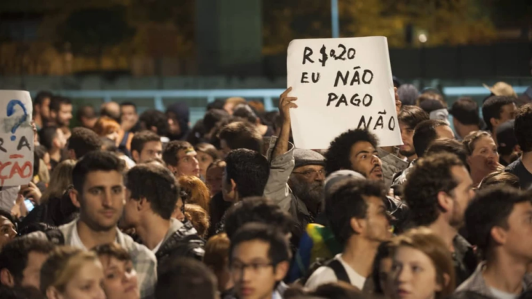
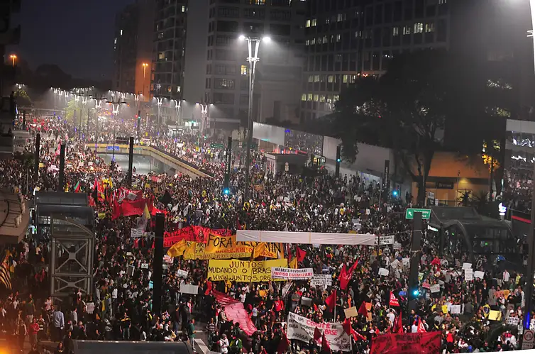
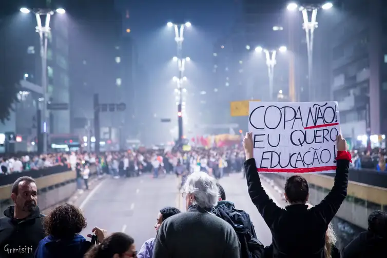
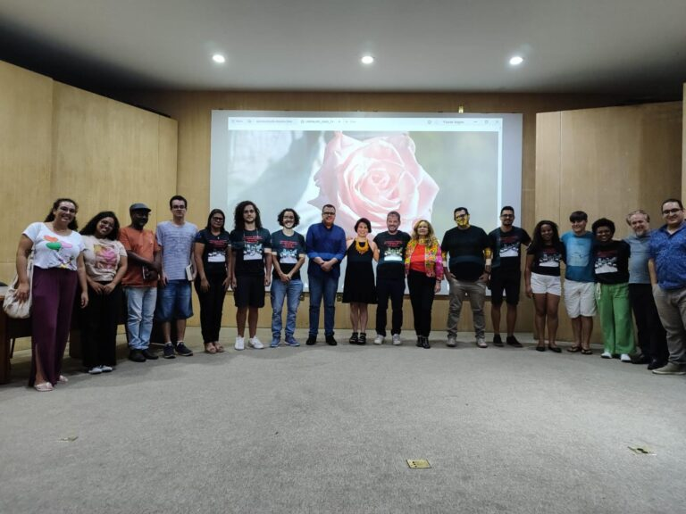

+++
title = "Protests that swept across Brazil in 2013 still shape today's political landscape"
subtitle = "UNIFAL-MG researchers show how the educational and political legacy of the 2013 Jornadas (the June 2013 protest wave) fueled collective action across the country"
date = "2024-10-30"
author = "Rafael Martins da Silva Afeto"
cover = "jornadas-2013.jpg"
coverCaption = "The June 2013 protest wave. (Photo: Fabio Rodrigues Pozzebom/Agência Brasil)"
tags = ["2013 Jornadas", "June Jornadas", "Projeto +Ciência", "UNIFAL-MG"]
categories = ["Social Sciences"]
keywords = ["June 2013 Jornadas", "Brazil 2013 protests", "political legacy of the Jornadas", "social movements in Brazil", "UNIFAL-MG research"]
description = "A UNIFAL-MG study examines how the 2013 Jornadas influenced Brazil's political and educational landscape, based on interviews with researchers and activists."
showFullContent = false
readingTime = false
hideComments = false
+++

Eleven years ago, Brazil was swept by nationwide protests in what became known as **“The 2013 Jornadas”** (literally “the 2013 Days,” the protest wave of June 2013). This historic moment in Brazil led researcher Luís Antonio Groppo, a professor at the Institute of Humanities and Letters (ICHL) at UNIFAL-MG, together with students Emanoely Sigiani, Nikole Mendonça de Almeida and Lucas Vieira, to carry out a study in 2023 to understand how the protests influenced Brazil's current political and educational landscape.

Titled [“Interpretations of the educational dimensions of the 2013 Jornadas: debates, meanings and legacies”](https://www.scielo.br/j/tes/a/JYLhhBjyHFwkCCMCNnZ8QBh/?format=html&lang=pt), the study is part of the research project “Educational Dimensions of the 2013 Jornadas: educational agendas, school experiences and the political formation of young protesters” at UNIFAL-MG's [Graduate Program in Education (PPGE)](https://www.unifal-mg.edu.br/ppge/). The research was based on interviews with 18 researchers in the field and with activists who took part in the protests at the time.

According to professor Luís Groppo, the study is one of the outputs of the second phase of the research. As the researcher explains, the interviews allowed participants to talk about the relationship between the Jornadas and the social and political changes that followed, as well as the educational aspects of the Jornadas.

For the study's authors, the main outcome of the research was the chance to prepare the team for the interviews of the third phase. In that stage, they interviewed 36 people who, in 2013, were young activists or  members of organizations that played an important role in the Jornadas.

“The interviews gave us relevant information about the predominantly, but not exclusively, youthful profile of 2013, as well as the differences between the initial demands, more focused on the right to the city, and the demands of the mass phase, which were plural and generic,” explains professor Luís Groppo.

## What were the 2013 Jornadas

The public transit fare hike in São Paulo was one of the issues behind the 2013 protests. (Photo: Divulgação/Agência Brasil)

The 2013 Jornadas were part of a series of protests that took place in the 2010s, marked by protesters occupying public spaces. This cycle of protests was driven by the 2007-2008 global economic crisis.

Here in Brazil, according to Luís Groppo, the protests against the public transit fare hike in the city of São Paulo in June, called by the São Paulo Free Fare Movement (Movimento Passe Livre, MPL-SP), were very important during the Jornadas. However, he and his fellow researchers also highlight the period leading up to June, which they call the latency.

”The latency is when movements and organizations such as the MPL in several states got organized, alongside the Popular World Cup Committees, denouncing the human rights violations caused by construction for the mega sporting events, the 2014 World Cup and the 2016 Olympics,” he explains. “In Porto Alegre, in the state of Rio Grande do Sul, we had already seen in March 2013 a successful movement against the bus fare hike organized by the Bloco de Lutas pelo Transporte Público de Porto Alegre (a public transit activist coalition),” he adds.

The researchers have preferred to refer to the Jornadas simply as the 2013 Jornadas protest cycle, without the “June.” “After June, the protests continue, and in places like Belo Horizonte and Rio de Janeiro they actually reach their peak,” says Luís Groppo. For the researchers, the height of the protests was marked by the presence of both progressive and conservative protesters on the streets. The movement stopped being essentially left-wing and gained participants with liberal and conservative ideologies.

The research showed that  the Jornadas had nationwide repercussions and spread to the interior of the country, leading to the set of collective actions with the greatest popular participation in Brazil's history. “At a certain point, the protests became even more massive and other demands, generally diffuse and ambiguous, were added,” notes Luís Groppo. He continues: “But after June, the trend was toward protests with once again progressive and well-defined agendas, such as defensive strikes around labor rights, the housing movement and protests against the World Cup and the Olympics,” he says.

## How interviewees see the 2013 Jornadas

The June 2013 protests drew crowds in several cities across the country. (Photo: Marcelo Camargo/Agência Brasil)

For the study's authors, the material collected in the interviews shows that the Jornadas were a complex event. “The most interesting part of this article is the relative convergence of the researchers' interpretations of the Jornadas, despite some differences in how they assess their legacies,” highlights Luís Groppo.

According to the researcher, the Jornadas are interpreted as a very complex historical phenomenon, with different overlapping historical layers, as well as social classes, agendas and political ideologies. “The Jornadas demonstrate the limits of representative democracy and of the pact inaugurated by Lulism, as well as the effects of the global economic crisis,” he points out.

The protests began as a progressive proposal that brought together autonomists and socialists critical of the PT (Workers' Party), mobilizing young people from working-class backgrounds. For Paulo Arantes, of the Department of Philosophy at the University of São Paulo, a professor and one of the interviewees, the Jornadas had the character of a Student Movement. “If I think about the influence of the MPL, if I think that it all started because of free fares for all citizens, but above all Catraca Livre (free turnstile) for students, and that this was the trigger, then I can say that it was organized high school students who made June happen,” he concludes.

For Ana Karina Brenner, a faculty member of the Graduate Program in Education at Rio de Janeiro State University and one of the interviewees, the complexity of the Jornadas also stems from the extensive media capture that took place during the protests. “There was media capture, in certain sectors of society, toward a reactionary interpretation that, in fact, helped build a reactionary right-wing movement,” she says. “It didn't exist in the country; in fact, nobody had the courage to say they were right-wing,” she observes, and continues: “Now we see lots of people saying they're right-wing,” she explains.

Another factor raised in some of the interviews was that the Jornadas brought about an intense process of political subjectivation, that is, the process through which individuals and groups form their political identities, beliefs and actions in response to social and political contexts.

## What are the consequences of the 2013 Jornadas?

The Free Fare Movement organized the demonstration held on June 20, 2013, in São Paulo. (Photo: Gianluca Ramalho Misiti/Flickr)

For the interviewees, the 2013 Jornadas had both positive and negative consequences. Among the positive ones is, for example, the visibility of new issues or issues that were previously barely visible. According to the authors, these issues are now seen not only in new social movements but also in public policies and election campaigns, such as public transit, including progress on the free-fare agenda, urban mobility and the right to the city.

“Today you have city governments that are fundamentally concerned with public transit and access to public transit, which is still very precarious. But people already talk about free fares much more comfortably, something that was unimaginable,” says Bárbara Lou Dias, of the Institute of Philosophy and Human Sciences at the Federal University of Pará, a professor, lawyer and one of the interviewees, reinforcing the idea that issues of public importance have carried on.

For Paulo Arantes, the Jornadas opened up a horizon of hope, since the legacies of this protest cycle are: the continuity of progressive demonstrations, a demonstration of the capacity for popular mobilization, recognition by new generations of the potential of youth mobilizations, broader possibilities for people's political participation, with a questioning of traditional ways of doing politics, the politicization of civil society, learning how to do politics in public space and how to use public policy tools concerning urban space, the proliferation and diversification of collectives, and the discovery that it is possible to bring about change through politics.

Another faculty member interviewed, Olívia Perez, professor of Political Science and Public Policy at the Federal University of Piauí (UFPI), explained that many young people were politically socialized in 2013 with this idea of anti-institutional politics, anti-system. “The formation of what we called new forms of organization, although there is something new about it, carries a lot of old ideas, namely this criticism of the hierarchy of traditional political institutions, such as political parties, and a message that all political institutions should be open, open to diversity, to the inclusion of women, Black people, young people, residents of the urban periphery, in an intersectional way,” she emphasizes.

Among the negative consequences, those mentioned in the interviews relate to the rise of the right and the far right in the years following the 2013 Jornadas. Participants also state that the way the PT handled the demands of the Jornadas after its 2014 electoral victory, and the way the political system protected itself against the reforms demanded by civil society, helped the far right rise in the country, as did the social and political transformations that favored the far right in the medium term. Some of the interviewees also point out that the mass phase of the Jornadas increased the visibility of the far right.

## Next steps for the research

Part of the team on the research project led by professor Luís Groppo. (Photo: Arquivo/Luís Groppo)

According to Luís Groppo, both this article and the study fall under basic research, aimed at building new knowledge that serves as a foundation for the field of research, namely social movements and youth.

“The results can provide relevant knowledge for different social actors and institutions interested in better understanding the trajectories of young activists and militants, as well as the impacts of the 2013 Jornadas on the social and political life of our country, especially those interested in rethinking and deepening democracy in our country,” he points out.

The fourth and final phase of the research includes new science communication and outreach activities, such as the publication of a book systematizing the main results of the research. “Following the 2013 Jornadas Memorial Seminar, held in March 2024 at our university, we also plan to create a website with the research data and outputs,” says Luís Groppo.

The study received funding from the [National Council for Scientific and Technological Development (CNPq)](https://www.gov.br/cnpq/pt-br), the [Minas Gerais State Research Foundation (FAPEMIG)](https://fapemig.br/), the [Coordination for the Improvement of Higher Education Personnel (CAPES)](https://pt.wikipedia.org/wiki/Coordena%C3%A7%C3%A3o_de_Aperfei%C3%A7oamento_de_Pessoal_de_N%C3%ADvel_Superior#:~:text=Coordena%C3%A7%C3%A3o%20de%20Aperfei%C3%A7oamento%20de%20Pessoal%20de%20N%C3%ADvel%20Superior%20(CAPES)%20%C3%A9,em%20todos%20os%20estados%20brasileiros.) and UNIFAL-MG.

*Text written under the supervision and guidance of Ana Carolina Araújo, journalist at the Federal University of Alfenas (UNIFAL-MG).*

Visit the [UNIFAL-MG page](https://jornal.unifal-mg.edu.br/impacto-das-jornadas-de-2013-na-politica-e-educacao-do-brasil/) to read the full text.
