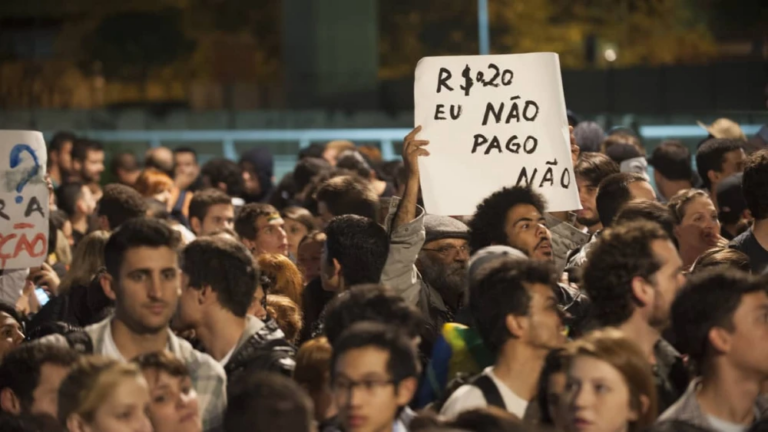
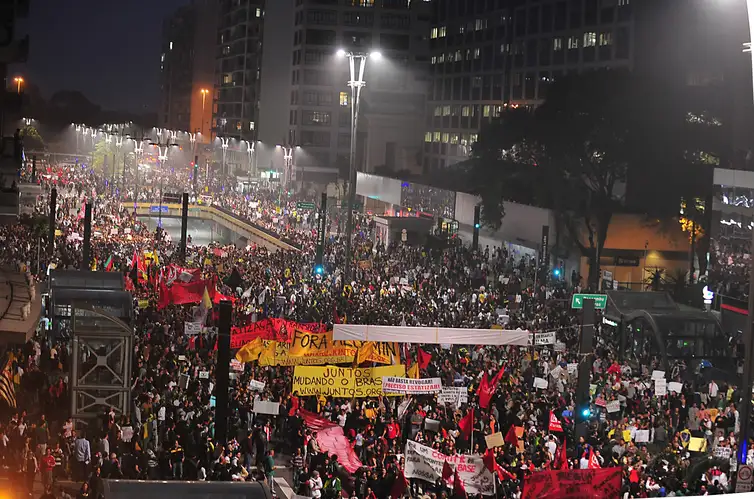
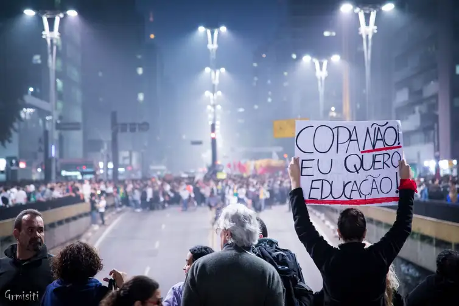
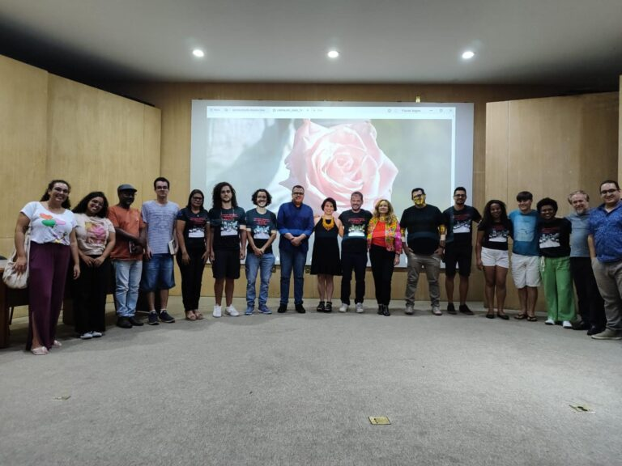

+++
title = "Las protestas que se extendieron por todo Brasil en 2013 todavía impactan la estructura política actual"
subtitle = "Investigadores de la UNIFAL-MG muestran cómo el legado educativo y político de las Jornadas de 2013 (la ola de protestas de junio de 2013) impulsó acciones colectivas en todo el país"
date = "2024-10-30"
author = "Rafael Martins da Silva Afeto"
cover = "jornadas-2013.jpg"
coverCaption = "Jornadas de protestas de junio de 2013. (Foto: Fabio Rodrigues Pozzebom/Agência Brasil)"
tags = ["Jornadas de 2013", "Jornadas de Junio", "Projeto +Ciência", "UNIFAL-MG"]
categories = ["Ciencias Sociales"]
keywords = ["jornadas de junio 2013", "protestas Brasil 2013", "legado político de las jornadas", "movimientos sociales Brasil", "investigación UNIFAL-MG"]
description = "Un estudio de la UNIFAL-MG analiza cómo las Jornadas de 2013 influyeron en la estructura política y educativa brasileña, a partir de entrevistas con investigadores y activistas."
showFullContent = false
readingTime = false
hideComments = false
+++

Hace 11 años se produjeron en Brasil protestas a escala nacional, en lo que se conoció como **“Las Jornadas de 2013”**. Este momento histórico brasileño hizo posible que, en 2023, el investigador Luís Antonio Groppo, profesor del Instituto de Ciencias Humanas y Letras (ICHL) de la UNIFAL-MG, junto con los estudiantes Emanoely Sigiani, Nikole Mendonça de Almeida y Lucas Vieira, realizara un estudio para entender cómo las protestas influyeron en la estructura política y educativa brasileña actual.

Titulado [“Interpretaciones de las dimensiones educativas de las Jornadas de 2013: debates, sentidos y legados”](https://www.scielo.br/j/tes/a/JYLhhBjyHFwkCCMCNnZ8QBh/?format=html&lang=pt), el estudio está vinculado a la investigación “Dimensiones Educativas de las Jornadas de 2013: agendas educativas, experiencias escolares y formación política de jóvenes en protesta” del [Programa de Posgrado en Educación (PPGE)](https://www.unifal-mg.edu.br/ppge/) de la UNIFAL-MG. La investigación se realizó mediante entrevistas con 18 investigadores del área y con activistas que participaron en las protestas de la época.

Según el profesor Luís Groppo, el estudio es uno de los productos relacionados con la segunda fase de la investigación. De acuerdo con el investigador, las entrevistas permitieron que los participantes hablaran sobre la relación entre las Jornadas y las transformaciones sociales y políticas posteriores, así como sobre los aspectos educativos de las Jornadas.

Para los autores del estudio, el principal resultado de la investigación fue la posibilidad de preparar al equipo para las entrevistas de la tercera fase. En esta etapa, se entrevistó a 36 personas que, en 2013, eran jóvenes activistas o  militantes de organizaciones que tuvieron una actuación importante en las Jornadas.

“Las entrevistas nos aportaron información relevante sobre el perfil juvenil mayoritario de 2013, aunque no exclusivo, así como sobre las diferencias entre las reivindicaciones iniciales, más centradas en el derecho a la ciudad, y las de la fase masiva, plurales y genéricas”, explica el profesor Luís Groppo.

## Qué fueron las Jornadas de 2013

El aumento de la tarifa del transporte público en São Paulo fue una de las reivindicaciones de las protestas de 2013. (Foto: Divulgação/Agência Brasil)

Las Jornadas de 2013 formaron parte de una serie de protestas realizadas en la década de 2010, caracterizadas por la ocupación de espacios públicos por parte de los manifestantes. Este ciclo de protestas fue impulsado por la crisis económica mundial de 2007-2008.

Aquí en Brasil, para Luís Groppo, durante las Jornadas fueron muy importantes las protestas contra el aumento de la tarifa del transporte público en la ciudad de São Paulo, en junio, convocadas por el Movimiento Pase Libre de São Paulo (Movimento Passe Livre, MPL-SP). Sin embargo, él y sus colegas investigadores también destacan el período previo a junio, al que llaman latencia.

”La latencia es cuando movimientos y organizaciones como el MPL de varios estados se organizaron, junto a los Comités Populares del Mundial, denunciando las violaciones de derechos humanos causadas por las obras para los megaeventos deportivos, el Mundial de 2014 y los Juegos Olímpicos de 2016”, explica. “En Porto Alegre, en Rio Grande do Sul, ya habíamos visto en marzo de 2013 un exitoso movimiento contra el aumento de las tarifas de autobús organizado por el Bloco de Lutas pelo Transporte Público de Porto Alegre (una coalición de activistas por el transporte público)”, complementa.

Los investigadores han preferido referirse a las Jornadas solo como el ciclo de protestas de las Jornadas de 2013, sin el “Junio”. “Después de junio, las protestas continúan y, en lugares como Belo Horizonte y Río de Janeiro, de hecho alcanzan su punto máximo”, afirma Luís Groppo. Para los investigadores, el auge de las protestas estuvo marcado por la presencia de manifestantes progresistas y conservadores en las calles. El movimiento dejó de ser esencialmente de izquierda y sumó actores con ideologías liberales y conservadoras.

La investigación mostró que  las Jornadas tuvieron repercusión nacional y llegaron al interior del país, dando lugar al conjunto de acciones colectivas con mayor adhesión popular en la historia de Brasil. “En un momento dado, las protestas se masificaron aún más y se sumaron otras demandas, en general difusas y ambiguas”, señala Luís Groppo. Y continúa: “Pero después de junio, la tendencia fue la de protestas con reivindicaciones nuevamente progresistas y bien definidas, como huelgas defensivas en torno a los derechos laborales, el movimiento por la vivienda y las protestas contra el Mundial y los Juegos Olímpicos”, afirma.

## La visión de los entrevistados sobre las Jornadas de 2013

Las protestas de junio de 2013 reunieron multitudes en varias ciudades del país. (Foto: Marcelo Camargo/Agência Brasil)

Para los autores del estudio, el material recopilado en las entrevistas indica que las Jornadas fueron un acontecimiento complejo. “La parte más interesante de este artículo es la relativa convergencia de las interpretaciones de las investigadoras y los investigadores sobre las Jornadas, a pesar de cierta diferencia en la evaluación de sus legados”, destaca Luís Groppo.

Según el investigador, las Jornadas se interpretan como un fenómeno histórico muy complejo, con diferentes capas históricas superpuestas, así como clases sociales, reivindicaciones e ideologías políticas. “Las Jornadas demuestran los límites de la democracia representativa y del pacto inaugurado por el lulismo, así como los efectos de la crisis económica mundial”, puntualiza.

Las protestas comenzaron como una propuesta progresista, que reunía a autonomistas y socialistas críticos del PT (Partido de los Trabajadores), movilizando a jóvenes de clases populares. Para Paulo Arantes, del Departamento de Filosofía de la Universidad de São Paulo, profesor y uno de los entrevistados, las Jornadas tienen un carácter de Movimiento Estudiantil. “Si pienso en la influencia del MPL, si pienso que todo empezó por la tarifa cero para todos los ciudadanos, pero sobre todo por la Catraca Livre (torniquete libre) para los estudiantes, y que eso fue el detonante, entonces puedo decir que fueron los estudiantes secundarios organizados los que hicieron Junio”, concluye.

Para Ana Karina Brenner, docente del Programa de Posgrado en Educación de la Universidad del Estado de Río de Janeiro y entrevistada, la complejidad de las Jornadas se debe también a la gran captura mediática que se produjo durante las protestas. “Hubo una captura de los medios, en determinados sectores de la sociedad, hacia una interpretación reaccionaria que, de hecho, ayudó a construir un movimiento de la derecha reaccionaria”, afirma. “No existía en el país; de hecho, nadie tenía el valor de decir que era de derecha”, observa, y continúa: “Ahora vemos que un montón de gente dice que es de derecha”, explica.

Otro factor señalado en algunas de las entrevistas fue que las Jornadas propiciaron un intenso proceso de subjetivación política, es decir, el proceso mediante el cual individuos y grupos forman sus identidades, creencias y acciones políticas en respuesta a los contextos sociales y políticos.

## ¿Cuáles son las consecuencias de las Jornadas de 2013?

El Movimiento Pase Libre organizó la manifestación realizada el 20 de junio de 2013 en la capital paulista. (Foto: Gianluca Ramalho Misiti/Flickr)

Para los entrevistados, las Jornadas de 2013 tuvieron consecuencias tanto positivas como negativas. Entre las positivas se encuentra, por ejemplo, la visibilidad de reivindicaciones nuevas o que antes eran poco visibles. Según los autores, estas reivindicaciones ya no aparecen solo en los nuevos movimientos sociales, sino también en políticas públicas o campañas electorales, como el transporte público, incluido el avance del tema de la tarifa cero, la movilidad urbana y el derecho a la ciudad.

“Hoy hay alcaldías que tienen una preocupación esencial por el transporte público y el acceso al transporte público, todavía muy precarizado. Pero ya se habla de gratuidad con más tranquilidad, algo que era inimaginable”, afirma Bárbara Lou Dias, del Instituto de Filosofía y Ciencias Humanas de la Universidad Federal de Pará, profesora, abogada y una de las entrevistadas, reforzando la idea de que hubo una continuidad de reivindicaciones de importancia pública.

Para Paulo Arantes, las Jornadas abrieron el horizonte a la esperanza, ya que los legados de este ciclo de protestas son: la continuidad de manifestaciones progresistas, la demostración de la capacidad de movilización popular, el reconocimiento por parte de las nuevas generaciones del potencial de las movilizaciones juveniles, la ampliación de las posibilidades de participación política de las personas, con el cuestionamiento de las formas tradicionales de hacer política, la politización de la sociedad civil, el aprendizaje del quehacer político en el espacio público y de los instrumentos de las políticas públicas sobre el espacio urbano, la proliferación y diversificación de los colectivos y el descubrimiento de que es posible hacer cambios a través de la política.

Otra docente entrevistada, Olívia Perez, profesora de Ciencia Política y de Políticas Públicas de la Universidad Federal de Piauí (UFPI), explicó que muchos jóvenes se socializaron políticamente en 2013 con esa idea de antipolítica institucional, antisistema. “La formación de lo que llamamos nuevas formas de organización, aunque tiene algo de novedad, carga mucho de ideas antiguas, que es esa crítica a la jerarquía de las instituciones políticas tradicionales, como los partidos políticos, y un mensaje de que todas las instituciones políticas deben ser abiertas, abiertas a la diversidad, a la entrada de mujeres, personas negras, jóvenes, habitantes de la periferia, de manera interseccional”, subraya.

Entre las consecuencias negativas, las mencionadas en las entrevistas están relacionadas con el ascenso de la derecha y la extrema derecha en los años posteriores a las Jornadas de 2013. Los participantes también afirman que la forma en que el PT manejó las demandas de las Jornadas tras su victoria electoral de 2014 y la manera en que el sistema político se protegió de las reformas exigidas por la sociedad civil contribuyeron al ascenso de la extrema derecha en el país, al igual que las transformaciones sociales y políticas que la favorecieron a mediano plazo. Algunos de los entrevistados también señalan que la fase masiva de las Jornadas amplió la visibilidad de la extrema derecha.

## Próximos pasos de la investigación

Parte del equipo del proyecto de investigación liderado por el profesor Luís Groppo. (Foto: Arquivo/Luís Groppo)

Según Luís Groppo, tanto este artículo como el estudio se enmarcan en la investigación básica, destinada a construir nuevos conocimientos que sirvan de fundamento dentro del campo de investigación, es decir, los movimientos sociales y las juventudes.

“Los resultados pueden servir como conocimientos relevantes para diferentes sujetos sociales e instituciones interesados en conocer mejor las trayectorias de jóvenes activistas y militantes, así como los impactos de las Jornadas de 2013 en la vida social y política de nuestro país, especialmente quienes están interesados en repensar y profundizar la democracia en nuestro país”, señala.

La cuarta fase de la investigación, que será la última, prevé nuevas actividades de comunicación y divulgación científica, como la publicación de un libro que sistematice los principales resultados de la investigación. “Después del Seminario Memorial de las Jornadas de 2013, realizado en marzo de 2024 en nuestra universidad, también está prevista la creación de una página web con los datos y productos de la investigación”, informa Luís Groppo.

El estudio recibió recursos para su desarrollo del [Consejo Nacional de Desarrollo Científico y Tecnológico (CNPq)](https://www.gov.br/cnpq/pt-br), de la [Fundación de Apoyo a la Investigación del Estado de Minas Gerais (FAPEMIG)](https://fapemig.br/), de la [Coordinación de Perfeccionamiento del Personal de Nivel Superior (CAPES)](https://pt.wikipedia.org/wiki/Coordena%C3%A7%C3%A3o_de_Aperfei%C3%A7oamento_de_Pessoal_de_N%C3%ADvel_Superior#:~:text=Coordena%C3%A7%C3%A3o%20de%20Aperfei%C3%A7oamento%20de%20Pessoal%20de%20N%C3%ADvel%20Superior%20(CAPES)%20%C3%A9,em%20todos%20os%20estados%20brasileiros.) y de la UNIFAL-MG.

*Texto elaborado bajo la supervisión y orientación de Ana Carolina Araújo, periodista de la Universidad Federal de Alfenas (UNIFAL-MG).*

Visita la [página de la UNIFAL-MG](https://jornal.unifal-mg.edu.br/impacto-das-jornadas-de-2013-na-politica-e-educacao-do-brasil/) para acceder al texto completo.
