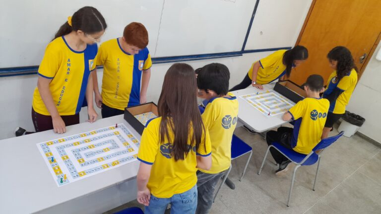
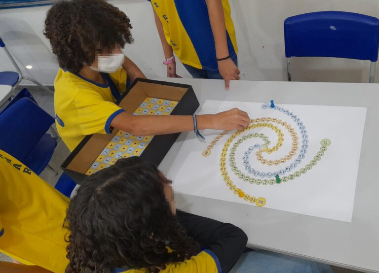

+++
title = "Board game for teaching Mathematics helps middle school children understand integers"
subtitle = "Tool proposed by research carried out at UNIFAL-MG also fosters social interaction among players"
date = "2024-11-19"
author = "Rafael Martins da Silva Afeto"
cover = "capa_materia_jogo_matematica.jpg"
tags = ["Mathematics Education", "Board Game", "Mathematics", "PROFMAT", "Projeto +Ciência", "UNIFAL-MG"]
categories = ["Education"]
keywords = ["math board game", "teaching integers", "Corrida Zahl", "middle school math education", "educational math games"]
description = "UNIFAL-MG research develops the game 'Corrida Zahl' to teach integers to 7th graders, promoting learning and social interaction."
showFullContent = false
readingTime = false
hideComments = false
+++

Mathematics is a core subject known for being difficult, especially in childhood. With that in mind, Luiz Gustavo Alves Silva, supervised during his [master's degree](https://www.unifal-mg.edu.br/profmat/) by professor Cátia Regina de Oliveira Quilles Queiroz, of the Department of Mathematics at UNIFAL-MG's [Institute of Exact Sciences (ICEx)](https://www.unifal-mg.edu.br/icex/), developed a game for teaching integers to children from the 7th grade of Ensino Fundamental (Brazil's elementary and middle school) onward.

Called “Corrida Zahl” (“Zahl Race”), the game was used with 7th graders at the Benedita Braga Cobra Municipal School (EMBBC) in the town of Borda da Mata, Minas Gerais, in 2023, and proved effective, above all, at fostering social interaction among the participants. “The game lived up to the expectation of being fun and interactive; the children helped each other with calculations, reviewing moves and strategies,” he shares. “Students who had more difficulty with Mathematics and logical reasoning gradually became more confident with the help of other students with stronger skills,” he adds.

“Students who had more difficulty with Mathematics and logical reasoning gradually became more confident with the help of other students with stronger skills,” says Luiz Gustavo Alves Silva, author of the research. (Photo: Arquivo/Luiz Gustavo Alves Silva)

According to the author of the research, the idea for the board game came about during the Covid-19 pandemic, when he spent much of the quarantine playing board games at home with his family. But its rules took shape during his trips between Pouso Alegre and Alfenas, both in Minas Gerais, as he made the journey every week to attend his master's classes. “It was ‘spare time’ that I tried to fill with ideas for the project,” he says.

Luiz Gustavo Alves Silva – author of the research carried out in the University's National Network Professional Master's in Mathematics (PROFMAT). (Photo: Personal Archive)

The name is related to the German word ”Zahl,” which, according to the author of the research, is a reference to the fact that the set of integers is represented by the symbol **ℤ**, which in turn comes from the German word ‘zahl,’ meaning ‘number.’

The game has two modes: addition/subtraction and multiplication/division. In both modes, two to four players compete to advance on separate boards. In the addition and subtraction game, participants start on square 0 and move toward square 100, using operation dice (a D12 to move forward and a D6 to move back) to add or subtract positive and negative numbers. Players receive fraction tokens when they land on golden squares, which let them roll a D20 to move forward faster.

In the multiplication and division game, the goal is to reach the center square of a board shaped like a Fibonacci spiral. Players roll two D10s and choose whether to multiply or divide the numbers rolled, moving according to the result. Like signs move the pawn forward; unlike signs move it back. The Wild Card, obtained on golden squares, forces the use of a special die that randomly decides the operation, requiring players to adapt their strategy.

According to Luiz Gustavo Silva, each mode has its own strategy for winning. “While in the addition and subtraction game the strategy lies almost entirely in the most effective way to use the Fraction Tokens, in the multiplication and division game the main strategy is choosing which operation to use. Which of the two operations will produce a larger move? Besides that, you have to consider whether the move is forward or backward,” he explains.

To test the tool, some 7th graders at EMBBC were selected based on their expressed interest and then took part in assessment sessions. “The first session was dedicated to a diagnostic assessment related to the content covered in the game; in the second, we played the addition and subtraction game; in the third, the multiplication and division game; in the fourth session, a second assessment on problem solving covering the content worked on during the games was given; and in the fifth and final session, we held a workshop on building dice using hands-on materials,” he details.

Although at first glance the rules may seem complex, Luiz Gustavo Silva says: “The children sampled in this research, in general, understood the game's rules and dynamics very easily.”

## Educational games as a way of teaching mathematics

“Corrida Zahl” refers to the fact that the set of integers is represented by the symbol ℤ, which in turn comes from the German word ‘zahl,’ meaning ‘number.’ (Photo: Arquivo/Luiz Gustavo Alves Silva)

For Luiz Gustavo Silva and his advisor, the design of “Corrida Zahl” and its use in schools for teaching integers in Mathematics is an important tool, since Mathematics has a reputation for being a difficult subject. In their view, the causes of this difficulty are multifactorial and form a broad field of inquiry in many academic studies. “Educational games are pointed out by studies and official documents such as the Base Nacional Comum Curricular (BNCC, Brazil's national curriculum framework) as alternatives for making Mathematics more appealing and accessible to children,” emphasizes Luiz Gustavo Silva.

The author stresses that educational games have been used as tools in teaching and learning Mathematics for many years, since formal Mathematics is based on rigorous axioms, definitions and propositions, concepts that can be far too abstract for elementary and middle school children. “Games would serve as ‘bridges’ in this process of bringing formal knowledge into a more playful language that is accessible to students in basic education,” he says.

The game produced during the research also fits into this picture, since, as Luiz Gustavo Silva points out, there was an interest in designing structures and materials that are easy to make so that any basic education teacher can reproduce the board by hand and use it with their students, making the tool easy to use.

## Future prospects for the research

Further analyses, tests and improvements to the tool are planned for the research, which may also be used with other audiences, as Luiz Gustavo Silva notes: “Besides the study of Integers, the game's rules are based on concepts from Combinatorics and Probability, which means the game could also be used with high school students and produce equally interesting results.”

The research was funded by the [Coordination for the Improvement of Higher Education Personnel (CAPES)](https://www.gov.br/capes/pt-br), with the [thesis defense](https://jornal.unifal-mg.edu.br/mestrado-profissional-em-matematica-realiza-primeira-defesa-tema-do-trabalho-apresentado-envolve-jogos-de-tabuleiro-no-ensino-de-numeros-inteiro/) held in the National Network Professional Master's in Mathematics (PROFMAT) at the end of 2023.

For more information, [access the thesis at this link](https://profmat-sbm.org.br/dissertacoes/?aluno=Luiz+Gustavo+Alves+Silva&titulo=&polo=)

Also check out UNIFAL-MG's [National Network Professional Master's in Mathematics (PROFMAT)](https://www.unifal-mg.edu.br/profmat/)

*Text written under the supervision and guidance of Ana Carolina Araújo, journalist at the Federal University of Alfenas (UNIFAL-MG).*

Visit the [UNIFAL-MG page](https://jornal.unifal-mg.edu.br/jogo-de-tabuleiro-para-o-ensino-da-matematica/) to read the full text.
