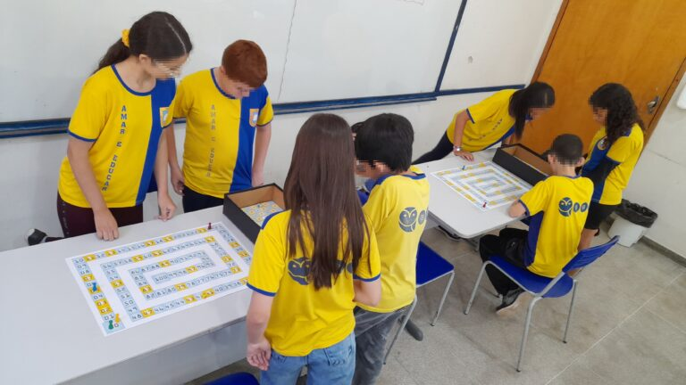
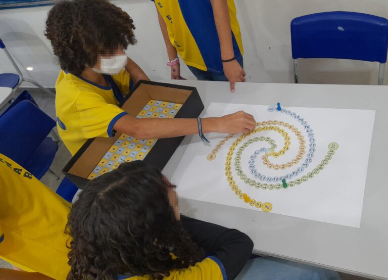

+++
title = "Un juego de mesa para la enseñanza de las Matemáticas ayuda a niños de educación básica a comprender los números enteros"
subtitle = "La herramienta, propuesta por una investigación desarrollada en la UNIFAL-MG, también promueve interacciones sociales entre los participantes"
date = "2024-11-19"
author = "Rafael Martins da Silva Afeto"
cover = "capa_materia_jogo_matematica.jpg"
tags = ["Educación Matemática", "Juego de Mesa", "Matemáticas", "PROFMAT", "Projeto +Ciência", "UNIFAL-MG"]
categories = ["Educación"]
keywords = ["juego de mesa matemáticas", "enseñanza de números enteros", "Corrida Zahl", "educación matemática educación básica", "juegos educativos matemáticas"]
description = "Una investigación de la UNIFAL-MG desarrolla el juego 'Corrida Zahl' para enseñar números enteros a niños de 7.º año, promoviendo el aprendizaje y la interacción social."
showFullContent = false
readingTime = false
hideComments = false
+++

Las Matemáticas son una asignatura básica conocida por ser difícil, sobre todo durante la infancia. Pensando en ello, Luiz Gustavo Alves Silva, orientado en su [maestría](https://www.unifal-mg.edu.br/profmat/) por la profesora Cátia Regina de Oliveira Quilles Queiroz, del Departamento de Matemáticas del [Instituto de Ciencias Exactas (ICEx)](https://www.unifal-mg.edu.br/icex/) de la UNIFAL-MG, desarrolló un juego para la enseñanza de los números enteros a niños a partir del 7.º año del Ensino Fundamental (la educación básica brasileña, de 6 a 14 años).

Llamado “Corrida Zahl” (“Carrera Zahl”), el juego se utilizó con niños de 7.º año de la Escuela Municipal Benedita Braga Cobra (EMBBC), en el municipio de Borda da Mata, Minas Gerais, en 2023, y resultó eficaz, principalmente, para generar interacciones sociales entre los participantes. “El juego cumplió con las expectativas de ser divertido e interactivo; los niños se ayudaban mutuamente a hacer cálculos, revisar jugadas y estrategias”, comparte. “Los alumnos con mayores dificultades en Matemáticas y razonamiento lógico, poco a poco, mostraban mayor desenvoltura con la mediación de otros alumnos con más habilidades”, completa.

“Los alumnos con mayores dificultades en Matemáticas y razonamiento lógico, poco a poco, mostraban mayor desenvoltura con la mediación de otros alumnos con más habilidades”, cuenta Luiz Gustavo Alves Silva, autor de la investigación. (Foto: Arquivo/Luiz Gustavo Alves Silva)

Según el autor de la investigación, el juego de mesa se ideó en plena pandemia de Covid-19, cuando pasaba buena parte de la cuarentena jugando juegos de mesa en casa con su familia. Pero sus reglas maduraron durante los viajes entre Pouso Alegre y Alfenas, ambas en Minas Gerais, ya que hacía el trayecto cada semana para asistir a las clases de la maestría. “Fue un ‘tiempo libre’ que intenté llenar con ideas para el proyecto”, afirma.

Luiz Gustavo Alves Silva – autor de la investigación desarrollada en la Maestría Profesional en Matemáticas en Red Nacional (PROFMAT) de la Universidad. (Foto: Archivo Personal)

El nombre está relacionado con la palabra alemana ”Zahl”, lo que, según el autor de la investigación, es una referencia al hecho de que el conjunto de los números enteros se representa con el símbolo **ℤ**, que a su vez proviene de la palabra alemana ‘zahl’, cuyo significado es ‘número’.

La dinámica del juego tiene dos modalidades: suma/resta y multiplicación/división. En ambas modalidades, de dos a cuatro jugadores compiten para avanzar en tableros distintos. En el juego de suma y resta, los participantes comienzan en la casilla 0 y avanzan hasta la casilla 100, usando dados de operaciones (un D12 para avanzar y un D6 para retroceder) para sumar o restar números positivos y negativos. Hay fichas de fracción que se reciben al caer en casillas doradas, que permiten lanzar un D20 para avanzar más rápido.

En el juego de multiplicación y división, el objetivo es llegar a la casilla central de un tablero con forma de espiral de Fibonacci. Los jugadores lanzan dos D10 y eligen multiplicar o dividir los números obtenidos, moviéndose según el resultado. Los signos iguales hacen avanzar el peón; los signos diferentes lo hacen retroceder. La Carta Comodín, obtenida en las casillas doradas, obliga a usar un dado especial que decide la operación al azar, lo que exige adaptar la estrategia.

Según Luiz Gustavo Silva, cada modalidad tiene su propia estrategia para ganar. “Mientras que en el juego de suma y resta la estrategia está casi únicamente en la forma más eficaz de usar las Fichas de Fracción, en el juego de multiplicación y división la mayor estrategia está en qué operación elegir. ¿Cuál de las dos operaciones generará un mayor desplazamiento? Además, hay que tener en cuenta si el movimiento es de avance o de retroceso”, explica.

Para probar la herramienta, se seleccionó a algunos alumnos de 7.º año de la EMBBC que manifestaron interés y que, a continuación, participaron en sesiones de evaluación. “La primera sesión se destinó a aplicar una evaluación diagnóstica relacionada con los contenidos abordados en el juego; en la segunda se aplicó el juego de suma y resta; en la tercera, el juego de multiplicación y división; en la cuarta se aplicó una segunda evaluación sobre resolución de problemas que abarcaba los contenidos trabajados durante los juegos; y en la quinta y última sesión se realizó un taller de construcción de dados con materiales manipulativos”, detalla.

Aunque a primera vista las reglas parezcan complejas, Luiz Gustavo Silva afirma: “Los niños de la muestra de esta investigación, en general, comprendieron con gran facilidad las reglas y la dinámica del juego.”

## Juegos educativos como medio para enseñar matemáticas

“Corrida Zahl” es una referencia al hecho de que el conjunto de los números enteros se representa con el símbolo ℤ, que a su vez proviene de la palabra alemana ‘zahl’, cuyo significado es ‘número’. (Foto: Arquivo/Luiz Gustavo Alves Silva)

Para Luiz Gustavo Silva y su orientadora, la concepción de “Corrida Zahl” y su uso en las escuelas para la enseñanza de los números enteros en Matemáticas constituye una herramienta importante, ya que las Matemáticas tienen fama de ser una materia difícil. Para ellos, las causas de esa dificultad son multifactoriales y constituyen un amplio campo de estudio en diversas investigaciones académicas. “Los juegos educativos son señalados por estudios y documentos oficiales, como la Base Nacional Comum Curricular (BNCC, el marco curricular nacional de Brasil), como alternativas para hacer las Matemáticas más atractivas y accesibles para los niños”, enfatiza Luiz Gustavo Silva.

El autor subraya que los juegos educativos en la enseñanza y el aprendizaje de las Matemáticas son herramientas utilizadas desde hace muchos años, dado que la Matemática formal se basa en axiomas, definiciones y proposiciones rigurosas, conceptos que pueden ser demasiado abstractos para los niños de educación básica. “Los juegos servirían como ‘puentes’ en este proceso de llevar un conocimiento formal a un lenguaje más lúdico y accesible para los alumnos de la educación básica”, cuenta.

En este escenario se inscribe también el juego producido durante la investigación, ya que, como destaca Luiz Gustavo Silva, hubo interés en elaborar estructuras y materiales fáciles de confeccionar para que cualquier docente de educación básica pueda reproducir el tablero de forma artesanal y utilizarlo con sus alumnos, facilitando el uso de la herramienta.

## Perspectivas futuras de la investigación

Se prevén otros análisis, pruebas y mejoras de la herramienta, que también podría utilizarse con otros públicos, como señala Luiz Gustavo Silva: “Además del estudio de los Números Enteros, las reglas del juego se basan en conceptos de Análisis Combinatorio y Probabilidad; es decir, el juego también podría trabajarse con alumnos de Educación Media y generar resultados igualmente interesantes.”

La investigación fue financiada por la [Coordinación de Perfeccionamiento de Personal de Nivel Superior (CAPES)](https://www.gov.br/capes/pt-br), con la [defensa de la tesis](https://jornal.unifal-mg.edu.br/mestrado-profissional-em-matematica-realiza-primeira-defesa-tema-do-trabalho-apresentado-envolve-jogos-de-tabuleiro-no-ensino-de-numeros-inteiro/) realizada en la Maestría Profesional en Matemáticas en Red Nacional (PROFMAT) a finales de 2023.

Para más información, [accede a la tesis en este enlace](https://profmat-sbm.org.br/dissertacoes/?aluno=Luiz+Gustavo+Alves+Silva&titulo=&polo=)

Conoce también la [Maestría Profesional en Matemáticas en Red Nacional (PROFMAT)](https://www.unifal-mg.edu.br/profmat/) de la UNIFAL-MG

*Texto elaborado bajo la supervisión y orientación de Ana Carolina Araújo, periodista de la Universidad Federal de Alfenas (UNIFAL-MG).*

Visita la [página de la UNIFAL-MG](https://jornal.unifal-mg.edu.br/jogo-de-tabuleiro-para-o-ensino-da-matematica/) para acceder al texto completo.
