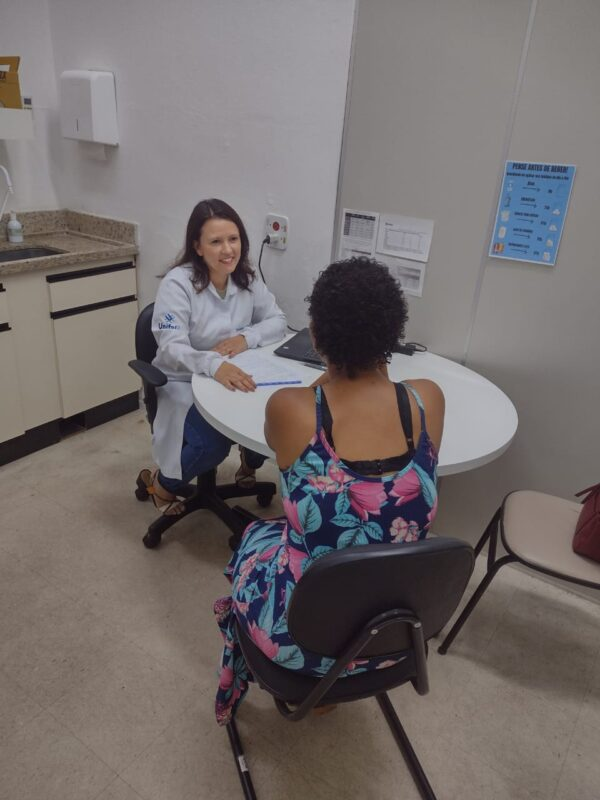
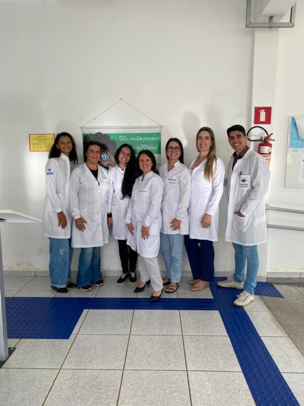

+++
title = "More than half of warfarin users in Alfenas lack basic information about their anticoagulant treatment"
subtitle = "Ongoing research in UNIFAL-MG's Graduate Program in Pharmaceutical Care shows that about 60% of patients are outside the ideal therapeutic range"
date = "2025-04-08"
author = "Rafael Martins da Silva Afeto"
cover = "varfarina1.jpg"
coverCaption = "Illustrative image. (Photo: Reproduction/Canva Education)"
tags = ["Anticoagulant", "Graduate Program in Pharmaceutical Care", "Warfarin", "Projeto +Ciência", "UNIFAL-MG"]
categories = ["Health"]
keywords = ["warfarin anticoagulant", "health literacy", "pharmaceutical care Alfenas", "safe use of warfarin", "pharmaceutical research UNIFAL"]
description = "UNIFAL-MG research reveals that more than 50% of warfarin users in Alfenas have low health literacy, compromising the safety of their treatment."
showFullContent = false
readingTime = false
hideComments = false
+++

A study carried out in UNIFAL-MG's [Graduate Program in Pharmaceutical Care (PPGASFAR)](https://www.unifal-mg.edu.br/ppgasfar/) presents relevant data on the profile of patients taking warfarin, a widely prescribed anticoagulant. The ongoing research indicates that more than 50% of the drug's users in Alfenas-MG have low health literacy — which can compromise the safety and effectiveness of the treatment.

The work is part of the master's research of student Camila Campos Dutra, supervised by professors Tiago Marques dos Reis and Leilismara Sousa Nogueira, both from the [School of Pharmaceutical Sciences (FCF)](https://www.unifal-mg.edu.br/fcf/), and included patients who use warfarin in the municipality of Alfenas, identified through the [Specialty Medical Clinic (CEM)](https://www.unifal-mg.edu.br/faculdadedemedicina/clinica-de-especialidades-medicas-2/), the [University Pharmacy (FarUni)](https://www.unifal-mg.edu.br/faruni/), the [Central Clinical Analysis Laboratory (LACEN)](https://www.unifal-mg.edu.br/lacen/), and the [Municipal Health Department](https://www.instagram.com/secretariasaudealfenas/).

The research methodology included individual pharmaceutical consultations with a patient-centered approach, collection of sociodemographic and clinical data, application of instruments to measure patients' literacy level and knowledge about warfarin use, as well as laboratory tests to assess the effectiveness and safety of the treatment.

A patient being seen at the University Pharmacy. (Photo: Archive/Research Group)

"About two-thirds of the participants did not show satisfactory knowledge about anticoagulation, and nearly 60% of them were outside the therapeutic target defined for anticoagulation, indicating a risk of bleeding and health complications for warfarin users," says the study's advisor, Tiago Reis, about the preliminary results.

According to the researcher, the study is pioneering in its approach, mainly for characterizing the patients who use warfarin in Alfenas and for analyzing how the pharmacist's role can benefit these patients' health. For him, the fact that a large share of participants show low health literacy and a lack of knowledge about coagulation reinforces the pharmacist's strategic role in managing drug-based anticoagulation.

"[The study] could generate social and economic impact for the municipality and the micro-region where it is located, in addition to contributing to the training of undergraduate and graduate students," he emphasizes. "It could also contribute to our Institution's visibility and to fulfilling its role in society as a public university," he adds.

As an outcome of the research, the group plans to establish a clinical outpatient service for warfarin patients at UNIFAL-MG's FarUni. For the researcher, the main product of the research is not only to evaluate the outcomes of this initiative, but also to make the service sustainable for the Institution and satisfactory to society.

For 2025, the group plans to hold training sessions for pharmacists, residents of the Multiprofessional Residency in Family Health, students, and professors, with the goal of preparing the team that will continue the service after the research project ends.

The team has also been promoting health education activities, such as discussion circles for users of the anticoagulant, led by students under the supervision of the project's faculty.

Some of the members of the research group. (Photo: Archive/Research Group)

In the new phase of the study, which now moves on to the doctoral level, the focus will be on deepening the analysis of the intervention's clinical and humanistic outcomes. The goal is to assess more broadly the benefits that qualified anticoagulation management, with the active presence of a pharmacist, can offer patients.

The study is linked to the [Pharmaceutical Care Research Group](https://www.unifal-mg.edu.br/gpaf/#:~:text=O%20Grupo%20de%20Pesquisa%20em,na%20%C3%A1rea%20do%20Cuidado%20Farmac%C3%AAutico.) and is part of a broader project, titled Projeto FLUIR: Management and care of patients on anticoagulation, coordinated by the research advisors. The research received funding from the [Minas Gerais State Research Foundation (FAPEMIG)](https://fapemig.br/).

Meet the researchers in the group:

    
    
    
    
    
    
    
    


*Text written under the supervision and guidance of Ana Carolina Araújo, journalist at the Federal University of Alfenas (UNIFAL-MG).*

Visit the [UNIFAL-MG page](https://jornal.unifal-mg.edu.br/116639-2/) to read the full text (in Portuguese).
