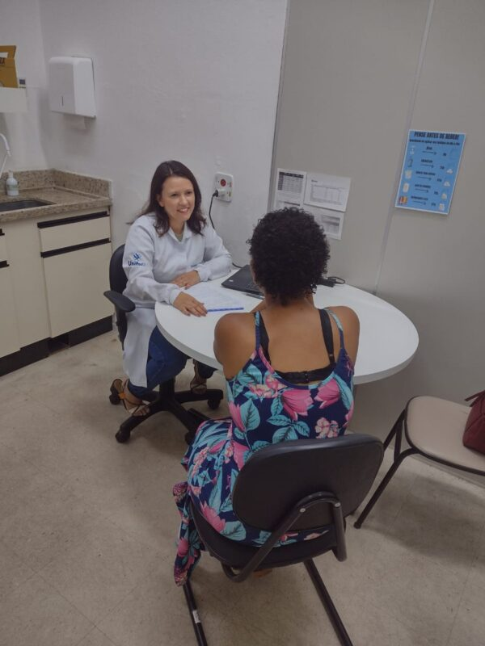
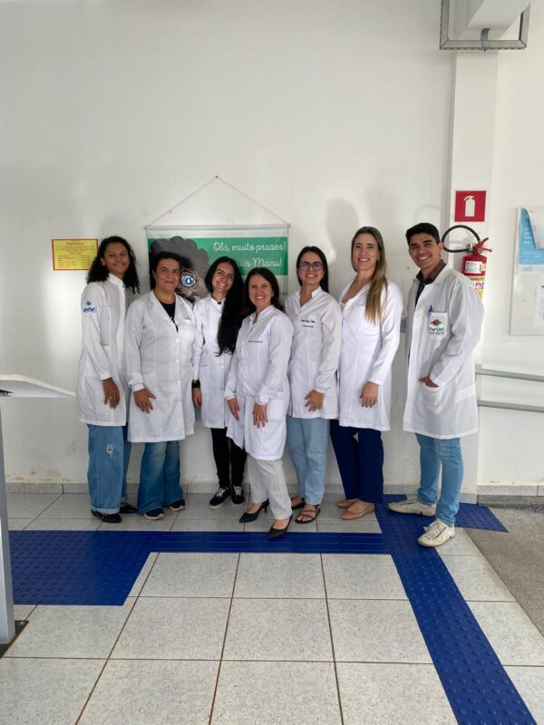

+++
title = "Más de la mitad de los usuarios del anticoagulante warfarina en Alfenas desconocen información básica sobre el tratamiento"
subtitle = "Investigación en curso en el Programa de Posgrado en Atención Farmacéutica de la UNIFAL-MG muestra que cerca del 60% de los pacientes están fuera del rango terapéutico ideal"
date = "2025-04-08"
author = "Rafael Martins da Silva Afeto"
cover = "varfarina1.jpg"
coverCaption = "Imagen ilustrativa. (Foto: Reproducción/Canva Education)"
tags = ["Anticoagulante", "Posgrado en Atención Farmacéutica", "Warfarina", "Projeto +Ciência", "UNIFAL-MG"]
categories = ["Salud"]
keywords = ["warfarina anticoagulante", "alfabetización en salud", "atención farmacéutica Alfenas", "uso seguro de warfarina", "investigación farmacéutica UNIFAL"]
description = "Investigación de la UNIFAL-MG revela que más del 50% de los usuarios de warfarina en Alfenas tienen baja alfabetización en salud, lo que compromete la seguridad del tratamiento."
showFullContent = false
readingTime = false
hideComments = false
+++

Un estudio realizado en el [Programa de Posgrado en Atención Farmacéutica (PPGASFAR)](https://www.unifal-mg.edu.br/ppgasfar/) de la UNIFAL-MG presenta datos relevantes sobre el perfil de los pacientes que usan warfarina, un anticoagulante ampliamente recetado. La investigación, en curso, indica que más del 50% de los usuarios del medicamento en Alfenas-MG tienen baja alfabetización en salud, lo que puede comprometer la seguridad y la eficacia del tratamiento.

El trabajo forma parte de la investigación de maestría de la estudiante Camila Campos Dutra, bajo la dirección de los profesores Tiago Marques dos Reis y Leilismara Sousa Nogueira, ambos de la [Facultad de Ciencias Farmacéuticas (FCF)](https://www.unifal-mg.edu.br/fcf/), y consideró a los pacientes que usan warfarina en el municipio de Alfenas, identificados a través de la [Clínica de Especialidades Médicas (CEM)](https://www.unifal-mg.edu.br/faculdadedemedicina/clinica-de-especialidades-medicas-2/), la [Farmacia Universitaria (FarUni)](https://www.unifal-mg.edu.br/faruni/), el [Laboratorio Central de Análisis Clínicos (LACEN)](https://www.unifal-mg.edu.br/lacen/) y la [Secretaría Municipal de Salud](https://www.instagram.com/secretariasaudealfenas/).

La metodología de la investigación incluyó consultas farmacéuticas individuales con un enfoque centrado en el paciente, recolección de datos sociodemográficos y clínicos, aplicación de instrumentos para medir el nivel de alfabetización y el conocimiento de los pacientes sobre el uso de la warfarina, así como pruebas de laboratorio para evaluar la efectividad y la seguridad del tratamiento.

Registro de la atención a un paciente en la Farmacia Universitaria. (Foto: Archivo/Grupo de Investigación)

"Cerca de dos tercios de los participantes no mostraron un conocimiento satisfactorio sobre anticoagulación y casi el 60% de ellos estaba fuera de la meta terapéutica definida para la anticoagulación, lo que indica riesgo de sangrado y de complicaciones para la salud de los usuarios de warfarina", detalla el director del trabajo, Tiago Reis, sobre los resultados preliminares.

Según el investigador, el estudio es pionero en su propuesta, principalmente por caracterizar a los pacientes que usan warfarina en Alfenas y por analizar cómo la actuación del farmacéutico puede beneficiar la salud de estos usuarios. Para él, el hecho de que buena parte de los participantes muestre baja alfabetización en salud y desconocimiento sobre la coagulación refuerza el papel estratégico del farmacéutico en la gestión de la anticoagulación con medicamentos.

"[El estudio] podrá generar un impacto social y económico en el municipio y en la microrregión donde se ubica, además de contribuir a la formación de estudiantes de grado y posgrado", enfatiza. "Esto también podrá contribuir a la visibilidad de nuestra Institución y al cumplimiento de su papel ante la sociedad como universidad pública", añade.

Como resultado de la investigación, el grupo planea consolidar un consultorio clínico para pacientes que usan warfarina en la FarUni de la UNIFAL-MG. Para el investigador, el principal producto de la investigación no es solo evaluar los resultados de esta iniciativa, sino también hacer que el servicio sea sostenible para la Institución y satisfactorio para la sociedad.

Para 2025, el grupo pretende realizar capacitaciones dirigidas a farmacéuticos, residentes de la Residencia Multiprofesional en Salud de la Familia, estudiantes y profesores, con el objetivo de preparar al equipo que dará continuidad al servicio tras la finalización del proyecto de investigación.

El equipo también ha venido promoviendo acciones de educación en salud, como círculos de conversación dirigidos a los usuarios del anticoagulante, conducidos por estudiantes con la supervisión de los docentes del proyecto.

Parte de los integrantes del grupo de investigación. (Foto: Archivo/Grupo de Investigación)

En la nueva fase del estudio, que ahora avanza al nivel de doctorado, el foco será profundizar el análisis de los resultados clínicos y humanísticos de la intervención. La propuesta es evaluar de forma más amplia los beneficios que la gestión calificada de la anticoagulación, con la presencia activa del farmacéutico, puede ofrecer a los pacientes.

El estudio está vinculado al [Grupo de Investigación en Atención Farmacéutica](https://www.unifal-mg.edu.br/gpaf/#:~:text=O%20Grupo%20de%20Pesquisa%20em,na%20%C3%A1rea%20do%20Cuidado%20Farmac%C3%AAutico.) y forma parte de un proyecto más amplio, titulado Projeto FLUIR: Manejo y cuidado del paciente en anticoagulación, coordinado por los directores de la investigación. Esta investigación recibió financiamiento de la [Fundación de Apoyo a la Investigación del Estado de Minas Gerais (FAPEMIG)](https://fapemig.br/).

Conoce a los investigadores del grupo:

    
    
    
    
    
    
    
    


*Texto elaborado bajo la supervisión y orientación de Ana Carolina Araújo, periodista de la Universidad Federal de Alfenas (UNIFAL-MG).*

Visita la [página de la UNIFAL-MG](https://jornal.unifal-mg.edu.br/116639-2/) para leer el texto completo (en portugués).
