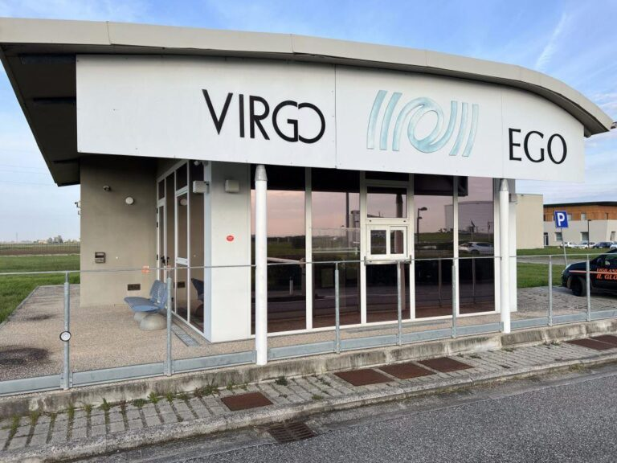
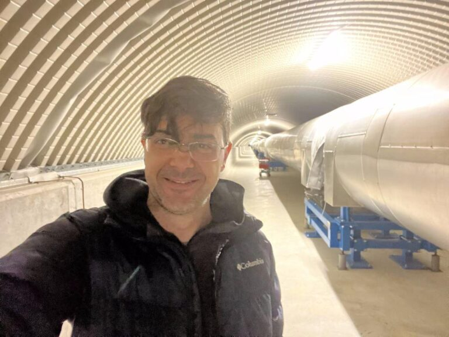

+++
title = "Study uses basic physics concepts to explain black holes and gravitational waves"
subtitle = "UNIFAL-MG research turns advanced concepts into accessible learning for students in the Exact Sciences"
date = "2025-07-08"
author = "Rafael Martins da Silva Afeto"
cover = "buraco-negro.jpg"
coverCaption = "Illustrative image. (Photo: Reproduction/Canva Education)"
tags = ["Astrophysics", "Black Hole", "Physics", "Gravitational Waves", "Graduate Program in Physics", "Projeto +Ciência", "UNIFAL-MG"]
categories = ["Physics"]
keywords = ["black holes basic physics", "gravitational waves", "accessible astrophysics", "physics education", "LIGO-Virgo research UNIFAL"]
description = "UNIFAL-MG researchers use basic physics equations to make the study of black holes and gravitational waves accessible to undergraduate students."
showFullContent = false
readingTime = false
hideComments = false
+++

Aiming to make the study of gravitational waves and black holes more accessible to students at the start of undergraduate programs in the Exact Sciences, researchers at UNIFAL-MG have developed methods that use basic physics concepts and equations to simplify the calculations and the understanding. The research was carried out in 2022 as an undergraduate research project by Physics student Nicolas Lerioni Nascimento, supervised by professor Rodrigo Cuzinatto of UNIFAL-MG's [Graduate Program in Physics](https://www.unifal-mg.edu.br/ppgf/).


  
  


For the supervisor, the main merit of the work is its teaching value. “It delivers sophisticated ideas and results in a way that is supposedly as simple as possible,” he highlights. The professor adds that the equations they set out made it possible to accurately estimate the physical parameters of binary black hole systems compared with the data collected by the international network of observatories and interferometers [LIGO-Virgo-Kagra (LVK)](https://gcn-nasa-gov.translate.goog/missions/lvk?_x_tr_sl=en&_x_tr_tl=pt&_x_tr_hl=pt&_x_tr_pto=tc).

According to him, the resulting paper addresses gravitational waves at a level of technical rigor suited to the training stage of students at the beginning of undergraduate programs in the Exact Sciences.

## Understanding gravity in a teachable way

To explain the concepts of Einstein's relativity, Rodrigo Cuzinatto used a visual analogy: “We can imagine space as a stretched bedsheet, very smooth and flat, held by four people, one at each corner. A fifth person places a bowling ball in the center of the sheet. This would create a dip in the sheet. If we tossed a tennis ball onto this sheet, it would follow a curved path because of the dip produced by the bowling ball.” In this metaphor, the bowling ball represents the Earth, and the tennis ball, the Moon.

According to him, Einstein suggested that gravitation is not an attractive force, as Newton held, but rather a curvature of space and time produced by the presence of matter. The professor explained what gravitational waves are by comparing the disturbances a massive body causes in the fabric of spacetime to a stone thrown into a lake. “We know what waves on the surface of a calm lake disturbed by a falling pebble are. In a similar way, gravitational waves are disturbances in the fabric of space and time, caused by the motion of large bodies, such as black holes,” he clarifies.

## Scientific contribution and opportunities for students

According to the professor, besides making scientific content more accessible, the work also covers how gravitational waves are detected and how collisions of black holes and neutron stars confirm the predictions of the theory of relativity.

Rodrigo Cuzinatto points out that the whole community benefits from the economic activity generated to sustain the laboratories and from the development of industries – precision and instrumentation engineering, including Brazilian ones. In addition, students can benefit from scholarships at the universities involved in the LVK collaboration.

Virgo is the name of the gravitational wave detector located near the city of Pisa, Italy. (Photo: Archive/Rodrigo Cuzinatto)

The authors hope to encourage more students interested in space physics to steer their academic choices toward the study of gravitational waves.

“UNIFAL-MG students are invited to work in the LVK collaboration through the VirgoBR group. There are opportunities for IC [undergraduate research] and master's degrees with us; there is also the possibility of a doctorate at the other institutions, with a period of experience abroad,” stresses professor Rodrigo Cuzinatto.

Rodrigo Cuzinatto is a member of the VirgoBR Observatory research group, linked to the international LIGO-Virgo-Kagra (LVK) collaboration. (Photo: Personal Archive)

The project was funded by the [National Council for Scientific and Technological Development (CNPq)](https://www.gov.br/cnpq/pt-br), through UNIFAL-MG's Institutional Undergraduate Research Scholarship Program (PIBIC). The work was selected by the [Office of the Dean of Research and Graduate Studies (PRPPG)](https://www.unifal-mg.edu.br/prppg/) to compete nationally for the CNPq award for best undergraduate research in 2022.

For more information about the VirgoBR group, [click here](https://www.instagram.com/virgobrasil/).

To read the full article, click [this link](https://www.scielo.br/j/rbef/a/Rk3M8xjnHxGZVjVZSjPbDkt/?lang=pt).

*Text written under the supervision and guidance of Ana Carolina Araújo, journalist at the Federal University of Alfenas (UNIFAL-MG).*

Visit the [UNIFAL-MG page](https://jornal.unifal-mg.edu.br/estudo-usa-conceitos-de-fisica-basica-para-explicar-buracos-negros-e-ondas-gravitacionais/) to read the full original text.
