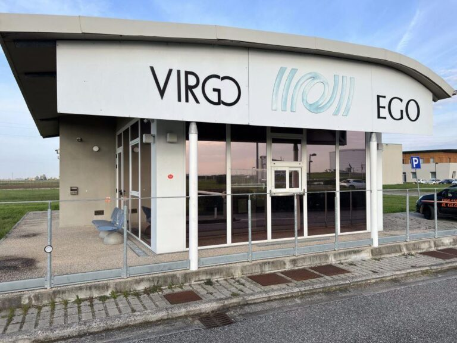
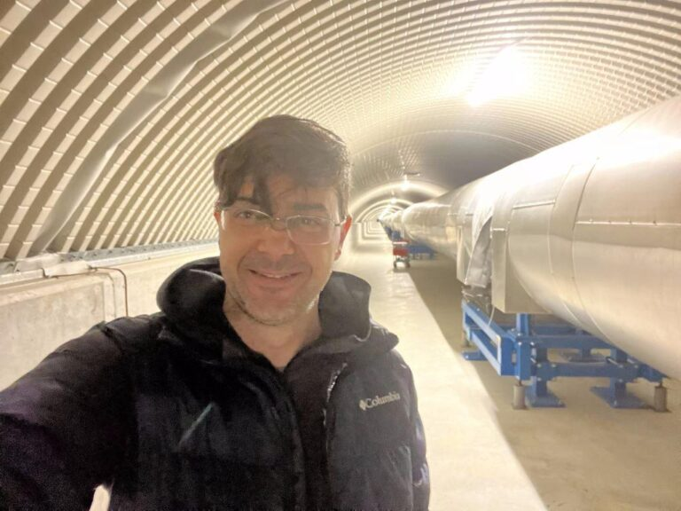

+++
title = "Estudio utiliza conceptos de física básica para explicar los agujeros negros y las ondas gravitacionales"
subtitle = "Investigación de la UNIFAL-MG transforma conceptos avanzados en aprendizaje accesible para estudiantes del área de Ciencias Exactas"
date = "2025-07-08"
author = "Rafael Martins da Silva Afeto"
cover = "buraco-negro.jpg"
coverCaption = "Imagen ilustrativa. (Foto: Reproducción/Canva Education)"
tags = ["Astrofísica", "Agujero Negro", "Física", "Ondas Gravitacionales", "Programa de Posgrado en Física", "Projeto +Ciência", "UNIFAL-MG"]
categories = ["Física"]
keywords = ["agujeros negros física básica", "ondas gravitacionales", "astrofísica accesible", "enseñanza de la física", "LIGO-Virgo investigación UNIFAL"]
description = "Investigadores de la UNIFAL-MG usan ecuaciones de física básica para hacer accesible a estudiantes de grado el estudio de los agujeros negros y las ondas gravitacionales."
showFullContent = false
readingTime = false
hideComments = false
+++

Con el propósito de que el estudio de las ondas gravitacionales y los agujeros negros sea más accesible para estudiantes de los primeros años de carreras del área de Ciencias Exactas, investigadores de la UNIFAL-MG desarrollaron métodos que utilizan conceptos y ecuaciones de física básica para facilitar los cálculos y la comprensión. La investigación se desarrolló en 2022 como un proyecto de iniciación científica del estudiante de Física Nicolas Lerioni Nascimento, dirigido por el profesor Rodrigo Cuzinatto, del [Programa de Posgrado en Física](https://www.unifal-mg.edu.br/ppgf/) de la UNIFAL-MG.


  
  


Para el director, el principal mérito del trabajo es su carácter pedagógico. “Entrega ideas y resultados sofisticados de una forma supuestamente tan simple como sea posible”, destaca. El profesor añade que las ecuaciones planteadas permitieron estimar con precisión los parámetros físicos de sistemas binarios de agujeros negros en comparación con los datos recopilados por la colaboración de la red internacional de observatorios e interferómetros [LIGO-Virgo-Kagra (LVK)](https://gcn-nasa-gov.translate.goog/missions/lvk?_x_tr_sl=en&_x_tr_tl=pt&_x_tr_hl=pt&_x_tr_pto=tc).

Según él, el artículo producido aborda el tema de las ondas gravitacionales con un nivel de exigencia técnica adecuado a la etapa de formación de estudiantes de Ciencias Exactas en los primeros años de la carrera.

## Entendiendo la gravedad de forma didáctica

Para explicar los conceptos de la relatividad de Einstein, Rodrigo Cuzinatto utilizó una analogía visual: “Podemos imaginar el espacio como una sábana estirada, bien lisa y plana, sostenida por cuatro personas, una en cada esquina. Una quinta persona coloca una bola de boliche en el centro de la sábana. Esto haría aparecer una hondonada en la sábana. Si lanzáramos una pelota de tenis sobre esa sábana, seguiría una trayectoria curva debido a la hondonada producida por la bola de boliche.” En esta metáfora, la bola de boliche representa a la Tierra, y la pelota de tenis, a la Luna.

Según él, Einstein sugirió que la gravitación no es una fuerza de atracción, como defendía Newton, sino una curvatura del espacio y del tiempo producida por la presencia de materia. El profesor explicó qué son las ondas gravitacionales comparando las perturbaciones que un cuerpo masivo provoca en el tejido del espacio-tiempo con una piedra arrojada a un lago. “Sabemos qué son las ondas en la superficie de un lago tranquilo perturbada por la caída de una piedrita. De forma parecida, las ondas gravitacionales son perturbaciones en el tejido del espacio y del tiempo, provocadas por el movimiento de grandes cuerpos, como los agujeros negros”, aclara.

## Contribución científica y oportunidades para estudiantes

Según el profesor, además de hacer más accesible el contenido científico, el trabajo también aborda cómo se detectan las ondas gravitacionales y cómo las colisiones de agujeros negros y estrellas de neutrones confirman las predicciones de la teoría de la relatividad.

Rodrigo Cuzinatto señala que toda la comunidad se beneficia de la actividad económica generada para sostener los laboratorios y del desarrollo de industrias – de precisión y de ingeniería de instrumentación, incluidas las brasileñas. Además, los estudiantes pueden beneficiarse con becas de estudio en las universidades que participan en la colaboración LVK.

Virgo es el nombre del detector de ondas gravitacionales ubicado en la ciudad de Pisa, en Italia. (Foto: Archivo/Rodrigo Cuzinatto)

Los autores esperan estimular a más estudiantes interesados en la física del espacio a orientar sus decisiones académicas hacia el estudio de las ondas gravitacionales.

“Los estudiantes de la UNIFAL-MG están invitados a trabajar en la colaboración LVK a través del grupo VirgoBR. Hay oportunidades de IC [iniciación científica] y maestría con nosotros; también existe la posibilidad de hacer el doctorado en las demás instituciones, con un período de experiencia en el exterior”, subraya el profesor Rodrigo Cuzinatto.

Rodrigo Cuzinatto integra el grupo de investigación del Observatorio VirgoBR, vinculado a la colaboración internacional LIGO-Virgo-Kagra (LVK). (Foto: Archivo Personal)

El proyecto fue financiado por el [Consejo Nacional de Desarrollo Científico y Tecnológico (CNPq)](https://www.gov.br/cnpq/pt-br), a través del Programa Institucional de Becas de Iniciación Científica (PIBIC) de la UNIFAL-MG. El trabajo fue seleccionado por la [Prorrectoría de Investigación y Posgrado (PRPPG)](https://www.unifal-mg.edu.br/prppg/) para competir a nivel nacional por el premio CNPq a la mejor iniciación científica de 2022.

Para más información sobre el grupo VirgoBR, [haz clic aquí](https://www.instagram.com/virgobrasil/).

Para leer el artículo completo, haz clic [en este enlace](https://www.scielo.br/j/rbef/a/Rk3M8xjnHxGZVjVZSjPbDkt/?lang=pt).

*Texto elaborado bajo la supervisión y orientación de Ana Carolina Araújo, periodista de la Universidad Federal de Alfenas (UNIFAL-MG).*

Visita la [página de la UNIFAL-MG](https://jornal.unifal-mg.edu.br/estudo-usa-conceitos-de-fisica-basica-para-explicar-buracos-negros-e-ondas-gravitacionais/) para acceder al texto original completo.
