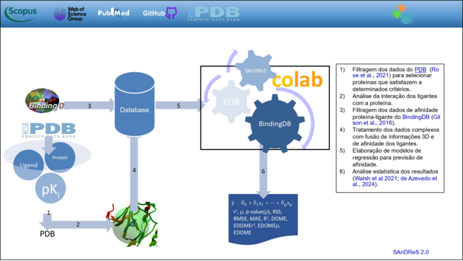

+++
title = "AI-powered computational tool streamlines the development of new drugs in studies of diseases such as cancer"
subtitle = "Using the SAnDReS platform, a team of UNIFAL-MG researchers identifies compounds with therapeutic potential faster and more accurately"
date = "2025-08-07"
author = "Rafael Martins da Silva Afeto"
cover = "docking-farmaco.jpg"
coverCaption = "Docking (lock and key): a drug (golden molecule) interacting with the binding site of a protein (spheres). (Image: Reproduction/SAnDRes)"
tags = ["Physics", "Artificial Intelligence", "PPGF", "SAnDReS", "Projeto +Ciência", "UNIFAL-MG"]
categories = ["Health", "Technology"]
keywords = ["artificial intelligence drugs", "SAnDReS molecular docking", "AI drug development", "CDK2 protein cancer", "machine learning drugs"]
description = "A UNIFAL-MG team uses the AI tool SAnDReS to model molecular interactions and speed up the identification of potential cancer drugs."
showFullContent = false
readingTime = false
hideComments = false
+++
A team of researchers affiliated with UNIFAL-MG's graduate programs in [Biotechnology](https://www.unifal-mg.edu.br/ppgbiotec/) and [Physics](https://www.unifal-mg.edu.br/ppgf/) used an AI tool called SAnDRes to model interactions between the CDK2 protein (a therapeutic target in the fight against cancer) and its inhibitors, in order to identify potential drugs faster and more accurately. The research was led by Walter Filgueira de Azevedo Júnior, a visiting professor in the Graduate Program in Physics (PPGF).

Walter Azevedo Júnior – visiting professor in the Graduate Program in Physics, who led the research. (Photo: Archive/Dicom)

According to the researcher, SAnDReS made it possible to simulate how inhibitors fit into the CDK2 protein and to predict which molecules have a real chance of working as drugs. “I solved the structure of this protein with inhibitors bound to it,” says Walter Azevedo Júnior. The researcher explains that this information captures a “frozen” moment of the protein and the drug, like a lock and key. “This data is tabulated and used as input to build a machine learning model,” he adds.

The methodology combines two technologies. First, docking simulation, a system capable of testing molecules that bind to this target protein. Second, machine learning, which improves the prediction by identifying patterns in the data. Together, these technologies produce a kind of score – the scoring function, which calculates how well the molecule fits.

The researcher points out that using this AI-driven computational approach makes it possible to filter out the molecules with the greatest chance of success. The technique also helps researchers focus experimental and clinical testing only on those that have already performed well in virtual simulations. “All experimental and clinical phases are optimized with the computational approach. Instead of clinically testing thousands of molecules, we test only those that passed the computational test,” he argues.

To get better results, the researcher stresses that AI models need to be trained specifically for each target protein. “In our experience, and that of other research groups developing scoring functions, it became clear that functions ‘trained’ for a specific protein work better than universal scoring functions, which try to determine the fit for all proteins,” he shares.

The schematic flowchart shows the steps followed in using big data to build models for predicting protein inhibition. (Image: Reproduction/SAnDRes)

According to Walter Azevedo Júnior, the goal of the research and of SAnDReS is to give the scientific community access to tools like these, especially groups focused on drug testing. SAnDReS is available as free software (open source), which allows it to be used at no cost in other research. His group is currently expanding the methods and variables used to add to the model.

The research project is funded by the [National Council for Scientific and Technological Development (CNPq)](https://www.gov.br/cnpq/pt-br).

The SAnDReS tool can be accessed [at this link](https://github.com/azevedolab/sandres). Its Wiki page also has a [short description](https://github.com/azevedolab/sandres/wiki/SAnDReS) of the program (in English).

For more information about Professor Walter Azevedo Júnior's research and projects, click here.

Read also: [International group of researchers led by UNIFAL-MG develops Artificial Intelligence program to predict drug action](https://jornal.unifal-mg.edu.br/grupo-internacional-de-pesquisadores-liderados-pela-unifal-mg-desenvolve-programa-de-inteligencia-artificial-para-previsao-de-acao-de-farmacos/) (in Portuguese)

*Text written under the supervision and guidance of Ana Carolina Araújo, journalist at the Federal University of Alfenas (UNIFAL-MG).*

Visit the [UNIFAL-MG page](https://jornal.unifal-mg.edu.br/plataforma-sandres-otimiza-a-identificacao-de-compostos-novos-farmacos/) to read the full text (in Portuguese).
