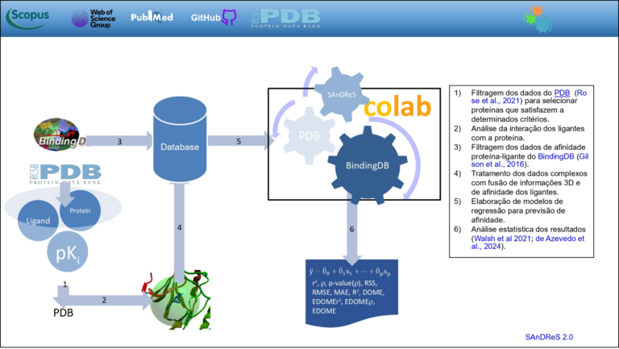

+++
title = "Herramienta computacional optimiza el desarrollo de nuevos fármacos en estudios de enfermedades como el cáncer con ayuda de la IA"
subtitle = "Con la plataforma SAnDReS, un equipo de investigadores de la UNIFAL-MG identifica compuestos con potencial terapéutico de forma más rápida y precisa"
date = "2025-08-07"
author = "Rafael Martins da Silva Afeto"
cover = "docking-farmaco.jpg"
coverCaption = "Docking (llave–cerradura): fármaco (molécula dorada) interactuando con el sitio de unión de una proteína (esferas). (Imagen: Reproducción/SAnDRes)"
tags = ["Física", "Inteligencia Artificial", "PPGF", "SAnDReS", "Projeto +Ciência", "UNIFAL-MG"]
categories = ["Salud", "Tecnología"]
keywords = ["inteligencia artificial fármacos", "SAnDReS docking molecular", "desarrollo de medicamentos IA", "proteína CDK2 cáncer", "aprendizaje automático fármacos"]
description = "Un equipo de la UNIFAL-MG usa la herramienta de IA SAnDReS para modelar interacciones moleculares y acelerar la identificación de posibles fármacos contra el cáncer."
showFullContent = false
readingTime = false
hideComments = false
+++
Un equipo de investigadores vinculado a los programas de posgrado en [Biotecnología](https://www.unifal-mg.edu.br/ppgbiotec/) y en [Física](https://www.unifal-mg.edu.br/ppgf/) de la UNIFAL-MG utilizó una herramienta de IA llamada SAnDRes para modelar las interacciones entre la proteína CDK2 (diana terapéutica en la lucha contra el cáncer) y sus inhibidores, con el fin de identificar posibles fármacos de forma más rápida y precisa. La investigación fue dirigida por el investigador Walter Filgueira de Azevedo Júnior, profesor visitante del Programa de Posgrado en Física (PPGF).

Walter Azevedo Júnior, profesor visitante del Programa de Posgrado en Física, fue quien dirigió la investigación. (Foto: Archivo/Dicom)

Según el investigador, mediante SAnDReS fue posible simular el acoplamiento de inhibidores en la proteína CDK2 y predecir qué moléculas tienen una posibilidad real de funcionar como fármacos. “Resolví la estructura de esta proteína con inhibidores acoplados a ella”, cuenta Walter Azevedo Júnior. El investigador afirma que esta información captura un instante “congelado” de la proteína y el fármaco, como una cerradura y su llave. “Estos datos se tabulan y se usan como entrada para crear un modelo de aprendizaje automático”, añade.

La metodología combina dos tecnologías. Primero, la simulación de docking, un sistema capaz de probar moléculas que se unen a esa proteína diana. Segundo, el aprendizaje automático, que mejora la predicción al identificar patrones en los datos. Juntas, estas tecnologías generan una especie de puntuación –la función de puntuación–, que calcula de qué forma encaja la molécula.

El investigador señala que el uso del enfoque computacional con inteligencia artificial permite filtrar las moléculas con mayor probabilidad de éxito. La técnica también ayuda a que los investigadores concentren las pruebas experimentales y clínicas solo en aquellas que ya mostraron un buen desempeño en las simulaciones virtuales. “Todas las fases experimentales y clínicas se optimizan con el uso del enfoque computacional. En lugar de probar clínicamente miles de moléculas, probamos solo las que pasaron la prueba computacional”, argumenta.

Para obtener mejores resultados, el investigador subraya que los modelos de IA deben entrenarse específicamente para cada proteína diana. “En nuestra experiencia y en la de otros grupos de investigación que desarrollan funciones de puntuación, quedó claro que las funciones ‘entrenadas’ para una proteína específica funcionan mejor que las funciones de puntuación universales, que intentan determinar el acoplamiento para todas las proteínas”, comparte.

El diagrama de flujo esquemático indica los pasos seguidos en el uso de big data para la construcción de modelos de predicción de inhibición de proteínas. (Imagen: Reproducción/SAnDRes)

Según Walter Azevedo Júnior, el objetivo de la investigación y de SAnDReS es que la comunidad científica tenga acceso a herramientas como estas, en especial los grupos dedicados a pruebas de fármacos. El programa SAnDReS se ofrece como software libre (open source), lo que permite su uso gratuito en otras investigaciones. Actualmente, su grupo está ampliando los métodos y las variables utilizadas para incorporarlos al modelo.

El proyecto de investigación está financiado por el [Consejo Nacional de Desarrollo Científico y Tecnológico (CNPq)](https://www.gov.br/cnpq/pt-br).

La herramienta SAnDReS puede consultarse [en este enlace](https://github.com/azevedolab/sandres). En la página Wiki también se encuentra una [descripción resumida](https://github.com/azevedolab/sandres/wiki/SAnDReS) del programa (en inglés).

Para más información sobre las investigaciones y proyectos del profesor Walter Azevedo Júnior, haga clic aquí.

Lea también: [Grupo internacional de investigadores liderado por la UNIFAL-MG desarrolla programa de Inteligencia Artificial para predecir la acción de fármacos](https://jornal.unifal-mg.edu.br/grupo-internacional-de-pesquisadores-liderados-pela-unifal-mg-desenvolve-programa-de-inteligencia-artificial-para-previsao-de-acao-de-farmacos/) (en portugués)

*Texto elaborado bajo la supervisión y orientación de Ana Carolina Araújo, periodista de la Universidad Federal de Alfenas (UNIFAL-MG).*

Visite la [página de la UNIFAL-MG](https://jornal.unifal-mg.edu.br/plataforma-sandres-otimiza-a-identificacao-de-compostos-novos-farmacos/) para acceder al texto completo (en portugués).
