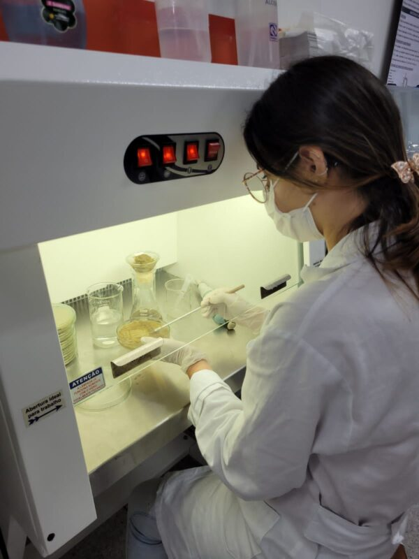
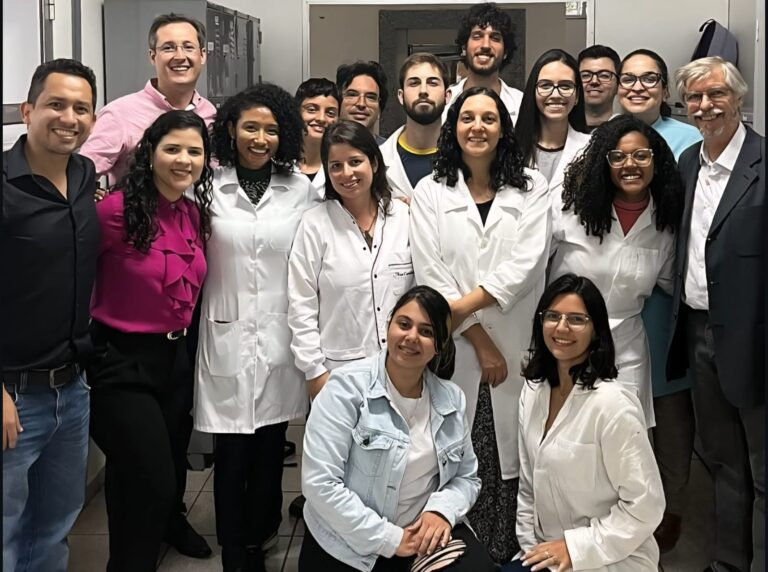

+++
title = "Research group develops groundbreaking Brazilian technology that promises to make the 'good sugar' widely available"
subtitle = "Researchers from UNIFAL-MG and partner institutions create an innovative method to produce fructooligosaccharides (FOS) from sugarcane sucrose, cutting costs and reducing dependence on imports"
date = "2025-09-03"
author = "Rafael Martins da Silva Afeto"
cover = "capa_pesquisa_acucar-do-bem.jpg"
coverCaption = "3D-printed PLA [polylactic acid, a type of biodegradable plastic] used to immobilize fungal cells. (Photo: Archive/Research group)"
tags = ["FAPEMIG", "Good sugar", "PPGEQ", "Biotechnology", "CNPq", "Projeto +Ciência", "UNIFAL-MG"]
categories = ["Biotechnology"]
keywords = ["fructooligosaccharides FOS", "good sugar", "Brazilian FOS production", "sugarcane prebiotics", "biotechnology chemical engineering UNIFAL"]
description = "UNIFAL-MG researchers develop groundbreaking technology to produce fructooligosaccharides (FOS) in Brazil, using sugarcane as the raw material."
showFullContent = false
readingTime = false
hideComments = false
+++

A UNIFAL-MG research group, linked to the [Graduate Program in Chemical Engineering](https://www.unifal-mg.edu.br/ppgeq/) and working with partner institutions, is close to changing the landscape of fructooligosaccharide (FOS) production, the so-called 'good sugar'. Currently 100% imported, this special type of sugar may soon be produced in Brazil at prices more affordable for the whole population.

According to the researchers, FOS are sugars with functional properties: they are low in calories, suitable for people with diabetes, do not cause tooth decay, and act as prebiotics, serving as food for the beneficial bacteria in the human gut. In addition, studies point to positive effects in preventing colon cancer and in treating conditions such as anemia and hypertension.

"We want to bring to market a low-cost, competitive sugar that can mainly serve people with metabolic diseases such as diabetes," explains professor Rafael Firmani Perna, leader of the research group and coordinator of UNIFAL-MG's [Laboratory of Enzyme Technology and Bioprocesses](https://www.unifal-mg.edu.br/ppgbiotec/lab-de-tecnologia-enzimatica/).

Rafael Firmani Perna – UNIFAL-MG professor and leader of the research group. (Photo: Personal Archive)

According to the authors, despite its benefits, Brazil does not produce FOS. All national consumption depends on imports, which makes the product more expensive and limits its presence on the market. The current price is around US$ 165 per kilogram, out of reach for most of the population. The global picture, however, shows a growing market: in 2024, the sector was worth US$ 3.85 billion and is expected to reach US$ 6.25 billion by 2029, with an annual growth rate of 10.19%.

## The Brazilian innovation

The group bet on two fronts to make national production viable: using sucrose from sugarcane as the raw material – abundant and cheap in the country – and adopting a continuous process with packed-bed reactors (PBR).

To convert sucrose into FOS, a specific biocatalyst was needed: an enzyme produced by the fungus Aspergillus oryzae IPT-301. "This fungus is the only one capable of producing the right enzyme to potentially transform sucrose into FOS," says professor Rafael Perna.

Researcher cultivating the fungus. (Photo: Archive/Research group)

The next challenge was to make the cells more resilient during production. The solution came from bioprocess engineering: the scientists used polylactic acid (PLA), a biodegradable and recyclable plastic, to create 3D structures that immobilize the microorganisms. This increased the operational stability of the cells and ensured more efficient and sustainable production of the prebiotic sugar. According to the professor, the group has already achieved a productivity of approximately 160 g/L.h of FOS at laboratory scale, a promising result that was validated by technical and economic feasibility studies carried out by the research group.


  
  


## Next steps

The group has already achieved FOS production in solution and is now moving forward with the recovery and purification stages of the bioproduct, aiming to serve both the food and pharmaceutical industries. The expectation is that the Brazilian 'good sugar' will be available on the market within eight years. "The team is fully focused on developing the FOS recovery and purification stages, which are fundamental to the process and account for up to 70% of the production costs of the prebiotic sugar," the researcher states.

And the research shouldn't stop there. According to Rafael Perna, the same technology could be applied to produce other high-value compounds, such as sugar esters, used in cosmetics for dermatological treatments.

## National and international collaborations and funding

The research network includes national and international partnerships, with laboratories at the Federal University of Tocantins (UFT, Palmas-TO campus), São Paulo State University (UNESP, São Vicente-SP campus), the Institute for Technological Research of São Paulo (IPT, São Paulo-SP), and the Centre of Biological Engineering at the University of Minho, in Portugal.

Some of the researchers who are part of the collaboration network. (Photo: Archive/Research group)

In recent years, the work has been supported by eight projects funded by the [Minas Gerais State Research Foundation – FAPEMIG](https://fapemig.br/) (Grants APQ-00793-24, BPD-00030-22, APQ-00085-21, and APQ-02131-14) and by the Federal Government's [National Council for Scientific and Technological Development (CNPq)](https://www.gov.br/cnpq/pt-br) (Grants 305029/2024-0, 408302/2023-2, 404912/2021-4, and 421540/2018-4).

For more information about the project, visit the Instagram page of UNIFAL-MG's Laboratory of Enzyme Technology and Bioprocesses [at this link](https://www.instagram.com/labtech.teb/?igsh=MWt3cGwzcWJtOG5pbw%3D%3D).

Also check out information about the partner laboratories: [Micobio-Nanotec Laboratory – UNESP/São Vicente-SP campus](https://www.instagram.com/micobionanotec/?igsh=aGtkaTk5cjI4eDVp) and [Scientific Instrumentation Laboratory – UFT/Palmas-TO campus](https://www.instagram.com/labic.uft/?igsh=YXk5ZjMwejJqOWtz)

*Text written under the supervision and guidance of Ana Carolina Araújo, journalist at the Federal University of Alfenas (UNIFAL-MG).*

Visit the [UNIFAL-MG page](https://jornal.unifal-mg.edu.br/grupo-de-pesquisa-desenvolve-tecnologia-nacional-inedita-que-promete-popularizar-o-acucar-do-bem/) to read the full text (in Portuguese).
