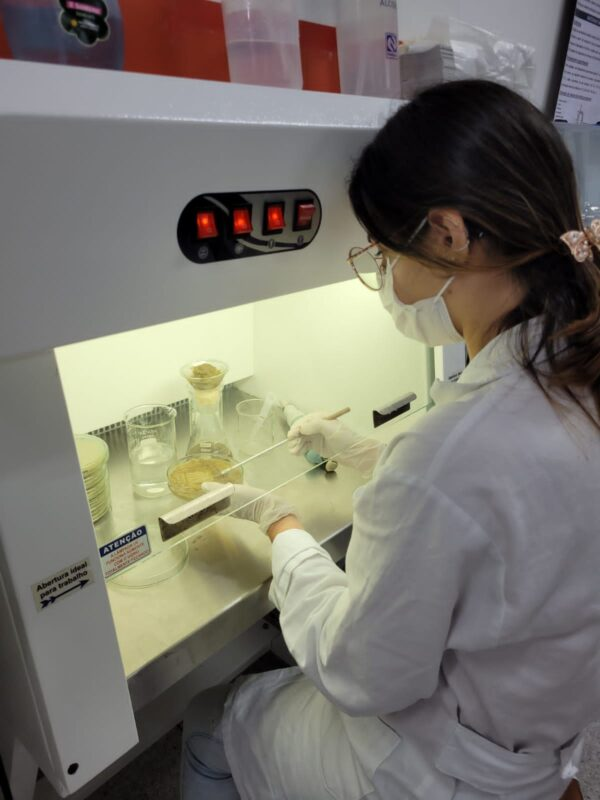
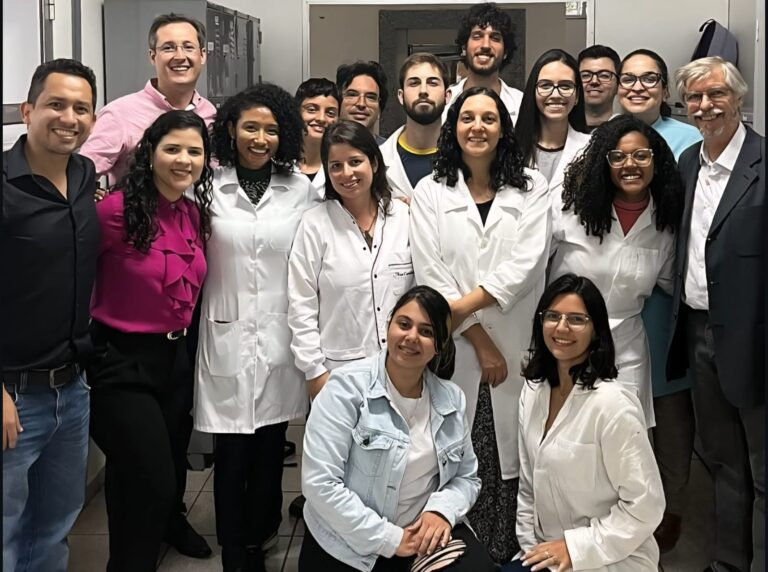

+++
title = "Grupo de investigación desarrolla una tecnología brasileña inédita que promete popularizar el 'azúcar del bien'"
subtitle = "Investigadores de la UNIFAL-MG y de instituciones asociadas crean un método innovador para producir fructooligosacáridos (FOS) a partir de la sacarosa de la caña de azúcar, lo que reduce costos y disminuye la dependencia de las importaciones"
date = "2025-09-03"
author = "Rafael Martins da Silva Afeto"
cover = "capa_pesquisa_acucar-do-bem.jpg"
coverCaption = "PLA [ácido poliláctico, un tipo de plástico biodegradable] impreso en 3D para la inmovilización de las células fúngicas. (Foto: Archivo/Grupo de investigación)"
tags = ["FAPEMIG", "Azúcar del bien", "PPGEQ", "Biotecnología", "CNPq", "Projeto +Ciência", "UNIFAL-MG"]
categories = ["Biotecnología"]
keywords = ["fructooligosacáridos FOS", "azúcar del bien", "producción nacional de FOS", "prebióticos de caña de azúcar", "biotecnología ingeniería química UNIFAL"]
description = "Investigadores de la UNIFAL-MG desarrollan una tecnología inédita para producir fructooligosacáridos (FOS) en Brasil, usando la caña de azúcar como materia prima."
showFullContent = false
readingTime = false
hideComments = false
+++

Un grupo de investigación de la UNIFAL-MG, vinculado al [Programa de Posgrado en Ingeniería Química](https://www.unifal-mg.edu.br/ppgeq/) y con la colaboración de instituciones asociadas, está cerca de cambiar el panorama de la producción de fructooligosacáridos (FOS), conocidos como el 'azúcar del bien'. Hoy 100% importado, este tipo especial de azúcar podría producirse pronto en Brasil a precios más accesibles para toda la población.

Según los investigadores, los FOS son azúcares con propiedades funcionales: tienen bajo valor calórico, son aptos para diabéticos, no causan caries y actúan como prebióticos, sirviendo de alimento para las bacterias beneficiosas del intestino humano. Además, diversos estudios señalan efectos positivos en la prevención del cáncer de colon y en el tratamiento de enfermedades como la anemia y la hipertensión.

"Queremos poner en el mercado un azúcar de bajo costo, competitivo y que pueda atender principalmente a personas con enfermedades metabólicas, como la diabetes", explica el profesor Rafael Firmani Perna, líder del grupo de investigación y coordinador del [Laboratorio de Tecnología Enzimática y Bioprocesos](https://www.unifal-mg.edu.br/ppgbiotec/lab-de-tecnologia-enzimatica/) de la UNIFAL-MG.

Rafael Firmani Perna – profesor de la UNIFAL-MG y líder del grupo de investigación. (Foto: Archivo Personal)

Para los autores, a pesar de sus beneficios, Brasil no produce FOS. Todo el consumo nacional depende de importaciones, lo que encarece el producto y restringe su presencia en el mercado. El precio actual es de cerca de US$ 165 por kilo, inaccesible para la mayoría de la población. El panorama global, sin embargo, muestra un mercado en expansión: en 2024, el sector movió US$ 3.850 millones y se espera que alcance los US$ 6.250 millones para 2029, con una tasa de crecimiento anual del 10,19%.

## La innovación brasileña

El grupo apostó por dos frentes para hacer viable la producción nacional: usar la sacarosa proveniente de la caña de azúcar como materia prima –abundante y barata en el país– y adoptar un proceso continuo con reactores de lecho fijo (PBR).

Para convertir la sacarosa en FOS, fue necesario un biocatalizador específico: una enzima producida por el hongo Aspergillus oryzae IPT-301. "Este hongo es el único capaz de producir la enzima adecuada para transformar, potencialmente, la sacarosa en FOS", detalla el profesor Rafael Perna.

Investigadora cultivando el hongo. (Foto: Archivo/Grupo de investigación)

El siguiente desafío fue hacer que las células fueran más resistentes en el proceso productivo. La solución vino de la ingeniería de bioprocesos: los científicos usaron ácido poliláctico (PLA), un plástico biodegradable y reciclable, para crear estructuras 3D que inmovilizan a los microorganismos. Esto aumentó la estabilidad operativa de las células y garantizó una producción más eficiente y sostenible del azúcar prebiótico. Según el profesor, el grupo ya alcanzó una producción de aproximadamente 160 g/L.h de FOS a escala de laboratorio, un resultado prometedor que fue validado por estudios de viabilidad técnico-económica realizados por el grupo de investigación.


  
  


## Próximos pasos

El grupo ya logró producir FOS en solución y ahora avanza en las etapas de recuperación y purificación del bioproducto, con el objetivo de atender tanto a la industria alimentaria como a la farmacéutica. Se espera que el 'azúcar del bien' nacional esté disponible en el mercado en un plazo de hasta ocho años. "El equipo está totalmente enfocado en el desarrollo de las etapas de recuperación y purificación del FOS, que son fundamentales para el proceso y representan hasta el 70% de los costos de producción del azúcar prebiótico", afirma el investigador.

Y la investigación no se detendrá ahí. Según Rafael Perna, la misma tecnología podrá aplicarse en la producción de otros compuestos de alto valor agregado, como los ésteres de azúcar, usados en cosméticos para tratamientos dermatológicos.

## Colaboraciones nacionales e internacionales y apoyo financiero

La red de investigación cuenta con alianzas nacionales e internacionales, que incluyen laboratorios de la Universidad Federal de Tocantins (UFT, Campus Palmas-TO), de la Universidad Estatal Paulista (UNESP, Campus São Vicente-SP), del Instituto de Investigaciones Tecnológicas de São Paulo (IPT, São Paulo-SP) y del Centro de Ingeniería Biológica de la Universidad do Minho, en Portugal.

Parte de los investigadores que integran la red de colaboración. (Foto: Archivo/Grupo de investigación)

En los últimos años, el trabajo recibió el apoyo de ocho proyectos financiados por la [Fundación de Apoyo a la Investigación del Estado de Minas Gerais – FAPEMIG](https://fapemig.br/) (Procesos APQ-00793-24, BPD-00030-22, APQ-00085-21 y APQ-02131-14) y por el [Consejo Nacional de Desarrollo Científico y Tecnológico (CNPq)](https://www.gov.br/cnpq/pt-br) del Gobierno Federal (Procesos 305029/2024-0, 408302/2023-2, 404912/2021-4 y 421540/2018-4).

Para más información sobre el proyecto, visita el Instagram del Laboratorio de Tecnología Enzimática y Bioprocesos de la UNIFAL-MG [en este enlace](https://www.instagram.com/labtech.teb/?igsh=MWt3cGwzcWJtOG5pbw%3D%3D).

Consulta también información sobre los laboratorios asociados: [Laboratorio Micobio-Nanotec – UNESP/Campus São Vicente-SP](https://www.instagram.com/micobionanotec/?igsh=aGtkaTk5cjI4eDVp) y [Laboratorio de Instrumentación Científica – UFT/Campus Palmas-TO](https://www.instagram.com/labic.uft/?igsh=YXk5ZjMwejJqOWtz)

*Texto elaborado bajo la supervisión y orientación de Ana Carolina Araújo, periodista de la Universidad Federal de Alfenas (UNIFAL-MG).*

Visita la [página de la UNIFAL-MG](https://jornal.unifal-mg.edu.br/grupo-de-pesquisa-desenvolve-tecnologia-nacional-inedita-que-promete-popularizar-o-acucar-do-bem/) para leer el texto completo (en portugués).
