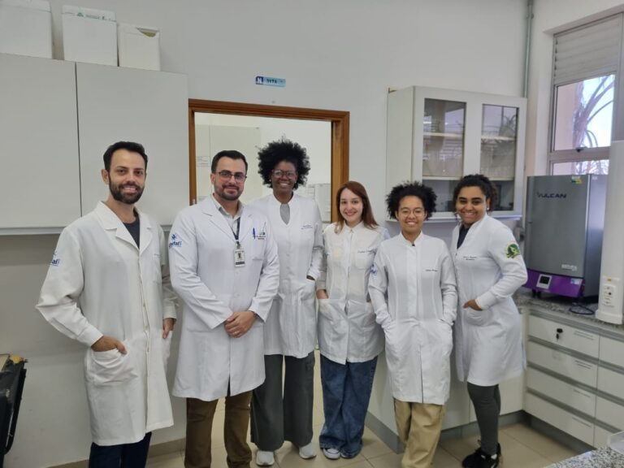

+++
title = "Natural soy compounds show beneficial effects for a genetic muscle disease, study finds"
subtitle = "Using an experimental model, a research group led by a UNIFAL-MG professor demonstrates the potential antioxidant and anti-inflammatory action of natural soy-derived compounds for Duchenne muscular dystrophy"
date = "2025-09-15"
author = "Rafael Martins da Silva Afeto"
cover = "capa_pesquisa_extrato-soja-distrofia.jpg"
coverCaption = "Illustrative image. (Photo: Reproduction/Canva Education)"
tags = ["Anatomy", "Neuromuscular Biostructure", "Duchenne Muscular Dystrophy", "Soy Extract", "Isoflavones", "Projeto +Ciência", "UNIFAL-MG"]
categories = ["Health"]
keywords = ["Duchenne muscular dystrophy", "soy isoflavones", "DMD treatment", "soy extract muscle health", "neuromuscular research UNIFAL"]
description = "A UNIFAL-MG study shows that soy isoflavones improve muscle function and reduce inflammation in an experimental model of Duchenne muscular dystrophy."
showFullContent = false
readingTime = false
hideComments = false
+++

Duchenne muscular dystrophy (DMD) is a severe genetic disease that causes progressive muscle loss and weakness and mainly affects boys, but researchers at UNIFAL-MG may have taken a step toward identifying compounds that could help treat it. These are isoflavones: substances found in soy extract and considered natural estrogens.

While investigating the protective action of isoflavones on muscle tissue in an experimental model using mdx mice, the Neuromuscular Biostructure Research Group (GPBioNM), led by Túlio de Almeida Hermes, a professor and researcher in the Department of Anatomy at UNIFAL-MG's [Institute of Biomedical Sciences](https://www.unifal-mg.edu.br/icb/), observed improved muscle function and reduced necrosis, as well as lower inflammatory and oxidative markers.

Túlio de Almeida Hermes, professor and researcher in the Department of Anatomy and leader of the Neuromuscular Biostructure Research Group. (Photo: Personal Archive)

“With the results of this research, we can determine which isoflavones are potentially the most active and investigate their effect on DMD in isolation,” the researcher points out.

According to him, Duchenne muscular dystrophy is caused by a mutation in the DMD gene, which leads to a lack of the protein dystrophin, responsible for stability in the muscle cell. “Without this protein, the muscle can suffer injuries, which are actual ruptures in the membrane, thus leading to an excessive influx of calcium, which is toxic at high concentrations,” he explains.

Currently, the disease has no cure, and treatment relies on glucocorticoids, which improve the patient's overall condition but cause many side effects.

According to Professor Túlio Hermes, the group's research has not yet produced a treatment. “For now it is a subject of investigation, and the possibility of finding isoflavones in the extract with great therapeutic potential is very exciting,” he notes.

Members of the Neuromuscular Biostructure Research Group with Professor Túlio Hermes. (Photo: Archive/Túlio Hermes)

The researchers also found that soy extract, besides being an advantageous alternative for a potential treatment due to soy's low cost and wide availability, was safe for the mice, causing no toxicity to the animals' kidneys or liver.

For Túlio Hermes, this is just the beginning. “This work made it possible to propose a new study, now in its early stages, investigating the molecular and cellular mechanisms of using one of the classes of isoflavones identified in the previous study,” he says.

The research, linked to CNPq project 402493/2021-4, was funded by the [National Council for Scientific and Technological Development (CNPq)](https://www.gov.br/cnpq/pt-br) and will soon be published with open access to the community.

*Text written under the supervision and guidance of Ana Carolina Araújo, journalist at the Federal University of Alfenas (UNIFAL-MG).*

Visit the [UNIFAL-MG page](https://jornal.unifal-mg.edu.br/compostos-naturais-da-soja-apresentam-efeitos-beneficos-para-doenca-muscular-genetica-aponta-estudo/) to read the full text (in Portuguese).
