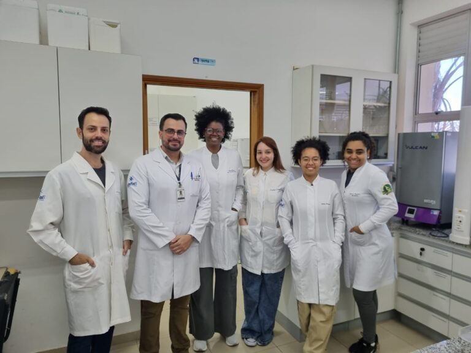

+++
title = "Compuestos naturales de la soya presentan efectos beneficiosos para una enfermedad muscular genética, señala estudio"
subtitle = "Con un modelo experimental, un grupo de investigación dirigido por un profesor de la UNIFAL-MG demuestra la posible acción antioxidante y antiinflamatoria de compuestos naturales derivados de la soya en la distrofia muscular de Duchenne"
date = "2025-09-15"
author = "Rafael Martins da Silva Afeto"
cover = "capa_pesquisa_extrato-soja-distrofia.jpg"
coverCaption = "Imagen ilustrativa. (Foto: Reproducción/Canva Education)"
tags = ["Anatomía", "Bioestructura Neuromuscular", "Distrofia Muscular de Duchenne", "Extracto de Soya", "Isoflavonas", "Projeto +Ciência", "UNIFAL-MG"]
categories = ["Salud"]
keywords = ["distrofia muscular de Duchenne", "isoflavonas de soya", "tratamiento DMD", "extracto de soya salud muscular", "investigación neuromuscular UNIFAL"]
description = "Un estudio de la UNIFAL-MG muestra que las isoflavonas de la soya mejoran la función muscular y reducen la inflamación en un modelo experimental de distrofia muscular de Duchenne."
showFullContent = false
readingTime = false
hideComments = false
+++

La distrofia muscular de Duchenne (DMD) es una enfermedad genética grave que causa pérdida muscular progresiva y debilidad, y que afecta principalmente a los niños varones, pero investigadores de la UNIFAL-MG podrían haber dado un paso en la identificación de posibles compuestos que ayuden en su tratamiento. Se trata de las isoflavonas: sustancias presentes en el extracto de soya, consideradas estrógenos naturales.

Al investigar la acción protectora de las isoflavonas en el tejido muscular en un modelo experimental con ratones mdx, el Grupo de Investigación en Bioestructura Neuromuscular (GPBioNM), dirigido por Túlio de Almeida Hermes, profesor e investigador del Departamento de Anatomía del [Instituto de Ciencias Biomédicas](https://www.unifal-mg.edu.br/icb/) de la UNIFAL-MG, observó una mejora en la función muscular y una reducción de la necrosis y de los marcadores inflamatorios y oxidativos.

Túlio de Almeida Hermes, profesor e investigador del Departamento de Anatomía, líder del Grupo de Investigación en Bioestructura Neuromuscular. (Foto: Archivo personal)

“Con los resultados de la investigación, podemos determinar qué isoflavonas son potencialmente más activas e investigar su efecto en la DMD de forma aislada”, señala el investigador.

Según él, la distrofia muscular de Duchenne es causada por una mutación en el gen DMD, que provoca la falta de la proteína distrofina, responsable de la estabilidad de la célula muscular. “Sin esta proteína, el músculo puede sufrir lesiones, que son verdaderas rupturas en la membrana, lo que provoca la entrada excesiva de calcio, que en altas concentraciones es tóxico”, explica.

Actualmente, la enfermedad no tiene cura y el tratamiento se basa en el uso de glucocorticoides, que mejoran el estado general del paciente, pero causan muchos efectos secundarios.

Según el profesor Túlio Hermes, la investigación del grupo aún no ha generado un tratamiento. “Por ahora es objeto de investigación, y la posibilidad de encontrar en el extracto isoflavonas con gran potencial terapéutico es muy estimulante”, observa.

Integrantes del Grupo de Investigación en Bioestructura Neuromuscular con el profesor Túlio Hermes. (Foto: Archivo/Túlio Hermes)

Los investigadores también identificaron que el extracto de soya, además de ser una alternativa ventajosa para un posible tratamiento debido al bajo costo y la mayor accesibilidad de la soya, también fue seguro para los ratones, sin generar toxicidad en los riñones ni en el hígado de los animales.

Para Túlio Hermes, esto es solo el comienzo. “Este trabajo permitió proponer un nuevo estudio, que se encuentra en fase inicial, sobre la investigación de los mecanismos moleculares y celulares del uso de una de las clases de isoflavonas identificadas en el estudio anterior”, cuenta.

La investigación, vinculada al proyecto CNPq 402493/2021-4, fue financiada por el [Consejo Nacional de Desarrollo Científico y Tecnológico (CNPq)](https://www.gov.br/cnpq/pt-br) y pronto será publicada en acceso abierto para la comunidad.

*Texto elaborado bajo la supervisión y orientación de Ana Carolina Araújo, periodista de la Universidad Federal de Alfenas (UNIFAL-MG).*

Visite la [página de la UNIFAL-MG](https://jornal.unifal-mg.edu.br/compostos-naturais-da-soja-apresentam-efeitos-beneficos-para-doenca-muscular-genetica-aponta-estudo/) para acceder al texto completo (en portugués).
