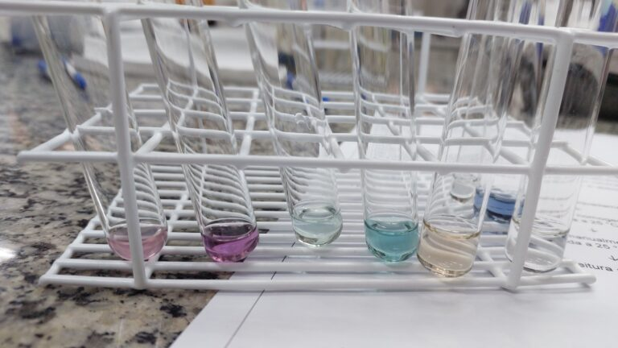
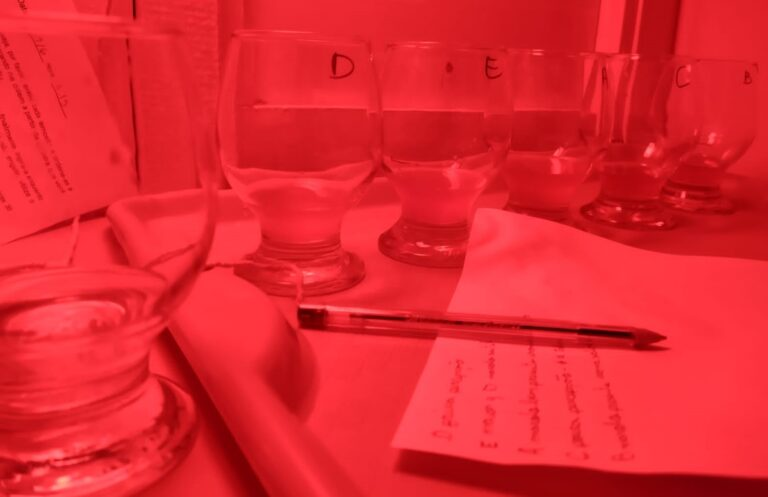
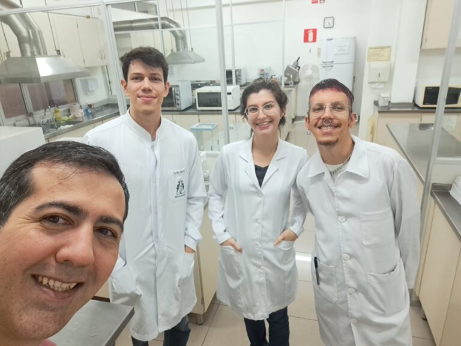

+++
title = "Researchers confirm antioxidant potential in beer brewed with marolo, and its flavor wins over tasters"
subtitle = "Results of an undergraduate research study at UNIFAL-MG reinforce the added value of fruit beers"
date = "2025-01-30"
author = "Rafael Martins da Silva Afeto"
cover = "capa_pesquisa-cerveja-com-marolo.jpg"
coverCaption = "Tallis Vinicius Araujo da Silva, a Biotechnology student, during the first phase of the research. (Photo: Personal Archive)"
tags = ["Cerveja com Ciência", "Marolo Beer", "Beer Science", "Marolo", "Research", "Projeto +Ciência", "UNIFAL-MG"]
categories = ["Biotechnology"]
keywords = ["marolo beer", "beer antioxidant potential", "craft fruit beer", "marolo cerrado", "beer research UNIFAL"]
description = "UNIFAL-MG research shows that beer brewed with marolo has greater antioxidant potential, and its flavor was approved in sensory evaluation."
showFullContent = false
readingTime = false
hideComments = false
+++
Researchers at UNIFAL-MG, linked to the [Cerveja com Ciência](https://www.unifal-mg.edu.br/lme/cervejacomciencia/) (Beer with Science) project, brewed beer with marolo (a native fruit of the Brazilian Cerrado savanna) and tested its antioxidant potential using different concentrations of the fruit. The results showed that the marolo beer has greater antioxidant potential and its flavor was approved by the tasters.

The research is part of an undergraduate research project carried out by Tallis Vinicius Araujo da Silva, a Biotechnology student, supervised by professors Gabriel Gerber Hornink, from the Institute of Biomedical Sciences (ICB), and Bruno Martins Dala Paula, from the School of Nutrition (FANUT), with help from fellow undergraduates in Biotechnology and Biological Sciences.

Marolo was added at different concentrations and at two points during brewing: during fermentation and during maturation. (Photo: Archive/Tallis Silva)

As the student explains, the fruit was added at different concentrations and at two points: during fermentation and during maturation. “The beer with marolo added during maturation showed the highest antioxidant potential and the highest preference compared with the other treatments – no marolo and marolo during fermentation,” reports Tallis Silva. “In addition, the tasters could not tell apart the variations in marolo concentration between the treatments, which allows the treatments with the highest concentration of the fruit to be used for the trained panel, since they have greater antioxidant potential and are statistically equal to the others in the sensory parameter,” he adds.

Photo taken during the sensory analysis. (Photo: Archive/Tallis Silva)

The evaluation took place in two stages: in the first, a group of 17 trained tasters carried out a sensory analysis of the beers, ranking them by the intensity of the marolo flavor. These tasters, who had been tested for their sensitivity in identifying different flavors, also indicated which beers they liked best. The most promising samples moved on to the next phase. The second stage was the preference test (untrained panel), in which 84 tasters indicated which treatment was their favorite and how much they liked each sample.

But drinking beer still carries risks, as the author points out. “Marolo beer, even with greater antioxidant potential compared with beer without marolo, is an alcoholic beverage; it contains ethanol, and consuming it, especially in excess, can contribute to the onset of several diseases,” he warns.

To test the marolo, Tallis Silva used a technological innovation called pico-fermenters. “Pico-fermenters are adaptations using Falcon tubes for laboratory-scale fermentation, which can be applied in many areas and help breweries with their quality testing or new product testing,” he explains. “Now that we have validated this laboratory-scale fermenter system, we are running new experiments evaluating other fermentation parameters using it,” the researcher stresses about the technology's contribution.

Beer research at the University was already underway through the work of professor Gabriel Hornink, who coordinates the project “Beer science: a study of the influence of fermentation variables on the fermentative performance and antioxidant potential of beers,” while the properties of marolo have been studied by professor Bruno Dala Paula.

On the left, professor Gabriel Hornink, together with Tallis Silva and colleagues from the project team. (Photo: Archive/Tallis Silva)

According to Tallis Silva, the partnership between the professors prompted the idea of testing the addition of marolo to beer, given the scarcity of research in the area and the economic potential of this regional fruit, since it is endemic to southern Minas Gerais and there is a cultural tradition of brewing beer with it, which can add value to fruit beers.

The research was supported by the Institutional Program for Scientific and Technological Initiation Scholarships – PIBICT/FAPEMIG.

The abstract of the work, presented at the 10th Integrated Symposium of UNIFAL-MG, can be [accessed in the UNIFAL newspaper](https://jornal.unifal-mg.edu.br/wp-content/uploads/2025/01/Aumento-de-valor-agregado-da-cerveja-uso-de-insumos-inovadores-e-aumento-do-potencial-antioxidante.pdf).

You can also find information about the [“Ciência com Cerveja”](https://www.unifal-mg.edu.br/lme/cervejacomciencia/) project

*Text written under the supervision and guidance of Ana Carolina Araújo, journalist at the Federal University of Alfenas (UNIFAL-MG).*

Visit the [UNIFAL-MG page](https://jornal.unifal-mg.edu.br/pesquisadores-confirmam-potencial-antioxidante-na-producao-de-cerveja-com-marolo-e-sabor-e-aprovado-por-avaliadores/) to read the full original text.
