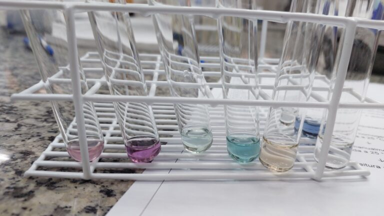
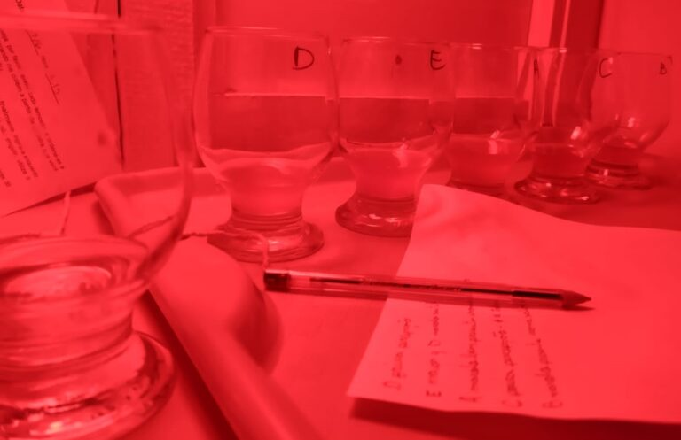
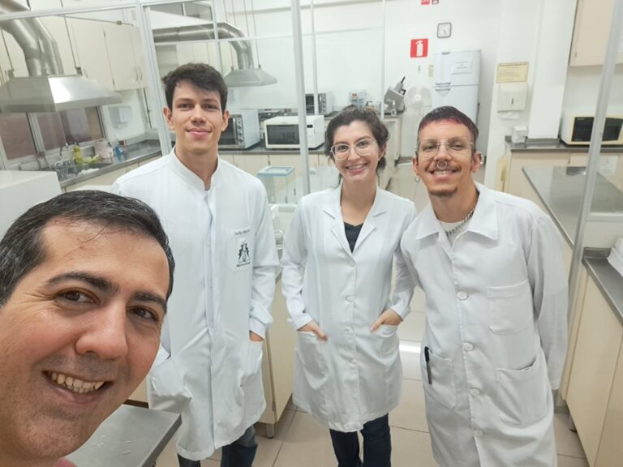

+++
title = "Investigadores confirman el potencial antioxidante de la cerveza elaborada con marolo y su sabor es aprobado por los evaluadores"
subtitle = "Resultados de un estudio de iniciación científica de la UNIFAL-MG refuerzan el valor agregado de las cervezas con frutas"
date = "2025-01-30"
author = "Rafael Martins da Silva Afeto"
cover = "capa_pesquisa-cerveja-com-marolo.jpg"
coverCaption = "Tallis Vinicius Araujo da Silva, estudiante de la carrera de Biotecnología, durante la primera fase de la investigación. (Foto: Archivo Personal)"
tags = ["Cerveja com Ciência", "Cerveza con Marolo", "Ciencia de la Cerveza", "Marolo", "Investigación", "Projeto +Ciência", "UNIFAL-MG"]
categories = ["Biotecnología"]
keywords = ["cerveza con marolo", "potencial antioxidante cerveza", "cerveza artesanal de frutas", "marolo cerrado", "investigación cervecera UNIFAL"]
description = "Investigación de la UNIFAL-MG comprueba que la cerveza elaborada con marolo tiene mayor potencial antioxidante, y su sabor fue aprobado en la evaluación sensorial."
showFullContent = false
readingTime = false
hideComments = false
+++
Investigadores de la UNIFAL-MG, vinculados al proyecto [Cerveja com Ciência](https://www.unifal-mg.edu.br/lme/cervejacomciencia/) (Cerveza con Ciencia), elaboraron cerveza con marolo (fruta nativa del Cerrado, la sabana brasileña) y probaron su potencial antioxidante utilizando diferentes concentraciones de la fruta. El resultado mostró que la cerveza con marolo tiene mayor potencial antioxidante y su sabor fue aprobado por los evaluadores.

La investigación forma parte del proyecto de iniciación científica realizado por Tallis Vinicius Araujo da Silva, estudiante de la carrera de Biotecnología, bajo la dirección de los profesores Gabriel Gerber Hornink, del Instituto de Ciencias Biomédicas (ICB), y Bruno Martins Dala Paula, de la Facultad de Nutrición (FANUT), con la ayuda de compañeros de las carreras de Biotecnología y de Ciencias Biológicas.

El marolo se añadió en diferentes concentraciones y en dos momentos de la elaboración de la cerveza: en la fermentación y en la maduración. (Foto: Archivo/Tallis Silva)

Según explica el estudiante, la fruta se añadió en diferentes concentraciones y en dos momentos: en la fermentación y en la maduración. “Se produjo cerveza con marolo en la maduración que presentó mayor potencial antioxidante y mayor preferencia en relación con los otros tratamientos – sin marolo y marolo en la fermentación”, relata Tallis Silva. “Además, los evaluadores no supieron diferenciar las variaciones en la concentración de marolo de los tratamientos, lo que habilita el uso de los tratamientos con mayor concentración de la fruta para el panel entrenado, ya que tienen mayor potencial antioxidante y son estadísticamente iguales a los demás en el parámetro sensorial”, añade.

Registro realizado durante el análisis sensorial. (Foto: Archivo/Tallis Silva)

La evaluación se realizó en dos momentos: en el primero, un grupo de 17 evaluadores entrenados hizo un análisis sensorial de las cervezas, clasificándolas según la intensidad del sabor del marolo. Estos evaluadores, a quienes se les había evaluado la sensibilidad para identificar diferentes sabores, también indicaron las cervezas que más les gustaron. Las muestras más prometedoras pasaron a la siguiente fase. El segundo momento fue la prueba de preferencia (panel no entrenado), en la que 84 evaluadores indicaron cuál tratamiento fue su preferido y cuánto les gustó cada muestra.

Pero el consumo de cerveza todavía implica riesgos, como destaca el autor. “La cerveza con marolo, aun con mayor potencial antioxidante en comparación con la cerveza sin marolo, es una bebida alcohólica; contiene etanol, y su consumo, sobre todo cuando no es moderado, puede contribuir a la aparición de varias enfermedades”, advierte.

Para probar el marolo, Tallis Silva utilizó una innovación tecnológica llamada pico-fermentadores. “Los pico-fermentadores son adaptaciones con tubos Falcon para fermentación a escala de laboratorio, que podrán aplicarse en diversas áreas y ayudar a las cervecerías en sus pruebas de calidad o de nuevos productos”, explica. “Una vez que validamos este sistema de fermentadores a escala de laboratorio, estamos realizando nuevos experimentos que evalúan otros parámetros de la fermentación utilizando este sistema”, resalta el investigador sobre la contribución de la tecnología.

El estudio cervecero en la Universidad ya estaba presente gracias al trabajo del profesor Gabriel Hornink, quien coordina el proyecto “Ciencia de la cerveza: estudio de la influencia de variables de la fermentación en el desempeño fermentativo y el potencial antioxidante de cervezas”, mientras que las propiedades del marolo ya venían siendo estudiadas por el profesor Bruno Dala Paula.

A la izquierda, el profesor Gabriel Hornink, acompañado por Tallis Silva y compañeros del equipo del proyecto. (Foto: Archivo/Tallis Silva)

De acuerdo con Tallis Silva, la colaboración entre los profesores impulsó la idea de probar la adición de marolo a la cerveza, debido a la escasez de investigaciones en el área y al potencial económico de esta fruta regional, ya que es endémica del sur de Minas Gerais y existe una tradición cultural de elaborar cerveza con ella, lo que puede agregar valor a las cervezas con frutas.

La investigación recibió apoyo a través del Programa Institucional de Becas de Iniciación Científica y Tecnológica – PIBICT/FAPEMIG.

El resumen del trabajo, presentado durante el 10.º Simposio Integrado de la UNIFAL-MG, puede [consultarse en el periódico de la UNIFAL](https://jornal.unifal-mg.edu.br/wp-content/uploads/2025/01/Aumento-de-valor-agregado-da-cerveja-uso-de-insumos-inovadores-e-aumento-do-potencial-antioxidante.pdf).

Consulta también información sobre el proyecto [“Ciência com Cerveja”](https://www.unifal-mg.edu.br/lme/cervejacomciencia/)

*Texto elaborado bajo la supervisión y orientación de Ana Carolina Araújo, periodista de la Universidad Federal de Alfenas (UNIFAL-MG).*

Visita la [página de la UNIFAL-MG](https://jornal.unifal-mg.edu.br/pesquisadores-confirmam-potencial-antioxidante-na-producao-de-cerveja-com-marolo-e-sabor-e-aprovado-por-avaliadores/) para acceder al texto original completo.
