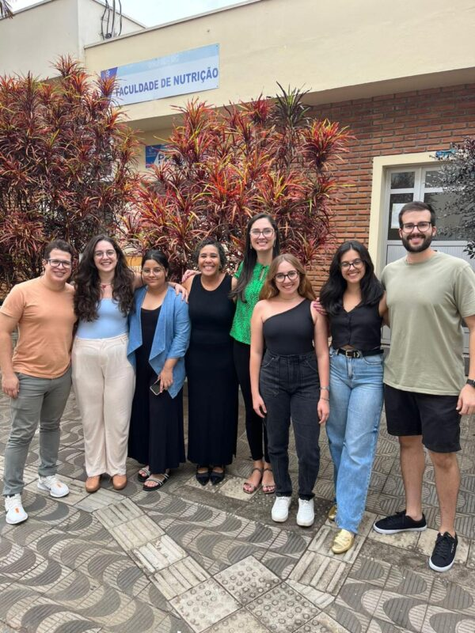

+++
title = "Study yields new findings on the link between loss of appetite and a ‘biomarker’ of aging"
subtitle = "Carried out by researchers at UNIFAL-MG, the study shows a relationship between the anorexia of aging and telomere length in older adults"
date = "2025-10-30"
author = "Rafael Martins da Silva Afeto"
cover = "capa-pesquisa-anorexia-do-envelhecimento.jpg"
coverCaption = "Illustrative image. (Photo: Reproduction/Canva Education)"
tags = ["Nursing", "Aging", "Nutrition", "PPGENF", "PPGNL", "Projeto +Ciência", "UNIFAL-MG"]
categories = ["Health"]
keywords = ["anorexia of aging", "telomeres older adults", "aging biomarker", "loss of appetite older adults", "nursing nutrition research UNIFAL"]
description = "A UNIFAL-MG study finds a link between the anorexia of aging and telomere shortening in older adults, a biomarker of aging."
showFullContent = false
readingTime = false
hideComments = false
+++

A study carried out by Ricardo Antônio Vieira, then a master's student in Nursing, and supervised by Professor Tábatta Renata Pereira de Brito, a faculty member in UNIFAL-MG's graduate programs in [Nursing (PPGENF)](https://www.unifal-mg.edu.br/ppgenf/programa/) and [Nutrition and Longevity (PPGNL)](https://www.unifal-mg.edu.br/ppgnl/), has yielded new findings on a biomarker of aging: the telomere.

The research team: Ricardo Antônio Vieira (left) and other researchers with Professor Tábatta Renata Pereira de Brito (in the green top). (Photo: Archive/Tábatta Renata Pereira de Brito)

According to Ricardo Vieira, the older adults evaluated showed a link between the anorexia of aging – a natural condition characterized by loss of appetite in older people – and the shortening of telomeres, structures that act as a kind of “protective cap” for DNA and serve as markers of biological time.

To identify this relationship, the team talked to 448 people aged 60 or older. They used a questionnaire known as the “Simplified Nutritional Appetite Questionnaire (SNAQ)” to understand the participants' appetite, separating those who had the anorexia of aging from those who did not. They then cross-referenced this information with the results of blood sample analyses, which made it possible to measure the telomere length of the older participants.

Ricardo Vieira believes that, by strengthening the hypothesis that the telomere can be a biomarker, the results may guide clinical trials and new studies on therapies targeting aging. He also sees potential for advances in precision nursing practice. “By using biomarkers of aging, nursing care starts to take into account each person's biological characteristics, making decisions more personalized and evidence-based,” he notes.

According to the researchers, because they are in direct contact with older adults in health services, nurses play a strategic role in screening for loss of appetite. The use of the SNAQ by these professionals allows a quick assessment, which favors early identification of anorexia and coordination with the multidisciplinary team, especially nutritionists. For the study's author, this joint effort encourages the adoption of healthy eating habits, ongoing follow-up by different professionals, and health education aimed at older adults.

The study's results also bring direct benefits to the older population. “The study helps older people receive more individualized, evidence-based care, strengthening health promotion and the prevention of health problems,” he highlights.

The study is part of the research project titled Association between low levels of social support and telomere length in older adults, funded by the [Coordination for the Improvement of Higher Education Personnel (CAPES)](https://www.gov.br/capes/pt-br), the [National Council for Scientific and Technological Development (CNPq)](https://www.gov.br/cnpq/pt-br), and the [Minas Gerais State Research Foundation (FAPEMIG)](https://fapemig.br/). These studies are linked to UNIFAL-MG's graduate programs in Nursing and in Nutrition and Longevity, and also had the collaboration of Professor Daniela Braga Lima, from the School of Nutrition, as well as researchers from Unicamp, UFSCar, and UFAC.

The plan is to continue the project with a longitudinal study following the participants who were first evaluated in 2019.

For more information, Ricardo Antônio Vieira's master's thesis in Nursing is available in the UNIFAL-MG Library of Theses and Dissertations [at this link](https://repositorio.unifal-mg.edu.br/items/2733e5f5-6f9e-4b89-810a-08330deec9ca). The corresponding article will also be available at the publication link [here](https://onlinelibrary.wiley.com/doi/10.1111/jhn.13338).

*Text written under the supervision and guidance of Ana Carolina Araújo, journalist at the Federal University of Alfenas (UNIFAL-MG).*

Visit the [UNIFAL-MG page](https://jornal.unifal-mg.edu.br/pesquisa-traz-novos-achados-sobre-a-relacao-entre-a-perda-de-apetite-e-um-biomarcador-do-envelhecimento/) to read the full text (in Portuguese).
