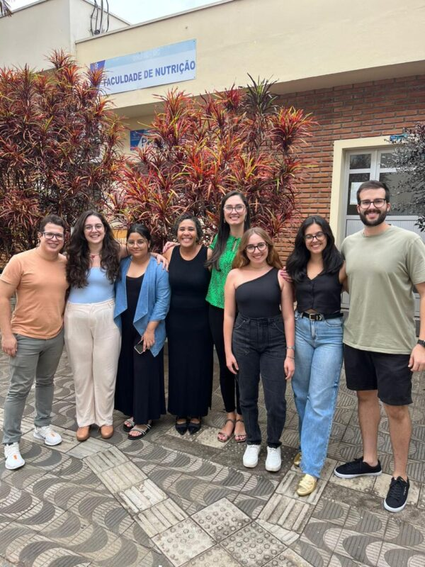

+++
title = "Investigación aporta nuevos hallazgos sobre la relación entre la pérdida de apetito y un ‘biomarcador’ del envejecimiento"
subtitle = "Realizado por investigadores de la UNIFAL-MG, el estudio muestra una relación entre la anorexia del envejecimiento y la longitud de los telómeros en personas mayores"
date = "2025-10-30"
author = "Rafael Martins da Silva Afeto"
cover = "capa-pesquisa-anorexia-do-envelhecimento.jpg"
coverCaption = "Imagen ilustrativa. (Foto: Reproducción/Canva Education)"
tags = ["Enfermería", "Envejecimiento", "Nutrición", "PPGENF", "PPGNL", "Projeto +Ciência", "UNIFAL-MG"]
categories = ["Salud"]
keywords = ["anorexia del envejecimiento", "telómeros personas mayores", "biomarcador del envejecimiento", "pérdida de apetito personas mayores", "investigación enfermería nutrición UNIFAL"]
description = "Un estudio de la UNIFAL-MG descubre una relación entre la anorexia del envejecimiento y el acortamiento de los telómeros en personas mayores, un biomarcador del envejecimiento."
showFullContent = false
readingTime = false
hideComments = false
+++

Una investigación realizada por Ricardo Antônio Vieira, entonces estudiante de maestría en Enfermería, bajo la dirección de la profesora Tábatta Renata Pereira de Brito, docente de los programas de posgrado en [Enfermería (PPGENF)](https://www.unifal-mg.edu.br/ppgenf/programa/) y en [Nutrición y Longevidad (PPGNL)](https://www.unifal-mg.edu.br/ppgnl/) de la UNIFAL-MG, aportó nuevos hallazgos sobre un biomarcador del envejecimiento: el telómero.

Equipo involucrado en la investigación: Ricardo Antônio Vieira (a la izquierda) y otros investigadores con la profesora Tábatta Renata Pereira de Brito (de blusa verde). (Foto: Archivo/Tábatta Renata Pereira de Brito)

Según Ricardo Vieira, en las personas mayores evaluadas se encontró un vínculo entre la anorexia del envejecimiento –condición natural caracterizada por la pérdida de apetito en personas de edad avanzada– y el acortamiento de los telómeros, estructuras que actúan como una especie de “capuchón protector” del ADN y sirven como marcadores del tiempo biológico.

Para identificar esta relación, el equipo conversó con 448 personas de 60 años o más. Utilizaron un cuestionario conocido como “Cuestionario Nutricional Simplificado del Apetito (SNAQ)” para entender el apetito de los participantes, separando a quienes presentaban anorexia del envejecimiento de quienes no. A continuación, cruzaron esa información con los resultados de los análisis de muestras de sangre, con los que fue posible medir la longitud de los telómeros de las personas mayores.

Ricardo Vieira cree que, al fortalecer la hipótesis de que el telómero puede ser un biomarcador, los resultados pueden orientar ensayos clínicos y nuevos estudios sobre terapias dirigidas al envejecimiento. También ve un potencial de avance en la práctica de la enfermería de precisión. “Al utilizar biomarcadores del envejecimiento, el cuidado de enfermería pasa a considerar las características biológicas de cada persona, lo que hace que las decisiones sean más personalizadas y basadas en evidencia”, señala.

De acuerdo con los investigadores, al estar en contacto directo con personas mayores en los servicios de salud, los enfermeros desempeñan un papel estratégico en la detección de la pérdida de apetito. El uso del SNAQ por parte de estos profesionales permite una evaluación rápida, lo que favorece la identificación temprana de la anorexia y la articulación con el equipo multiprofesional, especialmente con los nutricionistas. Para el autor del estudio, esta acción conjunta favorece la adopción de hábitos alimentarios saludables, el seguimiento continuo por parte de diferentes profesionales y la educación en salud dirigida a las personas mayores.

Los resultados de la investigación también traen beneficios directos para la población mayor. “El estudio contribuye a que las personas mayores reciban cuidados más individualizados y basados en evidencia, fortaleciendo la promoción de la salud y la prevención de enfermedades”, destaca.

El estudio forma parte de la investigación titulada Asociación entre bajo nivel de apoyo social y la longitud de los telómeros en personas mayores, financiada por la [Coordinación de Perfeccionamiento de Personal de Nivel Superior (CAPES)](https://www.gov.br/capes/pt-br), el [Consejo Nacional de Desarrollo Científico y Tecnológico (CNPq)](https://www.gov.br/cnpq/pt-br) y la [Fundación de Apoyo a la Investigación del Estado de Minas Gerais (FAPEMIG)](https://fapemig.br/). Estos estudios están vinculados a los programas de posgrado en Enfermería y en Nutrición y Longevidad, ambos de la UNIFAL-MG, y contaron también con la colaboración de la profesora Daniela Braga Lima, docente de la Facultad de Nutrición, además de investigadores de la Unicamp, la UFSCar y la UFAC.

La expectativa es dar continuidad al proyecto mediante un estudio longitudinal que acompañe a los participantes evaluados inicialmente en 2019.

Para más información, la tesis de maestría en Enfermería de Ricardo Antônio Vieira puede consultarse en la Biblioteca de Tesis y Disertaciones de la UNIFAL-MG, [en este enlace](https://repositorio.unifal-mg.edu.br/items/2733e5f5-6f9e-4b89-810a-08330deec9ca). El artículo correspondiente también estará disponible en el enlace de la publicación [aquí](https://onlinelibrary.wiley.com/doi/10.1111/jhn.13338).

*Texto elaborado bajo la supervisión y orientación de Ana Carolina Araújo, periodista de la Universidad Federal de Alfenas (UNIFAL-MG).*

Visite la [página de la UNIFAL-MG](https://jornal.unifal-mg.edu.br/pesquisa-traz-novos-achados-sobre-a-relacao-entre-a-perda-de-apetite-e-um-biomarcador-do-envelhecimento/) para acceder al texto completo (en portugués).
