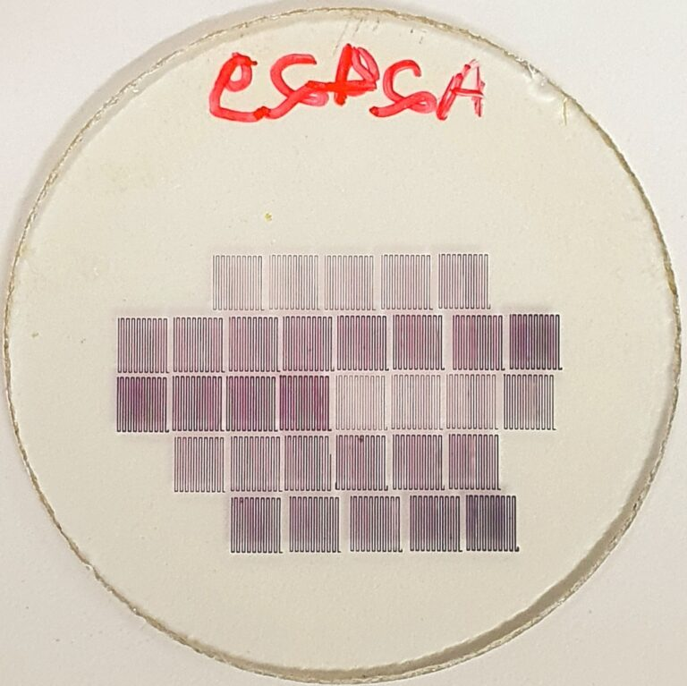

+++
title = "Research develops high-precision technique for producing gold nanoparticles with potential applications in health, technology and the environment"
subtitle = "Method developed in the doctoral program in Materials Science and Engineering at UNIFAL-MG uses an ultraviolet laser to control the size and shape of the particles"
date = "2026-01-19"
author = "Rafael Martins da Silva Afeto"
cover = "Capa_materia_tecnica-de-alta-precisao-para-producao-de-nanoparticulas-de-ouro.jpg"
coverCaption = "The process used in the research is known as “direct laser writing” and consists of applying an ultraviolet laser to a thin film of polymethyl methacrylate (PMMA) - a type of transparent plastic that contains a compound called gold salt. (Photo: Archive/Richard Pereira)"
tags = ["Nanoparticles", "Research", "Graduate Program in Materials Science and Engineering", "Projeto +Ciência", "UNIFAL-MG"]
categories = ["Technology"]
keywords = ["gold nanoparticles", "direct laser writing", "nanomaterials health", "PMMA nanoparticles", "materials engineering research UNIFAL"]
description = "Research at UNIFAL-MG presents a direct laser writing method to produce gold nanoparticles with precise control, with applications in health and technology."
showFullContent = false
readingTime = false
hideComments = false
+++
A study carried out at the [Optical Spectroscopy and Photonics Laboratory (LEOF)](https://www.unifal-mg.edu.br/ppgf/laboratorio-de-espectroscopia-optica-e-fotonica/) of UNIFAL-MG, on the Poços de Caldas campus, presents a new method for manufacturing gold nanoparticles with precise control over size, shape, density and concentration. The study is part of Richard Silveira Pereira's doctorate, developed under the supervision of professor Marcelo Gonçalves Vivas in the [Graduate Program in Materials Science and Engineering](https://www.unifal-mg.edu.br/ppgcem/), and paves the way for applications in areas such as disease diagnosis, sensor development and advanced optical technologies.

The process used in the research is known as “direct laser writing” and consists of applying an ultraviolet laser to a thin film of polymethyl methacrylate (PMMA) – a type of transparent plastic that contains a compound called gold salt. By varying the laser power and the speed at which it sweeps across the material, the group found that it was possible to shape the gold nanoparticles with a high degree of control.

Polymethyl methacrylate (PMMA) film + gold nanoparticles. (Image: Reproduction/Research)

This thin polymethyl methacrylate film was chosen because of advantages such as transparency, ease of handling, durability and stability under variations in temperature and humidity. According to the researcher, the laser's high energy drives the material into an ionized state (the fourth state of matter), which makes it possible to form extremely small gold nanoparticles −100,000 times smaller than the width of a strand of hair through the clustering of metal atoms.

After production, the nanoparticles were analyzed through computer simulations based on the so-called plasmonic effect, which occurs when light interacts with metal particles at the nanometer scale.

To explain the phenomenon, the researcher uses a simple analogy: “Imagine a crowd at a concert: when the band starts playing, the audience starts jumping and moving to the same rhythm as the music,” he explains. In the same way, light (the music) makes the free electrons on the surface of the gold nanoparticle (the crowd) vibrate in a synchronized, collective rhythm.

According to the researcher, studies on nanoparticles are recent, but they already show a major impact on society. “There is research with nanoparticles applied to fighting cancer and to the early diagnosis of Alzheimer's,” he says. “In the field of plasmonic materials, notable applications include the development of ultra-high-resolution displays and sensors capable of detecting viruses, bacteria and even pollutants in water quickly and efficiently,” he adds.

For Richard Pereira, the combination of a precise manufacturing method with fast, non-destructive optical readout techniques represents a promising tool for scientific and technological advancement. As next steps, the group intends to apply the same technique to other materials, such as silver nanoparticles, as well as to explore new polymer matrices and applications in sensor development.

The work is funded by the [Coordination for the Improvement of Higher Education Personnel (CAPES)](https://www.gov.br/capes/pt-br), the [National Council for Scientific and Technological Development (CNPq)](https://www.gov.br/cnpq/pt-br) and the [Minas Gerais State Research Support Foundation (FAPEMIG)](https://fapemig.br/)

The results were published in a scientific article authored by Richard Silveira Pereira and Marcelo Gonçalves Vivas, with the participation of researchers Diego Lourençoni Ferreira and Gabriel Ferrari de Oliveira, from the Optical Spectroscopy and Photonics Laboratory (LEOF) of UNIFAL-MG, in partnership with collaborators from the São Carlos Institute of Physics: Gabriele C. Felipe de Paula, André Luís dos Santos Romero and Cleber Renato Mendonça.


  
  
  
  
  
  
  


Read the full article on the website of the scientific journal ACS Applied Nano Materials, [at this link](https://pubs.acs.org/doi/10.1021/acsanm.5c00832).

Learn more about the Optical Spectroscopy and Photonics Laboratory [here](https://www.unifal-mg.edu.br/ppgf/laboratorio-de-espectroscopia-optica-e-fotonica/).

*Text written under the supervision and guidance of Ana Carolina Araújo, journalist at the Federal University of Alfenas (UNIFAL-MG).*

Visit the [UNIFAL-MG page](https://jornal.unifal-mg.edu.br/pesquisa-desenvolve-tecnica-de-alta-precisao-para-producao-de-nanoparticulas-de-ouro-com-potencial-aplicacao-em-saude-tecnologia-e-meio-ambiente/) to read the full original text.
