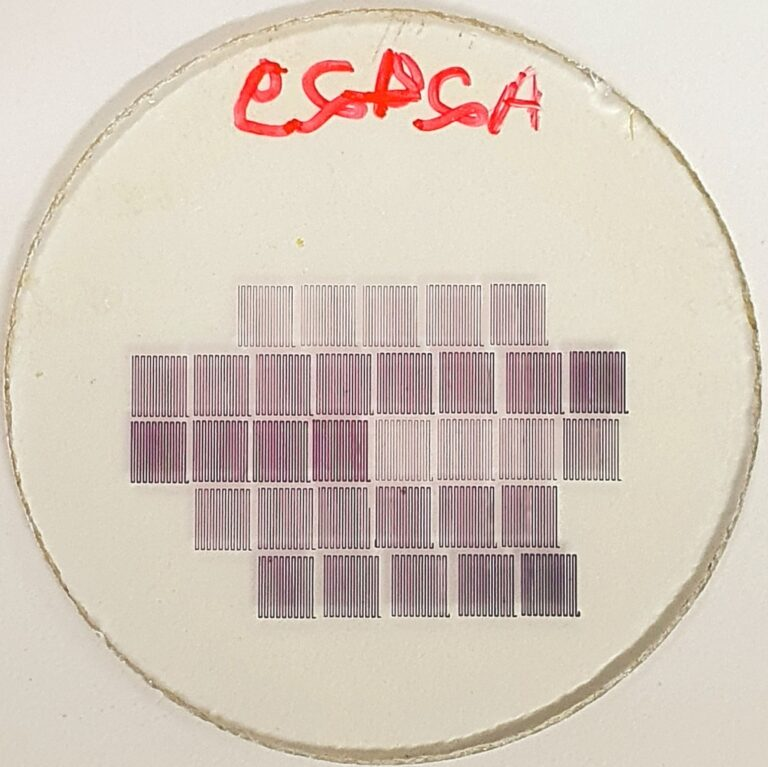

+++
title = "Investigación desarrolla una técnica de alta precisión para producir nanopartículas de oro con potencial aplicación en salud, tecnología y medio ambiente"
subtitle = "Método desarrollado en el doctorado en Ciencia e Ingeniería de Materiales de la UNIFAL-MG utiliza un láser ultravioleta para controlar el tamaño y la forma de las partículas"
date = "2026-01-19"
author = "Rafael Martins da Silva Afeto"
cover = "Capa_materia_tecnica-de-alta-precisao-para-producao-de-nanoparticulas-de-ouro.jpg"
coverCaption = "El proceso utilizado en la investigación se conoce como “escritura directa por láser” y consiste en aplicar un láser ultravioleta sobre una película delgada de polimetilmetacrilato (PMMA) - un tipo de plástico transparente que contiene un compuesto llamado sal de oro. (Foto: Archivo/Richard Pereira)"
tags = ["Nanopartículas", "Investigación", "Programa de Posgrado en Ciencia e Ingeniería de Materiales", "Projeto +Ciência", "UNIFAL-MG"]
categories = ["Tecnología"]
keywords = ["nanopartículas de oro", "escritura directa por láser", "nanomateriales salud", "PMMA nanopartículas", "investigación ingeniería de materiales UNIFAL"]
description = "Investigación de la UNIFAL-MG presenta un método de escritura directa por láser para producir nanopartículas de oro con control preciso, con aplicaciones en salud y tecnología."
showFullContent = false
readingTime = false
hideComments = false
+++
Una investigación realizada en el [Laboratorio de Espectroscopía Óptica y Fotónica (LEOF)](https://www.unifal-mg.edu.br/ppgf/laboratorio-de-espectroscopia-optica-e-fotonica/) de la UNIFAL-MG, en el campus de Poços de Caldas, presenta un nuevo método para fabricar nanopartículas de oro con control preciso de tamaño, forma, densidad y concentración. El estudio forma parte del doctorado de Richard Silveira Pereira, desarrollado bajo la dirección del profesor Marcelo Gonçalves Vivas, en el [Programa de Posgrado en Ciencia e Ingeniería de Materiales](https://www.unifal-mg.edu.br/ppgcem/), y abre camino para aplicaciones en áreas como el diagnóstico de enfermedades, el desarrollo de sensores y las tecnologías ópticas avanzadas.

El proceso utilizado en la investigación se conoce como “escritura directa por láser” y consiste en aplicar un láser ultravioleta sobre una película delgada de polimetilmetacrilato (PMMA) – un tipo de plástico transparente que contiene un compuesto llamado sal de oro. Al variar la potencia del láser y la velocidad con la que recorre el material, el grupo descubrió que era posible moldear las nanopartículas de oro con un alto grado de control.

Película de polimetilmetacrilato (PMMA) + nanopartículas de oro. (Imagen: Reproducción/Investigación)

Esta película delgada de polimetilmetacrilato fue elegida por presentar ventajas como transparencia, facilidad de manejo, resistencia y estabilidad frente a variaciones de temperatura y humedad. Según el investigador, la alta energía del láser lleva al material a un estado ionizado (el cuarto estado de la materia), lo que permite formar nanopartículas de oro extremadamente pequeñas −100 mil veces más pequeñas que el ancho de un cabello mediante la aglomeración de átomos del metal.

Después de su producción, las nanopartículas se analizaron mediante simulaciones computacionales basadas en el llamado efecto plasmónico, que ocurre cuando la luz interactúa con partículas metálicas a escala nanométrica.

Para explicar el fenómeno, el investigador usa una analogía sencilla: “Imagina una multitud en un concierto: cuando la banda empieza a tocar, el público comienza a saltar y moverse al mismo ritmo de la música”, explica. De la misma forma, la luz (la música) hace que los electrones libres de la superficie de la nanopartícula de oro (la multitud) vibren en un ritmo sincronizado y colectivo.

Según el académico, los estudios sobre nanopartículas son recientes, pero ya demuestran un gran impacto en la sociedad. “Hay investigaciones con nanopartículas aplicadas a la lucha contra el cáncer y al diagnóstico temprano del alzhéimer”, afirma. “En el campo de los materiales plasmónicos, destacan aplicaciones en el desarrollo de pantallas de altísima resolución y sensores capaces de detectar virus, bacterias e incluso contaminantes en el agua de manera rápida y eficiente”, añade.

Para Richard Pereira, la combinación de un método de fabricación preciso con técnicas de lectura óptica rápidas y no destructivas representa una herramienta prometedora para el avance científico y tecnológico. Como próximos pasos, el grupo pretende aplicar la misma técnica a otros materiales, como nanopartículas de plata, además de explorar nuevas matrices poliméricas y aplicaciones en el desarrollo de sensores.

El trabajo cuenta con financiamiento de la [Coordinación de Perfeccionamiento de Personal de Nivel Superior (CAPES)](https://www.gov.br/capes/pt-br), del [Consejo Nacional de Desarrollo Científico y Tecnológico (CNPq)](https://www.gov.br/cnpq/pt-br) y de la [Fundación de Apoyo a la Investigación del Estado de Minas Gerais (FAPEMIG)](https://fapemig.br/)

Los resultados se publicaron en un artículo científico firmado por Richard Silveira Pereira y Marcelo Gonçalves Vivas, con la participación de los investigadores Diego Lourençoni Ferreira y Gabriel Ferrari de Oliveira, del Laboratorio de Espectroscopía Óptica y Fotónica (LEOF) de la UNIFAL-MG, en colaboración con investigadores del Instituto de Física de São Carlos: Gabriele C. Felipe de Paula, André Luís dos Santos Romero y Cleber Renato Mendonça.


  
  
  
  
  
  
  


Consulta el artículo completo en el sitio de la revista científica ACS Applied Nano Materials, [en este enlace](https://pubs.acs.org/doi/10.1021/acsanm.5c00832).

Conoce el Laboratorio de Espectroscopía Óptica y Fotónica [aquí](https://www.unifal-mg.edu.br/ppgf/laboratorio-de-espectroscopia-optica-e-fotonica/).

*Texto elaborado bajo la supervisión y orientación de Ana Carolina Araújo, periodista de la Universidad Federal de Alfenas (UNIFAL-MG).*

Visita la [página de la UNIFAL-MG](https://jornal.unifal-mg.edu.br/pesquisa-desenvolve-tecnica-de-alta-precisao-para-producao-de-nanoparticulas-de-ouro-com-potencial-aplicacao-em-saude-tecnologia-e-meio-ambiente/) para acceder al texto original completo.
