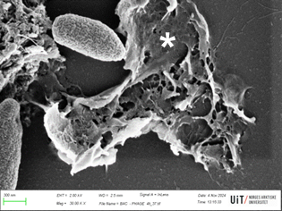

+++
title = "Nanotechnology with encapsulated viruses boosts effectiveness against superbug linked to hospital infections"
subtitle = "Developed by researchers from UNIFAL-MG and the Arctic University of Norway, the technique proved effective in its antibacterial response"

date = "2026-04-23"
#dateFormat = "2006-01-02" # This value can be configured for per-post date formatting
author = "Rafael Martins da Silva Afeto"
authorTwitter = "" #do not include @
cover = "capa_pesquisa_nanoparticulas_superbacterias.jpg"
coverCaption = "Nanoparticles interacting with the bacterium Pseudomonas aeruginosa. The phage-containing nanoparticles are degrading and releasing the bacteriophages (smaller, whiter structures). (Photo: Archive/Research group)"
tags = ["Hospital Infection", "Nanotechnology", "PPGCF", "Graduate Program in Pharmaceutical Sciences", "superbug", "Projeto +Ciência", "UNIFAL-MG", "Arctic University of Norway"]
categories = ["Health", "Biotechnology"]
keywords = ["bacteriophage nanoparticles", "Pseudomonas aeruginosa", "superbug hospital infection", "phage therapy", "nanotechnology UNIFAL"]
description = "UNIFAL-MG researchers have developed a strategy that may help fight Pseudomonas aeruginosa, a superbug responsible for severe, hard-to-treat hospital infections, using viruses that infect bacteria, encapsulated in nanoparticles to increase their effectiveness and stability in the body."
showFullContent = false
readingTime = false
hideComments = false
+++

UNIFAL-MG researchers have developed a strategy capable of fighting Pseudomonas aeruginosa – a superbug responsible for severe, hard-to-treat hospital infections. Created in partnership with the [Arctic University of Norway](https://en.uit.no/startsida) (UiT), the technique uses viruses that infect bacteria, encapsulated in nanoparticles, to increase their effectiveness and stability in the body.

The study was developed as part of Gustavo Aparecido da Cunha's doctorate in the [Graduate Program in Pharmaceutical Sciences (PPGCF)](https://www.unifal-mg.edu.br/ppgcf/), under the supervision of professors Luiz Felipe Leomil Coelho, from UNIFAL-MG's Institute of Biomedical Sciences, and Gabriel Magno de Freitas Almeida, from the Arctic University of Norway.

By applying an encapsulation technique that wraps phages (VAC1) – viruses capable of infecting and destroying bacteria – in bovine serum albumin (BSA) nanoparticles, the researchers observed increased antibacterial action against the superbug. Encapsulation also improved the phages' stability, how long they remain active in the body, and their ability to act within it.


    
    

Nanoparticles containing the encapsulated bacteriophage. (Images: Reproduction/Research group)

According to Luiz Felipe Coelho, the nanoparticles, which measure about 220 nm, were able to protect the phages from degradation at high temperatures, which allowed the viral particles to be released gradually over 5 days. "This stability contrasts sharply with the free phage, whose infectivity was lost after 48 hours," he explains.

The method's effectiveness was tested in vitro, comparing encapsulated and non-encapsulated phages in bacterial cultures and running safety tests on human cells, and also in vivo, in an animal model of acute lung infection by the bacterium Pseudomonas aeruginosa. "The results were promising both in the laboratory assays and in the animal experiments," the researcher highlights.

Nanoparticles interacting with the bacterium Pseudomonas aeruginosa. The released bacteriophages infect the bacterium and kill it (the asterisk marks the remains of a cell killed by the phage). (Image: Archive/Research group)

Luiz Felipe Coelho explains that, in the in vitro tests, encapsulation enhanced the antimicrobial effect, significantly reducing bacterial growth and increasing viral replication. In the in vivo assays, although the animals' survival rate did not change, there was a marked reduction in the bacterial load in the lungs, as well as greater recovery of viable phages and less inflammation and tissue damage in the treated samples.

For the professor, developing smart phage-delivery systems is a safe, biocompatible, and low-cost alternative for new antimicrobial therapies, especially at a time when resistant bacteria such as Pseudomonas aeruginosa threaten the effectiveness of conventional antibiotics.

The bovine albumin nanoparticles, he reported, can be produced easily and have potential for clinical use in chronic respiratory infections, especially in patients with cystic fibrosis or antibiotic-resistant lung diseases. The approach also paves the way for Brazilian nanotechnology-based therapies, strengthening scientific and technological innovation in the country and reducing dependence on imported supplies in the biomedical field.

In the future, the group hopes to advance testing in models of biofilm formation on the surfaces of medical devices (such as catheters and prostheses) and in models of  chronic lung infection (closer to conditions in human patients), as well as to assess the immune responses triggered by prolonged use of the nanoparticles.

The researchers also plan to optimize the formulations, investigate other routes of administration (continuous intranasal use or nebulization), and encapsulate other phages targeting different multidrug-resistant bacteria. "These steps aim to establish the albumin nanoparticle system as a versatile platform for the controlled delivery of biotherapeutic agents," concludes Luiz Felipe Coelho.


  
  
  


The study was funded by the [Minas Gerais State Research Foundation (FAPEMIG)](https://fapemig.br/), the [Coordination for the Improvement of Higher Education Personnel (CAPES)](https://www.gov.br/capes/pt-br), and the [National Council for Scientific and Technological Development (CNPq)](https://www.gov.br/cnpq/pt-br).

To learn more about the research, read the article published by the authors [at this link](https://www.nature.com/articles/s41598-026-38106-5).

Visit the [UNIFAL-MG page](https://jornal.unifal-mg.edu.br/nanotecnologia-com-virus-encapsulados-amplia-eficacia-no-combate-a-superbacteria-associada-a-infeccoes-hospitalares/) to read the full text (in Portuguese).
