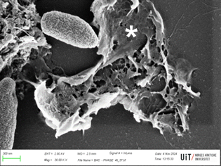

+++
title = "Nanotecnología con virus encapsulados amplía la eficacia en el combate a una superbacteria asociada a infecciones hospitalarias"
subtitle = "Desarrollada por investigadores de la UNIFAL-MG y de la Universidad Ártica de Noruega, la técnica demostró ser eficaz en la respuesta antibacteriana"

date = "2026-04-23"
#dateFormat = "2006-01-02" # This value can be configured for per-post date formatting
author = "Rafael Martins da Silva Afeto"
authorTwitter = "" #do not include @
cover = "capa_pesquisa_nanoparticulas_superbacterias.jpg"
coverCaption = "Nanopartículas en interacción con la bacteria Pseudomonas aeruginosa. Las nanopartículas que contienen el fago se encuentran en proceso de degradación y liberación de los bacteriófagos (estructuras más pequeñas y blanquecinas). (Foto: Archivo/Grupo de investigación)"
tags = ["Infección Hospitalaria", "Nanotecnología", "PPGCF", "Programa de Posgrado en Ciencias Farmacéuticas", "superbacteria", "Projeto +Ciência", "UNIFAL-MG", "Universidad Ártica de Noruega"]
categories = ["Salud", "Biotecnología"]
keywords = ["bacteriófagos nanopartículas", "Pseudomonas aeruginosa", "superbacteria infección hospitalaria", "terapia con fagos", "nanotecnología UNIFAL"]
description = "Investigadores de la UNIFAL-MG desarrollaron una estrategia que puede ayudar a combatir Pseudomonas aeruginosa, una superbacteria responsable de infecciones hospitalarias graves y de difícil tratamiento, utilizando virus que infectan bacterias, encapsulados en nanopartículas para aumentar su eficacia y estabilidad en el organismo."
showFullContent = false
readingTime = false
hideComments = false
+++

Investigadores de la UNIFAL-MG desarrollaron una estrategia capaz de combatir Pseudomonas aeruginosa, una superbacteria responsable de infecciones hospitalarias graves y de difícil tratamiento. Creada en colaboración con la [Universidad Ártica de Noruega](https://en.uit.no/startsida) (Arctic University of Norway – UiT), la técnica utiliza virus que infectan bacterias, encapsulados en nanopartículas, para aumentar su eficacia y estabilidad en el organismo.

El estudio se desarrolló como parte del doctorado de Gustavo Aparecido da Cunha en el [Programa de Posgrado en Ciencias Farmacéuticas (PPGCF)](https://www.unifal-mg.edu.br/ppgcf/), bajo la dirección de los profesores Luiz Felipe Leomil Coelho, del Instituto de Ciencias Biomédicas de la UNIFAL-MG, y Gabriel Magno de Freitas Almeida, de la Universidad Ártica de Noruega.

Al aplicar la técnica de encapsulamiento que envuelve a los fagos (VAC1) –virus capaces de infectar y destruir bacterias– en nanopartículas de albúmina bovina (BSA), los investigadores identificaron un aumento de la acción antibacteriana contra la superbacteria. La encapsulación también mejoró la estabilidad de los fagos, el tiempo que permanecen activos en el organismo y su capacidad de acción en él.


    
    

Nanopartículas que contienen el bacteriófago encapsulado. (Imágenes: Reproducción/Grupo de investigación)

Según Luiz Felipe Coelho, las nanopartículas, que miden cerca de 220 nm, fueron capaces de proteger a los fagos de la degradación a altas temperaturas, lo que permitió la liberación gradual de las partículas virales durante 5 días. "Esta estabilidad contrasta fuertemente con el fago libre, cuya infectividad se perdió después de 48 horas", explica.

La eficacia del método se probó en ensayos in vitro, comparando fagos encapsulados y no encapsulados en cultivos bacterianos y con pruebas de seguridad en células humanas, y también in vivo, en un modelo animal de infección pulmonar aguda por la bacteria Pseudomonas aeruginosa. "Los resultados fueron prometedores tanto en los ensayos de laboratorio como en los experimentos con animales", destaca el investigador.

Nanopartículas en interacción con la bacteria Pseudomonas aeruginosa. Los bacteriófagos liberados infectan a la bacteria y la llevan a la muerte (el asterisco señala restos de una célula muerta por la acción del fago). (Imagen: Archivo/Grupo de investigación)

Luiz Felipe Coelho detalla que, en las pruebas in vitro, el encapsulamiento potenció el efecto antimicrobiano, lo que redujo significativamente el crecimiento de la bacteria y aumentó la replicación de los virus. En los ensayos in vivo, aunque la tasa de supervivencia de los animales no mostró cambios, se observó una reducción expresiva de la carga bacteriana en los pulmones, además de una mayor recuperación de fagos viables y un menor grado de inflamación y daño a los tejidos en las muestras tratadas.

Para el profesor, el desarrollo de sistemas inteligentes de liberación de fagos es una alternativa segura, biocompatible y de bajo costo para nuevas terapias antimicrobianas, más aún en un momento en que las bacterias resistentes, como Pseudomonas aeruginosa, son una amenaza para la eficacia de los antibióticos convencionales.

Las nanopartículas de albúmina bovina, según relató, pueden producirse fácilmente y tienen potencial de uso clínico en infecciones respiratorias crónicas, principalmente en pacientes con fibrosis quística o enfermedades pulmonares resistentes a los antibióticos. El enfoque también abre el camino a la creación de terapias brasileñas basadas en nanotecnología, lo que fortalece la innovación científica y tecnológica en el país y reduce la dependencia de insumos importados en el área biomédica.

En el futuro, el grupo espera avanzar en las pruebas con modelos de formación de biopelículas en superficies de dispositivos médicos (como catéteres y prótesis) y modelos de  infección pulmonar crónica (más cercanos a las condiciones de pacientes humanos), además de evaluar las respuestas inmunológicas desencadenadas por el uso prolongado de las nanopartículas.

Los investigadores también planean optimizar las formulaciones, investigar otras vías de administración (uso intranasal continuo o por nebulización) y encapsular otros fagos dirigidos a diferentes bacterias multirresistentes. "Estas etapas buscan consolidar el sistema de nanopartículas de albúmina como una plataforma versátil para la liberación controlada de agentes bioterapéuticos", concluye Luiz Felipe Coelho.


  
  
  


El estudio contó con financiamiento de la [Fundación de Apoyo a la Investigación del Estado de Minas Gerais (FAPEMIG)](https://fapemig.br/), la [Coordinación de Perfeccionamiento de Personal de Nivel Superior (CAPES)](https://www.gov.br/capes/pt-br) y el [Consejo Nacional de Desarrollo Científico y Tecnológico (CNPq)](https://www.gov.br/cnpq/pt-br).

Para conocer más detalles de la investigación, consulta el artículo publicado por los autores [en este enlace](https://www.nature.com/articles/s41598-026-38106-5).

Visita la [página de la UNIFAL-MG](https://jornal.unifal-mg.edu.br/nanotecnologia-com-virus-encapsulados-amplia-eficacia-no-combate-a-superbacteria-associada-a-infeccoes-hospitalares/) para leer el texto completo (en portugués).
